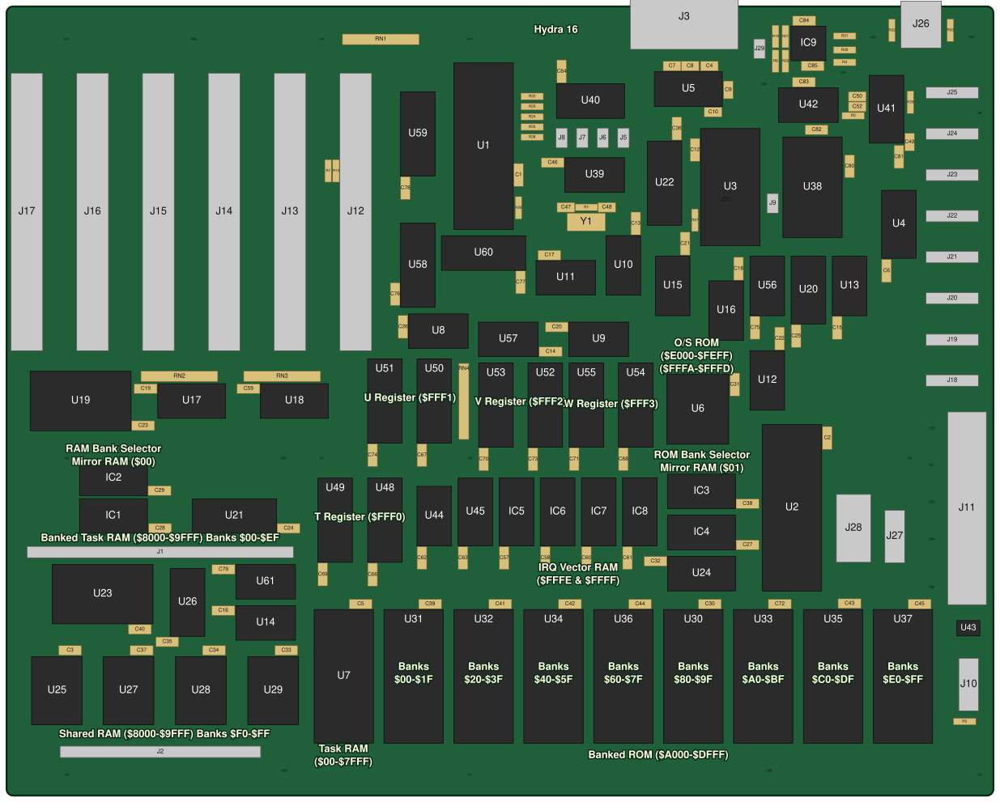
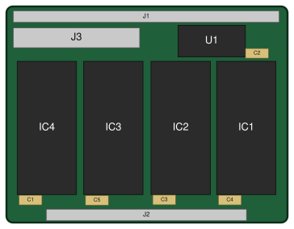
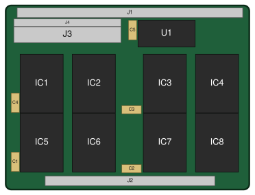
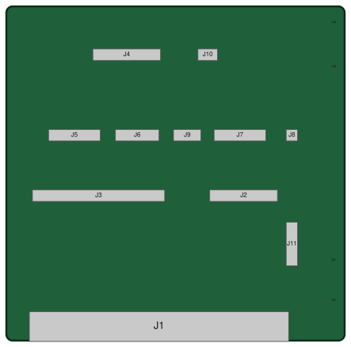

# The board layout

Where everything is on each board.  The drawings and the tables are made from the PCB files by
`node docs/build/layout.js`: don't edit them by hand.

## Reading the drawings

* **The board** is drawn from its outline (the PCB's Edge.Cuts layer), seen from the front (the component side), with
  its top left corner at 0, 0.
* **Each part** is the box its footprint's courtyard takes up, labelled with its reference: **ICs** dark grey,
  **connectors** light grey, **passive parts** (resistors, capacitors, the crystal) tan, anything else blue.  A part on
  the back of the board is drawn faint, with a dashed edge.
* **The labels** in pale yellow are the board's own silkscreen: the names of its areas ("Shared RAM", "T Register",
  the paged ROM's banks).
* **In the tables**, a part's place is its centre in millimetres from the top left corner (x across, y down), its side,
  and how far it's turned.  To find a part on the board, look it up in the table, then measure, or find it in the
  drawing: the references are there too, and a browser's search finds them in the SVG.

The drawings are SVG files beside this page; open one on its own to zoom in.

## Contents

1. [The main board](#the-main-board)
2. [The connectors and jumpers](#the-connectors-and-jumpers)
3. [The memory daughter card](#the-memory-daughter-card), [surface mount](#the-memory-daughter-card-surface-mount)
4. [The bus breakout card](#the-bus-breakout-card)

---

## The main board

The board's areas:

* **The top edge** is the back panel: the serial port (J3) and the audio jack (J26) stand over it.  Below them, the
  serial chips (U3, U5), the sound chips and the mixer (U38, U41, U42, IC9).
* **The left side** is the six slots, slot 5 (J17) at the edge and slot 0 (J12), the Vera X's, innermost.
* **The top middle** is the CPU (U1), its buffers (U58-U60), the clocks (Y1, U39, U40, with the clock jumpers J5-J8 in
  a row) and the decoding.
* **The right edge** is the SPI headers (J18 at the bottom, up to J25), the VIA (U2) and its header J27, the ATX
  connector (J11), the reset supervisor (U43) and the front panel (J10).
* **The middle** is the pseudo-registers (each labelled: `T`, `U`, `V`, `W`), the bank registers (IC1-IC4) and the
  interrupt logic with the vector RAM (U17, U18, U45, IC5-IC8), with the BIOS ROM (U6, "O/S ROM").
* **The bottom** is the memory: the shared RAM (U25, U27-U29) and the memory card connectors (J1, J2) at the left, the
  task RAM (U7), and the eight paged ROMs, each labelled with its banks.

<!-- layout:main:begin -->

The board is 304.8 mm wide and 243.8 mm high; a part's place is its centre, in millimetres from the board's top left corner (x across, y down), seen from the front.

| Part | Value | x | y | Side | Turned |
| :--- | :---- | --: | --: | :--- | --: |
| C1 | 104 (100 nF) | 158.1 | 49.6 | front | 270° |
| C2 | 104 (100 nF) | 253.5 | 130.8 | front | 270° |
| C3 | 104 (100 nF) | 22.1 | 199.0 | front | 180° |
| C4 | 105 (1 µF) | 218.3 | 18.4 | front | 180° |
| C5 | 104 (100 nF) | 111.8 | 184.7 | front | 180° |
| C6 | 104 (100 nF) | 271.8 | 79.2 | front | 270° |
| C7 | 105 (1 µF) | 204.3 | 18.4 | front |  |
| C8 | 105 (1 µF) | 212.4 | 18.4 | front | 180° |
| C9 | 105 (1 µF) | 222.9 | 24.5 | front | 270° |
| C10 | 105 (1 µF) | 219.5 | 32.6 | front | 180° |
| C12 | 104 (100 nF) | 212.6 | 41.8 | front | 270° |
| C13 | 104 (100 nF) | 194.3 | 64.6 | front | 270° |
| C14 | 104 (100 nF) | 170.5 | 106.7 | front | 180° |
| C15 | 104 (100 nF) | 256.5 | 101.8 | front | 90° |
| C16 | 104 (100 nF) | 64.4 | 186.7 | front |  |
| C17 | 104 (100 nF) | 170.1 | 76.8 | front | 180° |
| C18 | 104 (100 nF) | 226.1 | 78.5 | front | 270° |
| C19 | 104 (100 nF) | 45.4 | 118.1 | front | 180° |
| C20 | 104 (100 nF) | 167.4 | 99.1 | front |  |
| C21 | 104 (100 nF) | 209.6 | 70.8 | front | 270° |
| C22 | 104 (100 nF) | 238.8 | 100.1 | front | 270° |
| C23 | 104 (100 nF) | 44.7 | 129.5 | front | 180° |
| C24 | 104 (100 nF) | 84.6 | 161.3 | front |  |
| C25 | 104 (100 nF) | 243.8 | 99.4 | front | 270° |
| C26 | 104 (100 nF) | 122.4 | 101.5 | front | 90° |
| C27 | 104 (100 nF) | 226.4 | 166.4 | front |  |
| C28 | 104 (100 nF) | 44.9 | 161.3 | front |  |
| C29 | 104 (100 nF) | 44.7 | 149.6 | front |  |
| C30 | 104 (100 nF) | 219.7 | 184.7 | front | 180° |
| C31 | 104 (100 nF) | 224.9 | 119.3 | front | 90° |
| C32 | 104 (100 nF) | 202.9 | 171.5 | front | 180° |
| C33 | 104 (100 nF) | 88.9 | 199.0 | front | 180° |
| C34 | 104 (100 nF) | 66.5 | 199.0 | front | 180° |
| C35 | 104 (100 nF) | 52.1 | 196.3 | front | 180° |
| C36 | 104 (100 nF) | 207.0 | 40.2 | front | 90° |
| C37 | 104 (100 nF) | 44.2 | 199.0 | front | 180° |
| C38 | 104 (100 nF) | 226.3 | 153.7 | front |  |
| C39 | 104 (100 nF) | 128.3 | 184.7 | front |  |
| C40 | 104 (100 nF) | 38.6 | 192.5 | front |  |
| C41 | 104 (100 nF) | 149.9 | 184.7 | front |  |
| C42 | 104 (100 nF) | 171.5 | 184.7 | front |  |
| C43 | 104 (100 nF) | 257.9 | 184.5 | front |  |
| C44 | 104 (100 nF) | 193.1 | 184.7 | front |  |
| C45 | 104 (100 nF) | 279.5 | 184.7 | front |  |
| C46 | 104 (100 nF) | 171.2 | 48.3 | front | 180° |
| C47 | 330 (33 pF) | 174.0 | 62.1 | front | 180° |
| C48 | 330 (33 pF) | 184.2 | 62.1 | front |  |
| C49 | 475 (4.7 µF) | 278.9 | 40.7 | front | 270° |
| C50 | 332 (3.3 nF) | 264.0 | 27.8 | front | 180° |
| C51 | 107 (100 µF) | 285.8 | 144.7 | front | 90° |
| C52 | 332 (3.3 nF) | 264.0 | 31.0 | front | 180° |
| C53 | 107 (100 µF) | 285.8 | 133.3 | front | 90° |
| C54 | 107 (100 µF) | 285.7 | 167.6 | front | 90° |
| C55 | 107 (100 µF) | 285.7 | 156.2 | front | 90° |
| C56 | 107 (100 µF) | 285.7 | 176.5 | front | 270° |
| C57 | 104 (100 nF) | 153.7 | 167.9 | front | 270° |
| C58 | 104 (100 nF) | 166.4 | 167.9 | front | 270° |
| C59 | 104 (100 nF) | 77.2 | 118.1 | front | 180° |
| C60 | 104 (100 nF) | 179.1 | 167.9 | front | 270° |
| C61 | 104 (100 nF) | 191.8 | 167.9 | front | 270° |
| C62 | 104 (100 nF) | 128.3 | 167.9 | front | 270° |
| C63 | 104 (100 nF) | 141.0 | 167.9 | front | 270° |
| C64 | 104 (100 nF) | 171.4 | 22.6 | front | 90° |
| C66 | 104 (100 nF) | 113.0 | 173.1 | front | 270° |
| C67 | 104 (100 nF) | 128.3 | 136.2 | front | 270° |
| C68 | 104 (100 nF) | 190.5 | 137.4 | front | 270° |
| C69 | 104 (100 nF) | 97.7 | 178.0 | front | 90° |
| C70 | 104 (100 nF) | 147.3 | 142.5 | front | 90° |
| C71 | 104 (100 nF) | 175.3 | 142.4 | front | 90° |
| C72 | 104 (100 nF) | 241.3 | 184.7 | front | 180° |
| C73 | 104 (100 nF) | 162.6 | 142.5 | front | 90° |
| C74 | 104 (100 nF) | 113.0 | 141.2 | front | 90° |
| C75 | 104 (100 nF) | 231.1 | 101.8 | front | 90° |
| C76 | 104 (100 nF) | 120.0 | 91.4 | front | 90° |
| C77 | 104 (100 nF) | 158.8 | 82.7 | front | 270° |
| C78 | 104 (100 nF) | 123.2 | 58.6 | front | 90° |
| C79 | 104 (100 nF) | 69.5 | 174.0 | front | 180° |
| C80 | 104 (100 nF) | 260.4 | 46.9 | front | 270° |
| C81 | 104 (100 nF) | 275.6 | 44.0 | front | 270° |
| C82 | 104 (100 nF) | 247.7 | 38.1 | front |  |
| C83 | 104 (100 nF) | 243.8 | 23.4 | front |  |
| C84 | 104 (100 nF) | 243.8 | 4.4 | front |  |
| C85 | 104 (100 nF) | 246.5 | 18.4 | front |  |
| C86 | 476 (47 µF) | 54.7 | 10.2 | front |  |
| C87 | 476 (47 µF) | 82.6 | 139.7 | front |  |
| C88 | 476 (47 µF) | 232.5 | 236.2 | front |  |
| C89 | 476 (47 µF) | 82.8 | 236.2 | front |  |
| C90 | 106 (10 µF) | 233.8 | 26.7 | front | 90° |
| C91 | 106 (10 µF) | 258.4 | 23.2 | front | 90° |
| C92 | 227 NP (220 µF) | 267.6 | 13.5 | front | 90° |
| C93 | 227 NP (220 µF) | 297.9 | 13.4 | front | 90° |
| H1 | MountingHole_Pad | 95.2 | 139.7 | front |  |
| H2 | MountingHole | 276.8 | 139.7 | front |  |
| H3 | MountingHole_Pad | 141.0 | 139.7 | front |  |
| H4 | MountingHole_Pad | 16.5 | 237.5 | front |  |
| H5 | MountingHole_Pad | 16.5 | 139.7 | front |  |
| H6 | MountingHole_Pad | 95.2 | 10.2 | front |  |
| H7 | MountingHole_Pad | 141.0 | 237.5 | front |  |
| H8 | MountingHole_Pad | 298.4 | 33.0 | front |  |
| H9 | MountingHole_Pad | 298.4 | 237.5 | front |  |
| H10 | MountingHole_Pad | 141.0 | 10.2 | front |  |
| H11 | MountingHole_Pad | 16.5 | 10.2 | front |  |
| IC1 | 74LS219 | 41.9 | 153.7 | front | 270° |
| IC2 | 74LS219 | 41.9 | 142.0 | front | 270° |
| IC3 | 74LS219 | 223.5 | 146.0 | front | 270° |
| IC4 | 74LS219 | 223.5 | 158.8 | front | 270° |
| IC5 | 74LS219 | 161.3 | 165.1 | front | 180° |
| IC6 | 74LS219 | 174.0 | 165.1 | front | 180° |
| IC7 | 74LS219 | 186.7 | 165.1 | front | 180° |
| IC8 | 74LS219 | 199.4 | 165.1 | front | 180° |
| IC9 | NJM4556AD | 243.8 | 15.2 | front | 90° |
| J1 | Conn_01x32 | 86.9 | 168.6 | front | 270° |
| J2 | Conn_01x24 | 76.7 | 230.4 | front | 270° |
| J3 | DSUB_9 | 204.0 | 11.1 | front | 180° |
| J5 | 0.89489MHz | 190.5 | 41.9 | front | 90° |
| J6 | 1.78977MHz | 184.2 | 41.9 | front | 90° |
| J7 | 3.57955MHz | 177.8 | 41.9 | front | 90° |
| J8 | 7.15909MHz | 171.4 | 41.9 | front | 90° |
| J9 | SND CT1/2 | 236.6 | 59.6 | front | 270° |
| J10 | Front Panel | 295.9 | 203.2 | front |  |
| J11 | ATX-24 | 293.4 | 178.2 | front | 90° |
| J12 | SLOT 0 | 107.8 | 63.5 | front | 270° |
| J13 | SLOT 1 | 87.5 | 63.5 | front | 270° |
| J14 | SLOT 2 | 67.2 | 63.5 | front | 270° |
| J15 | SLOT 3 | 46.9 | 63.5 | front | 270° |
| J16 | SLOT 4 | 26.6 | 63.5 | front | 270° |
| J17 | SLOT 5 | 6.2 | 63.5 | front | 270° |
| J18 | SPI Device 0 | 285.7 | 115.6 | front | 90° |
| J19 | SPI Device 1 | 285.7 | 103.0 | front | 90° |
| J20 | SPI Device 2 | 285.7 | 90.2 | front | 90° |
| J21 | SPI Device 3 | 285.7 | 77.4 | front | 90° |
| J22 | SPI Device 4 | 285.7 | 64.7 | front | 90° |
| J23 | SPI Device 5 | 285.7 | 52.0 | front | 90° |
| J24 | SPI Device 6 | 285.7 | 39.3 | front | 90° |
| J25 | SPI Device 7 | 285.7 | 26.6 | front | 90° |
| J26 | Audio Jack | 282.4 | 4.9 | front | 180° |
| J27 | VIA Port A | 275.6 | 170.2 | front | 180° |
| J28 | SP720APP | 265.4 | 170.2 | front | 180° |
| J29 | Audio In | 232.5 | 14.4 | front | 90° |
| J30 | CTS | 222.3 | 57.1 | front |  |
| R1 | 105 (1M) | 176.5 | 62.1 | front |  |
| R2 | 471 (470 Ω) | 298.4 | 221.0 | front | 180° |
| R3 | 101 (100 Ω) | 264.0 | 33.8 | front | 180° |
| R4 | 103 (10K) | 261.4 | 17.3 | front | 180° |
| R6 | 103 (10K) | 237.5 | 14.4 | front | 270° |
| R7 | 103 (10K) | 99.3 | 53.3 | front | 90° |
| R13 | 103 (10K) | 101.7 | 53.3 | front | 90° |
| R19 | 103 (10K) | 237.5 | 11.8 | front | 90° |
| R20 | 103 (10K) | 240.5 | 14.4 | front | 270° |
| R21 | 103 (10K) | 240.5 | 6.7 | front | 270° |
| R22 | 331 (330 Ω) | 159.8 | 27.8 | front |  |
| R23 | 220 (22 Ω) | 159.8 | 30.9 | front |  |
| R24 | 220 (22 Ω) | 159.8 | 34.1 | front |  |
| R25 | 220 (22 Ω) | 159.8 | 37.2 | front |  |
| R26 | 220 (22 Ω) | 159.8 | 40.4 | front |  |
| R27 | 220 (22 Ω) | 212.6 | 63.5 | front | 270° |
| R28 | 103 (10K) | 158.1 | 59.7 | front | 270° |
| R29 | 0 (a link) | 279.1 | 27.1 | front | 270° |
| R30 | 330 (33 Ω) | 256.3 | 13.5 | front |  |
| R31 | 330 (33 Ω) | 256.3 | 9.1 | front |  |
| R32 | 103 (10K) | 273.4 | 9.9 | front | 90° |
| R33 | 103 (10K) | 291.5 | 9.9 | front | 90° |
| RN1 | 332 (3.3K) | 105.4 | 10.2 | front |  |
| RN2 | 332 (3.3K) | 43.2 | 114.3 | front |  |
| RN3 | 332 (3.3K) | 74.9 | 114.3 | front |  |
| RN4 | 103 (10K) | 141.2 | 132.2 | front | 90° |
| U1 | WDC65C02S | 154.9 | 67.3 | front | 180° |
| U2 | R65C22-P2 | 250.2 | 179.1 | front | 180° |
| U3 | R65C51-P2 | 215.9 | 39.3 | front |  |
| U4 | 74F138 | 279.4 | 76.2 | front | 180° |
| U5 | MAX232 | 219.5 | 21.7 | front | 270° |
| U6 | SST39SF0x0A | 214.8 | 119.4 | front |  |
| U7 | HM628512LP-5 | 96.5 | 188.0 | front |  |
| U8 | 74LS260 | 125.7 | 104.1 | front | 90° |
| U9 | 74LS260 | 175.3 | 106.7 | front | 90° |
| U10 | 74F20 | 186.7 | 72.4 | front |  |
| U11 | 74ACT08 | 165.1 | 87.6 | front | 90° |
| U12 | 74F86 | 231.1 | 108.0 | front |  |
| U13 | 74F32 | 264.2 | 94.0 | front | 180° |
| U14 | 74F30 | 72.4 | 194.3 | front | 90° |
| U15 | 74F00 | 201.9 | 78.7 | front |  |
| U16 | 74F32 | 218.4 | 86.4 | front |  |
| U17 | 74LS148 | 48.3 | 125.7 | front | 90° |
| U18 | 74LS148 | 80.0 | 125.7 | front | 90° |
| U19 | 74LS154 | 36.8 | 114.3 | front | 270° |
| U20 | 74F138 | 251.4 | 96.5 | front | 180° |
| U21 | 74F541 | 81.8 | 153.7 | front | 270° |
| U22 | 74ACT240 | 199.4 | 43.2 | front |  |
| U23 | 74LS154 | 43.6 | 174.0 | front | 270° |
| U24 | 74F138 | 205.7 | 179.1 | front | 90° |
| U25 | HM628512LP-5 | 15.5 | 211.5 | front |  |
| U26 | 74F139 | 59.7 | 193.0 | front | 180° |
| U27 | HM628512LP-5 | 37.6 | 211.5 | front |  |
| U28 | HM628512LP-5 | 60.0 | 211.5 | front |  |
| U29 | HM628512LP-5 | 82.3 | 211.5 | front |  |
| U30 | SST39SF040 | 204.5 | 188.0 | front |  |
| U31 | SST39SF040 | 118.1 | 188.0 | front |  |
| U32 | SST39SF040 | 139.7 | 188.0 | front |  |
| U33 | SST39SF040 | 226.1 | 188.0 | front |  |
| U34 | SST39SF040 | 161.3 | 188.0 | front |  |
| U35 | SST39SF040 | 247.7 | 188.0 | front |  |
| U36 | SST39SF040 | 182.9 | 188.0 | front |  |
| U37 | SST39SF040 | 269.2 | 188.0 | front |  |
| U38 | YM2151 | 241.3 | 41.9 | front |  |
| U39 | 74ACT14 | 174.0 | 55.9 | front | 90° |
| U40 | 74F191 | 171.4 | 33.0 | front | 90° |
| U41 | YM3012 | 275.6 | 40.6 | front | 180° |
| U42 | TL074 | 240.0 | 34.3 | front | 90° |
| U43 | DM1813-10 | 294.5 | 192.5 | front |  |
| U44 | 74F00 | 135.9 | 165.1 | front | 180° |
| U45 | 74F157 | 148.6 | 165.1 | front | 180° |
| U48 | 74F573 | 120.7 | 170.2 | front | 180° |
| U49 | 74F541 | 105.3 | 170.2 | front | 180° |
| U50 | 74F573 | 135.9 | 133.3 | front | 180° |
| U51 | 74F541 | 120.7 | 133.3 | front | 180° |
| U52 | 74F573 | 170.2 | 134.6 | front | 180° |
| U53 | 74F541 | 154.9 | 134.6 | front | 180° |
| U54 | 74F573 | 198.1 | 134.6 | front | 180° |
| U55 | 74F541 | 182.9 | 134.6 | front | 180° |
| U56 | 74F32 | 238.8 | 94.0 | front | 180° |
| U57 | 74F02 | 162.6 | 99.1 | front | 270° |
| U58 | 74F541 | 130.8 | 91.4 | front | 180° |
| U59 | 74ACT245 | 130.8 | 50.8 | front | 180° |
| U60 | 74F541 | 158.8 | 72.4 | front | 270° |
| U61 | 74F125 | 72.4 | 181.6 | front | 90° |
| Y1 | 14.31818MHz | 176.6 | 66.6 | front |  |

<!-- layout:main:end -->

---

## The connectors and jumpers

What each connector on the main board is for, and where its pins are described.  Pin 1 of each header is marked on the
silkscreen with a square pad.

| Ref | What | Its pins |
| :-- | :--- | :------- |
| J1, J2 | The memory card connectors (1 x 32, 1 x 24 sockets) | [The cards](cards.md#the-memory-daughter-card) |
| J3 | The serial port, a DE-9 male | [The devices](devices.md#the-acia-65c51-and-the-serial-port) |
| J5-J8 | The CPU clock jumpers: 0.89, 1.79, **3.58** (fit), 7.16 MHz | [The architecture](architecture.md#clocks) |
| J9 | The YM2151's CT1 and CT2 outputs | [The devices](devices.md#the-ym2151-and-the-audio-path) |
| J10 | The front panel: reset, power switch, power LED | [The architecture](architecture.md#reset-power-and-the-bus) |
| J11 | ATX-24 power | The ATX standard's |
| J12-J17 | Slots 0-5 | [The devices](devices.md#the-expansion-slots) |
| J18-J25 | SPI devices 0-7 (an SD card module on J18) | [The devices](devices.md#the-spi-bus) |
| J26 | Audio out, a 3.5 mm stereo jack | [The devices](devices.md#the-ym2151-and-the-audio-path) |
| J27 | The VIA's port A: GPIO, I2C, CA1, CA2 | [The devices](devices.md#the-via-65c22) |
| J28 | The SP720 ESD array (a chip, in a socket) | [The devices](devices.md#the-via-65c22) |
| J29 | The mixer's line input: pin 1 left, pin 2 right | [The devices](devices.md#the-ym2151-and-the-audio-path) |
| J30 | The ACIA's CTS: **1-2** (fit) or 2-3 | [The devices](devices.md#the-acia-65c51-and-the-serial-port) |

**The jumpers to fit** on a new board: **J7** (3.58 MHz) and **J30 1-2**.  Nothing else.

---

## The memory daughter card

<!-- layout:memory:begin -->

The board is 87.0 mm wide and 67.0 mm high; a part's place is its centre, in millimetres from the board's top left corner (x across, y down), seen from the front.

| Part | Value | x | y | Side | Turned |
| :--- | :---- | --: | --: | :--- | --: |
| C1 | .1uF | 4.9 | 60.0 | front |  |
| C2 | .1uF | 75.0 | 14.5 | front |  |
| C3 | .1uF | 46.3 | 60.0 | front |  |
| C4 | .1uF | 66.7 | 60.0 | front |  |
| C5 | .1uF | 25.5 | 60.1 | front |  |
| IC1 | HM628512LP-7 | 81.9 | 56.7 | front | 180° |
| IC2 | HM628512LP-7 | 61.5 | 56.7 | front | 180° |
| IC3 | HM628512LP-7 | 40.7 | 56.7 | front | 180° |
| IC4 | HM628512LP-7 | 20.1 | 56.7 | front | 180° |
| J1 | Conn_01x32 | 82.6 | 3.1 | front | 270° |
| J2 | Conn_01x24 | 72.5 | 64.6 | front | 270° |
| J3 | E  D  C  B  A  9  8   7  6  5  4  3  2  1  0 | 39.4 | 8.5 | front | 270° |
| U1 | 74HC139 | 72.4 | 6.9 | front | 270° |

<!-- layout:memory:end -->

## The memory daughter card, surface mount

<!-- layout:memory-smd:begin -->

The board is 88.9 mm wide and 67.3 mm high; a part's place is its centre, in millimetres from the board's top left corner (x across, y down), seen from the front.

| Part | Value | x | y | Side | Turned |
| :--- | :---- | --: | --: | :--- | --: |
| C1 | .1uF | 3.5 | 59.7 | front | 90° |
| C2 | .1uF | 48.4 | 59.7 | front | 180° |
| C3 | .1uF | 48.4 | 38.1 | front | 180° |
| C4 | .1uF | 3.5 | 38.1 | front | 90° |
| C5 | .1uF | 46.3 | 6.5 | front | 270° |
| IC1 | HM628512LFP-7 | 13.1 | 28.6 | front | 180° |
| IC2 | HM628512LFP-7 | 32.2 | 28.6 | front | 180° |
| IC3 | HM628512LFP-7 | 58.1 | 28.6 | front | 180° |
| IC4 | HM628512LFP-7 | 77.1 | 28.6 | front | 180° |
| IC5 | HM628512LFP-7 | 13.1 | 50.2 | front | 180° |
| IC6 | HM628512LFP-7 | 32.2 | 50.2 | front | 180° |
| IC7 | HM628512LFP-7 | 58.1 | 50.2 | front | 180° |
| IC8 | HM628512LFP-7 | 77.1 | 50.2 | front | 180° |
| J1 | Conn_01x32 | 84.7 | 2.7 | front | 270° |
| J2 | Conn_01x24 | 74.6 | 64.1 | front | 270° |
| J3 | Conn_02x15_Odd_Even | 40.3 | 9.3 | front | 270° |
| J4 | Conn_01x15_Pin | 40.3 | 6.7 | front | 270° |
| U1 | 74LS139 | 49.8 | 14.1 | front | 90° |

<!-- layout:memory-smd:end -->

---

## The bus breakout card

<!-- layout:breakout:begin -->

The board is 106.7 mm wide and 105.4 mm high; a part's place is its centre, in millimetres from the board's top left corner (x across, y down), seen from the front.

| Part | Value | x | y | Side | Turned |
| :--- | :---- | --: | --: | :--- | --: |
| H1 | MountingHole_3.2mm_M3 | 101.6 | 92.7 | front |  |
| H2 | MountingHole_3.2mm_M3_ISO7380_Pad_TopBottom | 101.6 | 80.0 | front |  |
| H3 | MountingHole_3.2mm_M3 | 101.6 | 19.1 | front |  |
| H4 | MountingHole_3.2mm_M3 | 101.6 | 5.1 | front |  |
| J1 | Bus_Hydra_8bit | 46.8 | 102.1 | front |  |
| J2 | Data Bus | 83.7 | 59.7 | front | 270° |
| J3 | Address Bus | 48.1 | 59.7 | front | 270° |
| J4 | SPI | 29.1 | 15.2 | front | 90° |
| J5 | Interrupts & I/O | 27.8 | 40.6 | front | 270° |
| J6 | Clocks | 46.4 | 40.6 | front | 270° |
| J7 | Bus Control | 80.0 | 40.6 | front | 270° |
| J8 | Reset | 90.0 | 40.6 | front | 180° |
| J9 | Audio | 59.6 | 40.6 | front | 270° |
| J10 | I2C | 64.8 | 15.2 | front | 270° |
| J11 | Power | 90.0 | 69.8 | front |  |

<!-- layout:breakout:end -->

The Vera X glue board has no PCB: it's built on a protoboard ([the cards](cards.md#the-vera-x)).
