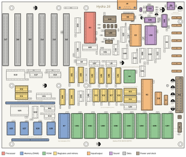

# Chapter 1. Welcome to the Hydra-16

Before you pick up a soldering iron or type your first command, let's look at what a computer *is*, and at the
particular computer you are about to meet. By the end of this chapter you will know the names of the Hydra's main
parts, what each one does, and how to read the strange numbers, like `$FF20`, that computer people love.

## 1.1 What is a computer?

A computer is a machine that **follows instructions**. That's all. A list of instructions is called a **program**,
and the computer works through a program one instruction at a time, very quickly, without getting bored or making
mistakes. Each instruction is tiny: "add these two numbers," "copy this number over there," "if this number is zero,
skip ahead." But a computer can follow millions of them every second, and from millions of tiny steps come games,
music, drawings, and everything else computers do.

Every computer, from a pocket calculator to a supercomputer, does the same four jobs:

| Job | What it means | On the Hydra |
|---|---|---|
| **Input** | Getting information in | The keyboard, files on a card, a mouse |
| **Processing** | Working on it | The 65C02 processor chip |
| **Memory** | Remembering it | RAM and ROM chips |
| **Output** | Showing the results | Text on a screen, sound, files |

Think of a computer as a cook in a kitchen. The **program** is the recipe. The **processor** is the cook, who reads
one step at a time and does it. The **memory** is the kitchen counter and the recipe book. And **input** and
**output** are the doors the groceries come in through and the plates go out through.

## 1.2 The parts of a computer

Open up almost any computer and you will find the same kinds of parts. The Hydra has all of them, and on the Hydra
they are big enough to see and touch.

### The processor

The **processor**, or **CPU** (central processing unit), is the chip that follows the instructions. The Hydra's
processor is a **W65C02S**, made by the Western Design Center. It is a modern version of the 6502, the processor
that powered many famous home computers and game machines of the late 1970s and 1980s. The 65C02 is small and
simple enough that a person can learn every single instruction it knows (there are about seventy), which is one of
the reasons the Hydra uses it. Part Five of this book teaches you to program it directly.

### Memory

A computer needs somewhere to keep its programs and the information they work on. That's **memory**, and it comes
in two kinds.

**RAM** (random-access memory) is like a whiteboard: the computer can write on it, read it back, and wipe it clean,
as often as it likes. RAM forgets everything when the power goes off.

**ROM** (read-only memory) is like a printed book: the computer can read it, but not change it, and it remembers
everything even with the power off. The Hydra keeps its operating system, its languages and its tools in ROM, so
they are ready the moment you switch on. (The Hydra's ROM chips are actually *flash* memory, a kind of ROM that a
special programmer can rewrite. That's how you put the software in them. See Chapter 4.)

Memory is divided into **bytes**. A byte holds one small number, from 0 to 255: enough for one letter of text, one
colour, or one piece of a bigger number. Each byte has an **address**, a number that says where it is, just as
each house on a street has a number. When the processor wants a byte, it sends out the address, and the memory
answers with the byte that lives there.

### Input and output

Input and output, often written **I/O**, are how the computer connects to the world. Special chips handle each
kind of connection: one sends and receives text over a cable, another makes sound, another reads the keyboard. To
the processor, each I/O chip looks like a few bytes of memory at special addresses. Writing a byte to the sound
chip's address plays a note; reading the serial chip's address gives you the key someone just typed.

### The clock

Inside every computer is a **clock**, not one that tells the time of day, but a steady beat, like a drummer
keeping time for a band. On each beat the processor does one small step of its work. The Hydra's clock beats
3,579,545 times every second, written **3.58 MHz** (megahertz: millions of beats per second). You can make it go
twice as fast, or slower, by moving a little jumper on the board.

### The bus

All these parts are connected by the **bus**: dozens of copper paths, called *traces*, that run between the chips.
The address bus carries addresses from the processor, the data bus carries bytes back and forth, and the control
lines say what's happening ("I'm reading," "I'm writing," "now!"). On the Hydra's circuit board you can see the bus
as the many thin lines running in parallel between the chips.

## 1.3 Meet the Hydra-16

The Hydra-16 is a computer you build yourself. It is a single large circuit board, about the size of a sheet of
paper, covered in chips that you put in their places one by one. Its name comes from the Hydra of Greek legend, a
monster with many heads. The Hydra-16 has sixteen "heads": it can run up to **sixteen programs at the same time**,
each in its own private part of the memory, without any of them getting in the others' way.

That ability, called **multitasking**, is something the home computers of the 1980s could not do. A Commodore 64
or an Apple II ran one program at a time. The Hydra is built from the same kind of chips as those machines, but it
adds a few clever extra chips that give every program its own memory. That lets its operating system, **HydraOS**,
juggle many programs at once, the way modern computers do.

Here is what's inside:

| Part | The Hydra-16 has |
|---|---|
| Processor | One W65C02S, at 3.58 MHz (or 7.16, 1.79 or 0.89 MHz) |
| Programs at once | Up to 16 *tasks*, each with its own 32K of memory |
| RAM | 512K for the tasks, 2 MB shared between them, and 2 MB more on each memory card you add (up to 15 cards) |
| ROM | 128K for the kernel (the heart of HydraOS), and up to 4 MB for the rest of the system |
| Serial port | A DE-9 connector for a PC or terminal: the Hydra's keyboard and screen |
| Sound | A Yamaha YM2151 FM sound chip, with a stereo headphone/line output |
| Storage | Up to eight SD card readers, and RAM disks |
| Connectors | Six expansion slots, eight SPI device headers, a 12-pin I/O header (six I/O pins, two handshake pins and the I²C bus) |
| Video (optional) | The Vera X card: a colour screen, sprites, a keyboard and mouse |
| Power | A standard ATX computer power supply |

> **NOTE:** "K" means 1,024 bytes, and "MB" (megabyte) means 1,024 K, or 1,048,576 bytes. Computers count in
> powers of two, so 1,024 (that is, 2 × 2 × 2 × 2 × 2 × 2 × 2 × 2 × 2 × 2) is a "round number" to a computer.
> The Hydra's 32K for each task is 32,768 bytes.

## 1.4 A tour of the board

Figure 1-1 shows the Hydra-16's circuit board from above, with its main parts labelled. Every part on the board
has a name printed next to it in white letters: a letter for the kind of part and a number. **U** is a chip
(integrated circuit), **R** a resistor, **C** a capacitor, **J** a connector, **Y** the crystal. You will use
these names all through the building chapters.

<figure>

<figcaption>Figure 1-1. The Hydra-16's circuit board and its main parts.</figcaption>
</figure>

Let's take a walk around the board.

**The processor (U1).** The big 40-pin chip near the top of the board, next to the expansion slots, is the W65C02S.
Everything else on the board is there to help it.

**The clock (Y1, U39, U40).** The little silver can marked *14.31818MHz* is the **crystal**, which vibrates
14,318,180 times a second. Two chips divide that beat down into the clocks the computer uses. Four jumpers,
J5 to J8, choose the processor's speed.

**The task RAM (U7).** One 512K RAM chip, near the bottom left, holds sixteen separate 32K blocks, one for each
task. When the Hydra switches from one program to another, it simply switches which block the processor sees.

**The shared RAM (U25, U27, U28, U29).** Four small surface-mounted RAM chips along the bottom edge hold 2 MB that
any program can use, a piece at a time.

**The memory cards (J1, J2).** Two long sockets on the left take the **memory cards**. Each card holds another 2 MB
of RAM, which gives every task 128K more memory of its own.

**The kernel ROM (U6).** The square chip in the middle of the board, in a socket with pins on all four sides, holds
the **kernel**: the heart of HydraOS, the part that runs the other programs.

**The paged ROM (U30 to U37).** Eight sockets along the bottom right hold up to eight more ROM chips, 512K each.
They hold the rest of HydraOS: its drivers, shells, languages and tools, and a whole disk's worth of files.

**The registers and mirrors.** The rows of smaller chips in the middle of the board are the Hydra's special trick.
Four of them, labelled **T**, **U**, **V** and **W Register**, choose which task's memory the processor sees, which
shared memory, which interrupt, and which page of the kernel ROM. Others, the **mirror RAMs**, remember which bank
of memory each task has chosen. Chapter 6 tells you how they work together.

**The VIA (U2).** The R65C22 *Versatile Interface Adapter* has two timers and two 8-bit ports. One timer ticks the
Hydra's clock for multitasking. One port runs the **SPI bus**, which talks to SD cards and other gadgets through
the eight **SPI device headers** (J18 to J25). The other port goes to the **I/O header** (J27), where you can
connect switches, lights and I²C sensors.

**The serial port (U3, U5, J3).** The R65C51 *ACIA* chip sends and receives characters one bit at a time, and the
MAX232 chip changes them into the voltages of a standard serial cable. The DE-9 connector at the top, J3, is where
your PC plugs in. This cable is how you type to the Hydra and see its answers.

**The sound (U38, U41, U42, IC9, J26).** The Yamaha **YM2151** is an FM synthesizer, the same kind of chip that made
the music in many 1980s arcade games. It has eight voices. The YM3012 turns its numbers into sound waves, and the
mixer adds in the sound from slot 0 and the *Audio In* header. Plug headphones or a speaker into the jack, J26.

**The expansion slots (J12 to J17).** Six long card-edge sockets let you plug in extra boards. **Slot 0** is
special: it's the one for the **Vera X**, a video card that gives the Hydra a colour screen, a keyboard and a mouse.

**The power (J11, J10, U43).** The big 24-pin connector, J11, takes a standard ATX computer power supply. The
front-panel header, J10, is for the power switch, the reset button and the power light, and U43 makes sure the
computer starts cleanly every time the power comes on or the reset button is pressed.

## 1.5 HydraOS, the Hydra's software

A computer without software is just a pile of chips. The Hydra's software is called **HydraOS**, and it lives in
the ROM chips, so it starts the moment you switch on. HydraOS is an **operating system**: the program that runs
the other programs. It decides which program gets the processor next, gives each one its memory, and lets them use
the files and devices without fighting over them.

HydraOS gives you:

* **Shells**: programs that read the commands you type and do them. The Hydra greets you with **HyForth**, a shell
  that understands both commands and the Forth programming language, and also has **rc**, a classic command shell.
* **Files**: a tree of folders and files on SD cards, in ROM, and in RAM disks, all in one tree.
* **Windows**: up to sixteen text windows on one screen, each with its own program, that you switch between with a
  couple of keys.
* **About fifty commands**: for listing, copying and editing files, watching the programs that are running,
  calculating, playing music, and much more.
* **Three programming languages**: **HyForth**, **hylang** and **HyBASIC**, plus an **assembler**, a
  **disassembler** and a **debugger** for programming the 65C02 itself.

Part Two of this book is all about using HydraOS. Part Four teaches the languages.

## 1.6 Bits, bytes and hexadecimal

Computers count with only two digits, **0** and **1**. Each 0 or 1 is called a **bit** (short for "binary digit").
A byte is eight bits in a row, like `01000001`. Just as the digits of an ordinary number stand for ones, tens and
hundreds, the bits of a byte stand for 1, 2, 4, 8, 16, 32, 64 and 128, from right to left:

| Bit value | 128 | 64 | 32 | 16 | 8 | 4 | 2 | 1 |
|---|---|---|---|---|---|---|---|---|
| `01000001` | 0 | 1 | 0 | 0 | 0 | 0 | 0 | 1 |

Add up the values where there's a 1: 64 + 1 = 65. So the byte `01000001` is the number 65, which also happens to
be the code for the letter **A**.

Long strings of 0s and 1s are hard for people to read, so programmers use **hexadecimal** ("hex" for short), which
counts in sixteens. Hex needs sixteen digits, so after 0 to 9 it uses the letters A to F:

| Decimal | 0 | 1 | 2 | 3 | 4 | 5 | 6 | 7 | 8 | 9 | 10 | 11 | 12 | 13 | 14 | 15 |
|---|---|---|---|---|---|---|---|---|---|---|---|---|---|---|---|---|
| Hex | 0 | 1 | 2 | 3 | 4 | 5 | 6 | 7 | 8 | 9 | A | B | C | D | E | F |
| Binary | 0000 | 0001 | 0010 | 0011 | 0100 | 0101 | 0110 | 0111 | 1000 | 1001 | 1010 | 1011 | 1100 | 1101 | 1110 | 1111 |

Each hex digit stands for exactly four bits, so one byte is always two hex digits. The byte `01000001` splits into
`0100` and `0001`, which are hex `4` and `1`: so 65 is **$41** in hex. The biggest byte, `11111111`, is **$FF**,
which is 255.

The Hydra's addresses go from **$0000** to **$FFFF**: four hex digits, or 65,536 different addresses. In this book,
as on many computers of the 1980s, a **$** in front of a number means it's hexadecimal. So **$10** is sixteen, not
ten, and **$FF20** is the address 65,312.

> **TRY THIS:** Can you work out what $20 is in decimal? (Each step in the second hex digit is worth 16.) Chapter 17
> has much more about numbers, and the Hydra's languages can convert between bases for you. In HyForth, type
> `hex 20 decimal .` to see the answer.

## 1.7 What you need

**To use the Hydra on a PC**, all you need is a web browser. Chapter 2 shows you how.

**To build and use a real Hydra-16**, you will need:

* The Hydra-16 kit: the main circuit board, its parts, and at least one memory card.
* A soldering iron and a few other tools (Chapter 3 lists them).
* An **ATX power supply**, the kind used in desktop PCs, with a 24-pin connector.
* A **power switch** (a toggle switch that stays on), and if you like, a reset button and a power light.
* A PC (Windows, Mac or Linux) and a **USB-to-serial adapter** with a DE-9 plug. It must be an "RS-232" adapter,
  the kind with a 9-pin connector, not a bare "TTL" cable.
* A programmer for flash ROM chips (such as a TL866 or T48), to put HydraOS into the ROM chips, unless your kit
  came with them already programmed.
* Optional: an SD card reader module for the SPI headers, headphones or speakers, and the Vera X video card.

## 1.8 Where to go next

* If you want to try the Hydra right away, turn to **Chapter 2** and run it on your PC.
* If you are building a Hydra, read **Chapters 3, 4 and 5** in order, carefully, before you start.
* If your Hydra is already built and working, skip ahead to **Part Two** and learn your way around HydraOS.
