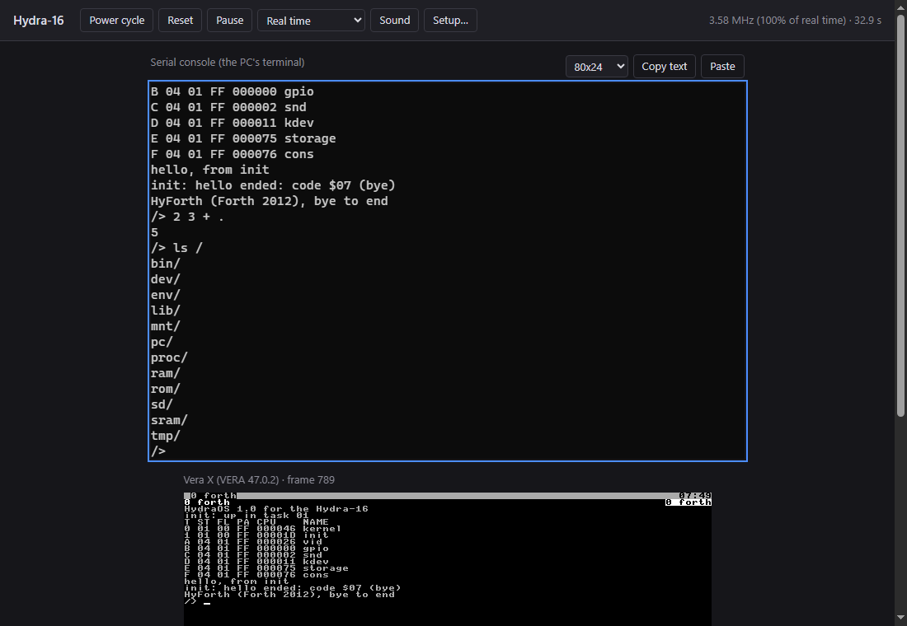
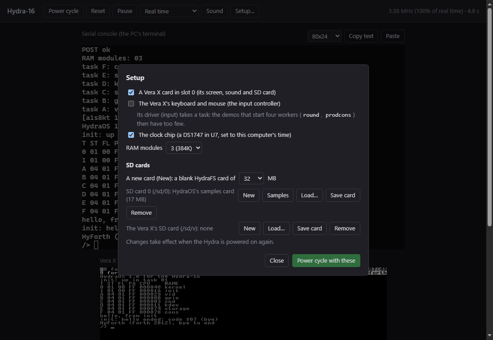

# Chapter 2. The Hydra on Your PC

You don't have to build a Hydra to start using one. The **Hydra emulator** is a program that makes your PC behave
exactly like a Hydra-16: it imitates every chip on the board, one clock beat at a time, and runs the very same
HydraOS that lives in a real Hydra's ROM chips. Programs you write in the emulator run unchanged on a real Hydra,
and the other way round.

> **IN THIS CHAPTER:** You'll run a Hydra on a PC, in a web browser and in a terminal window, choose its hardware,
> share files with your PC, and make SD card images. **You need:** a PC with a web browser; and for sections 2.3 to
> 2.7, permission to install Node.js on it.

This chapter shows you two ways to run the emulator: in a **web browser**, the easiest way, with nothing to
install; and in a **terminal window** on your PC, which gives you extra tools for exploring. At the end you'll see
how to share files between your PC and the Hydra.

> **FOR TEACHERS:** The web emulator is a single file. Make it once, on one computer (section 2.3), then copy it to
> every computer in the room (or put it on a shared drive), and each student can run a complete Hydra with no
> installation and no network. Everything the students save stays inside their own browser, on that computer: a
> student who moves to another computer needs **Save card** and **Load…** to take their work along.

## 2.1 The emulator in a web browser

The web emulator is one file called **hydra-16.html**. Your teacher may give it to you, or you can make it
yourself: section 2.3 shows how, and it takes one command. To start it, open the file in a web browser: Chrome, Edge, Firefox or Safari
all work. Double-clicking the file is usually enough.

The Hydra switches on at once. Within a few seconds the **serial console** fills with the Hydra's start-up
messages, and then the prompt `/>` appears, which means HydraOS is ready for you to type.

<figure>

<figcaption>Figure 2-1. The web emulator. The serial console is at the top; the Vera X card's screen is below it.</figcaption>
</figure>

Click in the console and try your first two commands. Type `2 3 + .` and press <kbd>RETURN</kbd>, then type `ls /`
and press <kbd>RETURN</kbd>:

```session
/> 2 3 + .
5
/> ls /
bin/
dev/
env/
lib/
mnt/
pc/
proc/
ram/
rom/
sd/
sram/
tmp/
```

The first command added two and three (Chapter 19 explains why the `+` comes after the numbers). The second listed
the folders at the top of the Hydra's file tree. Congratulations: you are using a Hydra.

### The buttons

Along the top of the page are the emulator's controls:

| Button | What it does |
|---|---|
| **Power cycle** | Switches the Hydra off and on again. Everything in RAM is lost, but the SD cards are kept. |
| **Reset** | Presses the Hydra's reset button. The computer starts again, but RAM is not cleared. |
| **Pause** | Stops the Hydra's clock until you press it again. |
| Speed | **Real time** runs the Hydra at its true speed, 3.58 MHz. **2×** and **4×** run it faster, and **As fast as it goes** runs it as fast as your PC can. |
| **Sound** | Turns on the sound, so you can hear the YM2151 and the Vera X's sound chips. |
| **Setup…** | Chooses what is plugged into this Hydra (see below). |

At the top right, the page shows the Hydra's clock speed, how close to real time it is running, and how many seconds
the Hydra has been switched on.

### The serial console

The big black box is the **serial console**. On a real Hydra, it's the terminal program on a PC connected to the
Hydra's serial port. Whatever you type here goes to the Hydra, and whatever the Hydra prints appears here.

Above the console:

* The **size** menu sets how many columns and rows the console has. The Hydra notices the change and fits its
  windows to the new size.
* **Copy text** copies everything in the console, including the lines that have scrolled away, so you can paste it
  into a document.
* **Paste** types whatever is on your PC's clipboard into the Hydra, as if you typed it: handy for a line or two.
  For a whole program, the Hydra can lose characters that arrive faster than it reads them, so keep programs on
  your PC and bring them in through `/pc` (section 2.5), or paste a few lines at a time.
  (<kbd>CTRL</kbd>-<kbd>SHIFT</kbd>-<kbd>V</kbd> does the same.)

You can also scroll back through old lines with the mouse wheel, and drag across text to select and copy it.

### The Vera X screen

Below the console is the screen of the **Vera X**, the Hydra's optional video card. When the Vera X is plugged in
(it is, in the emulator, unless you turn it off), HydraOS shows its windows on this screen as well as on the serial
console. Programs can also draw pictures, move sprites and play sounds through the Vera X; Chapter 16 shows you how.
If you turn on the Vera X's keyboard and mouse in Setup, click on the screen and you can type and use the mouse
there, just as on a real Hydra with a keyboard and mouse plugged in.

### Setup

The **Setup…** button opens the setup panel, where you choose the Hydra's hardware:

<figure>

<figcaption>Figure 2-2. The Setup panel.</figcaption>
</figure>

* **A Vera X card in slot 0** adds the video card: its screen, its sound chips and its own SD card.
* **The Vera X's keyboard and mouse** adds the card's input controller, so the screen takes keys and the mouse.
  The program that reads them, `input`, uses one of the Hydra's sixteen tasks.
* **The clock chip** fits a DS1747 clock chip in place of the task RAM chip U7. It keeps the date and time, which
  the emulator sets from your PC's clock.
* **RAM modules** chooses how many memory cards are plugged in: one, two or three.
* **SD cards**: **SD card 0** appears to the Hydra as `/sd/0`. **New** puts in a new, empty card (of the size you
  pick), **Samples** puts back HydraOS's sample card (programs, songs and examples), **Load…** loads a card image
  file from your PC, **Save card** saves the card as an image file, and **Remove** takes the card out. The Vera X's
  own card slot works the same way, and appears as `/sd/v`.

Changes take effect when the Hydra is switched on again: press **Power cycle with these**.

> **NOTE:** The web emulator keeps your SD cards inside your browser, so your files are still there the next time
> you open the page on the same computer. To keep a copy somewhere else, or to move your files to another computer
> or to a real Hydra, use **Save card**.

## 2.2 What the emulator can and can't do

The emulator imitates the Hydra very closely: the processor, every chip on the board, the serial port, the sound
chip, the Vera X, the SD cards, even the exact time each instruction takes. Programs can't tell the difference.

A few things are different from a real board:

* The emulator's "serial cable" never drops a character, and its SD cards never wear out.
* In **As fast as it goes** mode the Hydra's clock runs faster than real time, so music and other timed things
  play too fast. Use **Real time** for sound.
* The clock chip is only in the web emulator (its Setup). In the terminal emulator, the Hydra has no clock chip, so
  its clock starts at midnight on January 1, 2000 each time it is switched on.
* The web emulator has no `/pc` folder for sharing files with the PC. The terminal emulator does (section 2.5),
  and so does a real Hydra with the PC tool (Chapter 5).

## 2.3 Getting the Hydra's files

To run the emulator in a terminal window, make your own copy of the web emulator, or build HydraOS yourself, you
need two things on your PC:

1. **Node.js**, a free program that runs JavaScript programs outside a web browser. Download the "LTS" version from
   **nodejs.org** and install it. (On a school computer, ask your teacher; you may already have it.)

2. **The Hydra-16's files**: HydraOS, its emulator, the board's design files and this book. They are kept on
   GitHub at **github.com/danstruthers/hydra-16**. Use the green **Code** button and **Download ZIP**, then unzip
   the file. Or, if you have **git**, copy the whole project with:

```text
git clone https://github.com/danstruthers/hydra-16.git
```

The project's folder holds these folders:

| Folder | What's in it |
|---|---|
| `base` | The kernel (the heart of HydraOS) and the core of the emulator |
| `reborn` | The rest of HydraOS: its drivers, shells, languages and tools; its ROM images; and its emulator |
| `board` | The Hydra-16's circuit board design, for the KiCad design program |
| `manual` | This book |
| `docs` | The reference book: the architecture, every driver's files and commands, the expansion cards, the quirks |
| `old` | The first HydraOS, kept for the record; nothing in this book needs it |

Everything you need to *run* the emulator is already there, including the ROM images in `reborn/bin`. You do not
need to build anything.

To make your own web emulator, open a terminal window (on Windows, *Command Prompt* or *PowerShell*; on a Mac or
Linux, *Terminal*), go to the project's folder, and type:

```text
node reborn/sim/web.js
```

That writes the page to `reborn/obj/web/hydra-16.html`. Copy it anywhere you like. To try it straight away,
`node reborn/sim/web.js --serve` serves the page on your PC, at **http://localhost:8017**.

## 2.4 The emulator in a terminal window

The terminal emulator runs the Hydra with your PC's terminal window as its serial console. It also has extra tools
for exploring: a monitor that stops the processor and looks at its memory, and switches for every piece of hardware.
In a terminal window, in the project's folder, type:

```text
node reborn/sim/run.js -i
```

The `-i` means *interactive*: your terminal becomes the Hydra's serial console, running in real time. After the
start-up messages you'll see the `/>` prompt, just as in the browser.

### The emulator's keys

While the Hydra is running, <kbd>CTRL</kbd>-<kbd>A</kbd> is the emulator's own key. Press it, let go, then press
one of these:

| Keys | What they do |
|---|---|
| <kbd>CTRL</kbd>-<kbd>A</kbd> then <kbd>X</kbd> | Quit the emulator |
| <kbd>CTRL</kbd>-<kbd>A</kbd> then <kbd>R</kbd> | Press the Hydra's reset button |
| <kbd>CTRL</kbd>-<kbd>A</kbd> then <kbd>S</kbd> | Show the status: each task and what it's doing |
| <kbd>CTRL</kbd>-<kbd>A</kbd> then <kbd>B</kbd> | Stop the processor and open the **monitor** (below) |
| <kbd>CTRL</kbd>-<kbd>A</kbd> then <kbd>V</kbd> | Show the Vera X's screen as text |
| <kbd>CTRL</kbd>-<kbd>A</kbd> then <kbd>P</kbd> | Save the Vera X's screen as a picture (a PNG file) |
| <kbd>CTRL</kbd>-<kbd>A</kbd> then <kbd>H</kbd> | Show this list |
| <kbd>CTRL</kbd>-<kbd>A</kbd> then <kbd>CTRL</kbd>-<kbd>A</kbd> | Send a <kbd>CTRL</kbd>-<kbd>A</kbd> to the Hydra |

### Choosing the hardware

You choose the Hydra's hardware by adding **options** after `-i`. For example, this command starts a Hydra with a
Vera X card and its keyboard and mouse, and shows the Vera X's screen in your web browser:

```text
node reborn/sim/run.js -i --vera --smc --view
```

Open **http://localhost:8016** in your browser to see the screen, and click on it to use its keyboard and mouse.
The most useful options are:

| Option | What it does |
|---|---|
| `--vera` | Plugs a Vera X card into slot 0 |
| `--smc` | Adds the Vera X's keyboard and mouse |
| `--view` | Shows the Vera X's screen in a web browser, at http://localhost:8016 |
| `--sound` | Plays the Hydra's sound through a web browser page |
| `--modules N` | Plugs in N memory cards (the emulator's normal number is 2) |
| `--clock 7.15909` | Runs the processor at 7.16 MHz (see Chapter 4) |
| `--sd FILE` | Puts an SD card image file in the next SD reader |
| `--pc-dir FOLDER` | Lets the Hydra see a folder on your PC as `/pc` (section 2.5) |
| `--speed N` | Runs N times faster than real time (0: as fast as possible) |

Appendix H lists every option the emulator has.

### The monitor

<kbd>CTRL</kbd>-<kbd>A</kbd> then <kbd>B</kbd> stops the Hydra's processor and opens the **monitor**, the
emulator's own little command line. The monitor lets you see exactly what the processor is doing, one instruction at
a time. Its commands are:

| Command | What it does |
|---|---|
| `c` | Continue: start the processor again |
| `n` *N* | Run the next *N* instructions (one, if you leave out *N*), showing each one |
| `r` | Show the processor's registers |
| `t` | Show the tasks |
| `m` *ADDR* *N* *T* | Show *N* bytes of memory at address *ADDR* (64, if you leave out *N*), as task *T* sees it |
| `b` *SPEC* | Stop when the processor reaches an address (with no *SPEC*, list the stops) |
| `d` *N* | Delete stop number *N* |
| `w` *ADDR* | Stop when anything writes to address *ADDR* |
| `x` | Quit the emulator |

Nothing in this book needs the monitor (Part Five uses the Hydra's own debugger, `db`, which works on a real Hydra
too). But it's fun to peek inside: stop the Hydra while it's waiting at the prompt, type `r` to see the registers,
and `c` to carry on.

### Running without a terminal

The emulator can also run by itself, type a few things, and print what happened. Leave out `-i`, and give it the
keys to type with `--input`:

```text
node reborn/sim/run.js --input "\w\w2 3 + .\r" --cycles 40000000
```

`\w` waits two million clock beats, and two of them first give HydraOS time to start: keys that arrive while the
Hydra is busy are lost. `\r` stands for the <kbd>RETURN</kbd> key, and `--cycles` says how long to run (40 million
clock beats is a little over 11 seconds of the Hydra's time). At the end the emulator prints everything the Hydra printed, followed by a
report on its tasks. This is how HydraOS's own tests check that everything works.

## 2.5 Sharing files with your PC

When you start the terminal emulator with `--pc-dir`, the Hydra can see a folder on your PC as its own folder
`/pc`:

```text
node reborn/sim/run.js -i --pc-dir C:\Users\you\hydra-files
```

On the Hydra, `ls /pc` lists the files in that folder, and you can read them, run them, copy files into it and
change them. It's the easiest way to move programs between the Hydra and your PC: write a program in your favourite
PC editor, save it in the folder, and run it on the Hydra. Add `--pc-read-only` if you want the Hydra to be able to
read the folder but not change it.

A real Hydra can do the same through its serial cable, with the PC tool. Chapter 5 shows you how.

## 2.6 SD card images

The Hydra keeps files on SD cards. The emulator's SD cards are **image files** on your PC: a single file that holds
everything that would be on a card, block by block.

When you start the terminal emulator without any `--sd` option, it uses HydraOS's own sample card,
`reborn/bin/sdcard.img`, and keeps any changes you make only in memory, so the sample card is never changed. To use
your own card that keeps its changes, make an image with the `hydrafs.js` tool and give it to the emulator:

```text
node reborn/sim/tools/hydrafs.js mkfs mycard.img 32 MYCARD
node reborn/sim/run.js -i --sd mycard.img
```

The first command makes a new, empty 32 MB card called MYCARD. The Hydra sees it as `/sd/0`, and everything you
save there stays in `mycard.img`.

`hydrafs.js` can also copy files in and out of an image, list it, and check it:

| Command | What it does |
|---|---|
| `mkfs IMAGE MB [LABEL]` | Makes a new, empty card image of MB megabytes |
| `info IMAGE` | Shows the card's label, size and free space |
| `ls IMAGE [-l] [PATH]` | Lists a folder on the card |
| `put IMAGE FILE PATH` | Copies a file from your PC onto the card |
| `get IMAGE PATH FILE` | Copies a file from the card to your PC |
| `mkdir IMAGE PATH` | Makes a folder on the card |
| `rm IMAGE PATH` | Removes a file, or an empty folder |
| `import IMAGE FOLDER [PATH]` | Copies a whole folder from your PC onto the card |
| `check IMAGE` | Checks the card for errors |

To put an image onto a real SD card for a real Hydra, use `reborn/sim/tools/sdwrite.js`, or any "disk imager"
program. `node reborn/sim/tools/sdwrite.js --list` lists your PC's disks, so you can find the card. Then
`node reborn/sim/tools/sdwrite.js IMAGE DISK` writes it. It checks that the disk really is a removable card, and
asks you to confirm, before it writes anything.

> **CAUTION:** Writing an image to a disk erases everything that was on the disk. Make very sure you choose the SD
> card, not your PC's own disk! `sdwrite.js` refuses to write to the disk your PC starts from, but take care anyway.

## 2.7 Building HydraOS yourself

You never *need* to build HydraOS, because the ROM images come ready-made. But if you want to change HydraOS itself,
or to build programs in C, you'll need the **cc65** compiler and assembler (from **cc65.github.io**). Install it,
put its `bin` folder on your PATH (or set `CC65_HOME` to the folder you unpacked it in), then in the project's
folder type:

```text
node reborn/build.js
```

In about twenty seconds, it builds the kernel, every driver, shell, language and tool, and writes new ROM images to
`reborn/bin`: `bios.bin` for the kernel ROM, and `prom0.bin`, `prom1.bin` and `prom2.bin` for the paged ROM
chips. The emulator uses the new images the next time you start it, and Chapter 4 shows you how to put them into a
real Hydra's ROM chips.

Now that you can run a Hydra, you can try everything in Parts Two to Five of this book. If you're building a real
Hydra, read on: Chapter 3 gets you ready to solder.
