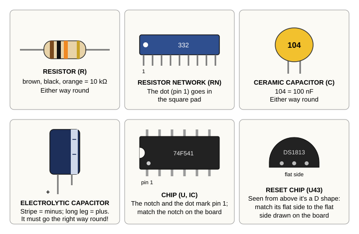
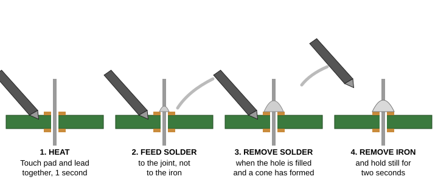
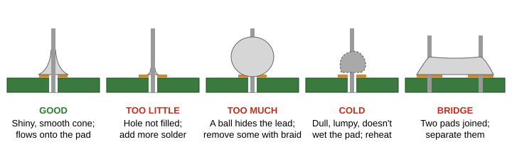

# Chapter 3. Tools, Parts and Soldering

Building a Hydra means soldering about 2,200 connections on the main board, and 240 more on a memory card, one at a
time. That sounds like a lot, and it is: this is a big project, not an afternoon's. But each joint takes only a few
seconds, more than half of them are in neat rows along the chip sockets, and after the first fifty or so your hands
will know what to do. This chapter gets you ready: the tools you need, how to stay safe, how to recognise every kind
of part in the kit, and how to make a good solder joint, and fix a bad one.

> **IN THIS CHAPTER:** You'll learn the tools, the safety rules, how to recognise each kind of part and read its
> value, and how to make, judge and repair a solder joint. **You need:** nothing yet. Read this chapter before you
> buy tools or open the kit.

**How long will it take?** At a careful beginner's pace, the soldering alone is eight to ten hours. Fitting the parts,
checking your work and cleaning up take about as long again. So plan on **fifteen to twenty hours**, in sessions of
an hour or two, and don't hurry: a joint made in a rush is the one you'll be hunting for later.

| Stage (Chapter 4) | Parts | Joints |
|---|---|---|
| Step 1: the surface-mount RAM chips (often done for you) | 4 | 128 |
| Step 2: the resistors and resistor networks | 27 | 82 |
| Step 3: the ceramic capacitors | 78 | 156 |
| Step 4: the chip sockets | 64 | 1,282 |
| Step 5: the crystal, the reset chip, the pin headers and sockets | 21 | 148 |
| Step 6: the electrolytic capacitors | 13 | 26 |
| Step 7: the connectors | 9 | 412 |
| **The main board** | **216** | **2,234** |
| A memory card (section 4.7) | 13 | 240 |

> **FOR TEACHERS:** A Hydra is a term's project for a small group, not a lesson's. Before students touch the Hydra's
> board, have each one practise on a scrap circuit board or an inexpensive "learn to solder" kit until their joints
> look like the good one in Figure 3-3. The *Educator's Course Guide* has a plan for sharing the build among a
> group, and a safety policy to adapt; the *Student Companion* has a build log with a box to tick for every part.

## 3.1 Safety first

> **CAUTION:** A soldering iron's tip is about 350 °C (660 °F), hot enough to burn you badly in an instant. Always
> put the iron back in its stand when you aren't using it, never touch the metal parts, and never leave it on when
> you walk away. Younger builders should work with an adult nearby.

Follow these rules every time you solder:

* **Protect your eyes.** Wear safety glasses. When you clip wire leads, they can fly off fast; hold the end of the
  lead as you cut it, or point it away from people.
* **Don't breathe the smoke.** The smoke comes from the *flux* inside the solder. Work in a room with fresh air, and
  use a small fan or a fume extractor to move the smoke away from your face.
* **Wash your hands** when you finish, and don't eat or drink while you solder. This matters most if your solder
  contains lead.
* **Choose your solder with care.** Solder with lead in it ("63/37" or "60/40") flows more easily, but lead is a
  poison if it gets into your body. **Lead-free** solder is the safer choice, and the right one for a school or
  for a young builder. It needs a slightly hotter iron (about 370 °C) and a little more patience.
* **Keep your workspace clear.** Use a heat-proof mat, keep cables away from the hot iron, and keep a damp sponge or
  brass tip cleaner ready. Tie back long hair, and roll up loose sleeves.
* **Never catch a falling iron.** Step back and let it fall. A mark on the floor is better than a burn on your hand.
* **The power supply stays off and unplugged** whenever you are soldering, inserting chips or changing jumpers.

**If you burn yourself**, put the burn under cool running water straight away, and keep it there for at least ten
minutes. Don't use ice, and don't put cream or butter on it. Tell an adult. A burn bigger than a coin, or one that
blisters, needs a doctor or a nurse to look at it.

## 3.2 The tools you need

| Tool | Why you need it |
|---|---|
| **Soldering iron** with temperature control (about 40 to 60 watts) and a fine conical or small chisel tip | To heat the joints. A cheap iron with no temperature control makes the job much harder. |
| **Iron stand** with a sponge or brass tip cleaner | To hold the hot iron safely, and to keep its tip clean |
| **Solder**: thin (0.5 to 0.8 mm) rosin-core solder | The metal that makes the joints. Lead-free solder is safer; "63/37" tin-lead solder is easier to use |
| **Flux pen** | Extra flux helps solder flow, and is essential for the surface-mount chips |
| **Desoldering braid** (solder wick) and/or a **solder sucker** | To remove solder when you make a mistake |
| **Flush cutters** | To trim the wire leads after soldering |
| **Needle-nose pliers** | To bend leads and hold parts |
| **Tweezers** | To place the small surface-mount chips |
| **Magnifier**, or a magnifying lamp | To inspect your joints |
| **Multimeter** | To check for short circuits and measure voltages |
| **Anti-static wrist strap** | To protect the chips from static electricity |
| **IC insertion and extraction tools** (or careful fingers) | To put chips into their sockets, and take them out |
| **Isopropyl alcohol** and an old toothbrush | To clean flux off the board when you're done |
| **Safety glasses** | To protect your eyes |

## 3.3 Static electricity

When you walk across a carpet and get a shock from a doorknob, that's static electricity: a spark of thousands of
volts. You can feel a spark of about 3,000 volts. A spark too small to feel can still destroy a chip. The Hydra's
processor, its memory chips and its input and output chips are made with **CMOS** technology (the "C" in 65C02),
which uses very little power but is easily damaged by static. Most of the small logic chips (the ones whose names
start with 74F or 74LS) are an older, tougher kind (the few marked 74ACT are CMOS too), but it's simplest, and
safest, to treat every chip the same careful way.

To protect the chips:

* Wear an **anti-static wrist strap** clipped to a grounded metal object, or touch a grounded metal object, such as
  the metal case of a plugged-in PC, before you handle chips.
* Keep chips in their **anti-static foam or tubes** until you are ready to put them in.
* Hold chips by their plastic bodies, not their pins.
* Don't work on a carpet, and avoid wool sweaters.

## 3.4 Knowing your parts

Every part in the kit has a **reference** printed on the circuit board where it goes: **R** for resistors, **C** for
capacitors, **U** and **IC** for chips (integrated circuits), **J** for connectors, **Y** for the crystal, and
**RN** for resistor networks. Appendix I lists every part, its reference, and its value.

<figure>

<figcaption>Figure 3-1. The kinds of parts in the Hydra kit, and how to tell which way round they go.</figcaption>
</figure>

### Resistors

A **resistor** limits how much electricity flows through a wire. Resistors are small tan or blue cylinders with a
wire at each end, and coloured **bands** that tell you their value in **ohms** (Ω). Resistors can go in either way
round.

Read the bands from the end where they are bunched up. The first two bands are digits, and the third says how many
zeros to add. The fourth band (gold or silver), if there is one, is the *tolerance*, how accurate the value is.
Some resistors have five bands: three digits, then the zeros, then the tolerance.

| Colour | Black | Brown | Red | Orange | Yellow | Green | Blue | Violet | Grey | White |
|---|---|---|---|---|---|---|---|---|---|---|
| Digit | 0 | 1 | 2 | 3 | 4 | 5 | 6 | 7 | 8 | 9 |

For example, **brown, black, orange** is 1, 0 and three zeros: 10,000 ohms, or **10 kΩ** ("10K").

The Hydra's parts list writes resistor values in a three-digit code that works the same way: two digits, then the
number of zeros. Here are all the resistor values in the kit:

| Code | Value | Bands | Parts |
|---|---|---|---|
| 220 | 22 Ω | red, red, black | R23 to R27 |
| 330 | 33 Ω | orange, orange, black | R30, R31 |
| 101 | 100 Ω | brown, black, brown | R3 |
| 331 | 330 Ω | orange, orange, brown | R22 |
| 471 | 470 Ω | yellow, violet, brown | R2 |
| 103 | 10 kΩ | brown, black, orange | R4 to R7, R13, R19 to R21, R28, R32, R33 |
| 105 | 1 MΩ | brown, black, green | R1 |
| 0 | 0 Ω | one black band | R29 (a "zero-ohm" resistor: just a wire) |

> **TIP:** If you're not sure about a resistor's colours, measure it with your multimeter set to ohms (Ω). Do this
> *before* you solder it in.

### Resistor networks

A **resistor network** (RN1 to RN4) is several resistors in one flat package with a row of nine pins. Eight of the
resistors share one pin, the *common* pin, marked with a **dot** or a line at one end. **The common pin goes in the
square pad** marked "1" on the board. A resistor network put in backwards won't work.

| Code | Value | Parts |
|---|---|---|
| 332 | 3.3 kΩ (8 resistors) | RN1, RN2, RN3 |
| 103 | 10 kΩ (8 resistors) | RN4 |

### Ceramic capacitors

A **capacitor** stores a tiny amount of electricity, like a very small, very fast battery. Ceramic capacitors are
small, flat, usually yellow, orange or blue discs, with a code printed on them. They can go in either way round.

The code works like the resistor code, but in **picofarads** (pF): two digits and the number of zeros. So **104** is
10 followed by four zeros: 100,000 pF, which is 100 nF or 0.1 µF.

| Code | Value | Parts |
|---|---|---|
| 330 | 33 pF | C47, C48 (beside the crystal) |
| 332 | 3.3 nF | C50, C52 (in the sound circuit) |
| 104 | 100 nF (0.1 µF) | C1 to C3, C5, C6, C12 to C46, C57 to C64, C66 to C85: 68 of them |
| 105 | 1 µF | C4, C7 to C10 (around the serial chip) |
| 475 | 4.7 µF | C49 |

Most of the 104 capacitors are **decoupling capacitors**. Each chip has one beside it, between its power pins. When
the chip suddenly needs a little extra current, its capacitor supplies it instantly, so the chip's power stays
steady.

### Electrolytic capacitors

**Electrolytic capacitors** are bigger cylinders, usually black or blue. They store much more electricity than
ceramic ones, and most of them **must go in the right way round**. An electrolytic capacitor has a **minus stripe**
down one side of its body, and its **longer leg is the plus (+)** side. The board marks the plus side with a "+" and
usually shades the minus side of the circle.

> **CAUTION:** An electrolytic capacitor put in backwards can get hot, bulge, or even burst with a pop when the
> power comes on. Always check its stripe against the board's markings before you solder it.

| Code | Value | Parts | Polarity |
|---|---|---|---|
| 106 | 10 µF | C90, C91 | Yes: stripe to minus |
| 476 | 47 µF | C86 to C89 | Yes: stripe to minus |
| 107 | 100 µF | C51, C53 to C56 | Yes: stripe to minus |
| 227 NP | 220 µF, non-polarized | C92, C93 | **No**: either way round |

C92 and C93 are a special **non-polarized** ("NP" or "bipolar") kind, which has no stripe and can go in either way.

### Chips

Most of the Hydra's chips come in **DIP** packages (dual in-line package): a black plastic body with two rows of
legs. At one end of the body is a **notch** or a small **dot**. The dot marks **pin 1**, and the pins are numbered
counter-clockwise from there, looking down on the chip.

On the circuit board, each chip's outline has a matching notch, and its pin 1 has a **square pad**. **The chip's notch
must match the board's notch.** A chip in backwards will not work, and may be damaged when the power comes on.

The Hydra's DIP chips don't get soldered in: their **sockets** do. You solder in an empty socket, and plug the chip
into it at the end. That way a chip is never hurt by the soldering iron, and you can change a chip easily. The
sockets have notches too; match them to the board, so you'll know which way the chip goes later.

Three other kinds of chip packages are in the kit:

* **U6**, the kernel ROM, is a square **PLCC** chip with legs on all four sides. It goes in a square socket. One
  corner of the chip, and of the socket, is cut off; the corners must match.
* **U25, U27, U28 and U29**, the shared RAM, are **surface-mount** chips (SOP packages): flat chips with short legs
  that solder directly to pads on the top of the board. Section 3.7 shows you how. (Your kit may have these already
  soldered in place.)
* **U43**, the reset chip, is a small black **TO-92** package, like a transistor, with three legs and one flat side.
  Its flat side matches the flat side of its outline on the board.

### The crystal

**Y1**, the crystal, is a small silver can marked **14.31818MHz**. It can go in either way. Don't let the iron rest
on its can for long; a crystal doesn't like too much heat.

### Connectors

The kit has many kinds of connectors:

* **Pin headers** are rows of square pins: J5 to J9, J10 (the front panel), J27 (the I/O header), J29 and J30.
  Small **jumpers** (shunts) push onto pairs of pins to connect them.
* **Pin sockets** are rows of little holes: J1 and J2 (for the memory card) and J18 to J25 (the SPI devices).
* **Card-edge sockets**, J12 to J17, are the six long expansion slots.
* **J11** is the 24-pin power connector, **J3** the 9-pin serial connector, and **J26** the audio jack.

All of these go in only one way, because their pins fit only one pattern of holes. But make sure each one sits flat
and straight on the board before you solder all its pins.

## 3.5 How to solder

Solder is a soft metal that melts at about 190 °C (or about 220 °C for lead-free solder). When melted solder flows
over a part's lead and the copper pad around its hole, and then cools, it joins them together, both mechanically and
electrically. The **flux** inside the solder cleans the metal as it melts, so the solder can stick.

<figure>

<figcaption>Figure 3-2. Soldering a joint: heat, feed, remove the solder, remove the iron.</figcaption>
</figure>

To solder a lead:

1. **Prepare.** Set the iron to about 330 °C (370 °C for lead-free solder). Wipe its tip on the sponge, and melt a
   little solder onto the tip so it's shiny. This is called *tinning* the tip.
2. **Heat.** Touch the tip so it touches **both** the copper pad **and** the lead at the same time. Hold it there for
   about one second.
3. **Feed.** Touch the end of the solder wire to the joint, on the opposite side from the iron, not to the iron
   itself. The solder should melt and flow around the lead and across the pad. Feed in just enough to fill the hole
   and make a little cone; this takes a second or two.
4. **Remove the solder**, then...
5. **Remove the iron.** Lift the tip straight away. Don't move the part until the solder has cooled, which takes
   about two seconds.

The whole joint takes about three to five seconds. If the solder doesn't flow nicely after five seconds, take the
iron away, let everything cool, clean and re-tin the tip, and try again.

## 3.6 Good joints and bad joints

<figure>

<figcaption>Figure 3-3. A good joint, and the common problems.</figcaption>
</figure>

A **good joint** is smooth and shiny (lead-free solder is a little duller), shaped like a small cone or volcano, with
the lead sticking up out of its middle, and the solder flowing smoothly onto the pad all the way round.

Common problems, and how to fix them:

| Problem | What it looks like | Fix |
|---|---|---|
| **Too little solder** | The hole isn't filled; you can see a gap around the lead | Heat it again and add a little more solder |
| **Too much solder** | A big round blob that hides the lead | Remove the extra with desoldering braid |
| **Cold joint** | Dull, grey, lumpy or cracked; often a ball that sits on the pad without flowing onto it | Heat it again until the solder flows, adding a touch of flux |
| **Bridge** | Solder joining two pads that should be separate | Drag the iron between the pads, or remove the extra with braid |
| **Lifted pad** | A copper pad peeling off the board, from too much heat | Ask for help: it can be fixed with a short wire |

**Desoldering braid** is a ribbon of fine copper wire that soaks up melted solder. Lay it on the joint, press the hot
iron onto the braid, and as the solder melts it is drawn into the braid. Lift both away together, and cut off the
used part of the braid.

After soldering a few joints, **clip the leads**. Use flush cutters to cut each lead just above the top of its solder
cone. Hold the end of the lead, or cover it with your hand, so the clipped piece doesn't fly away.

> **TRY THIS:** After every group of parts, inspect every joint with your magnifier, from two or three angles. It
> takes a few minutes, and finding a bad joint now is much easier than finding it later, when the Hydra doesn't
> work and you don't know why.

## 3.7 Soldering surface-mount chips

If your kit's shared RAM chips (U25, U27, U28 and U29) are not already soldered in, you'll need to solder them
yourself. Surface-mount chips have legs only 1.27 mm (0.05 inch) apart, which is fiddly, but quite possible with a
fine tip, plenty of flux, and patience. Do these **first**, before anything else on the board, while the board is
still flat and nothing is in the way.

1. **Find pin 1.** Each chip has a dot or a dimple near pin 1, and the board's outline marks pin 1. Turn the chip so
   they match.
2. **Tin one pad.** Melt a small blob of solder onto one corner pad of the chip's outline.
3. **Tack the chip.** Hold the chip in place with tweezers, exactly over its pads, with every leg centred on its pad.
   Touch the iron to the leg over the tinned pad so the solder melts and holds it.
4. **Check the alignment.** Look closely: every leg must sit squarely on its pad, on both sides. If not, melt the
   tack and nudge the chip until it's right.
5. **Tack the opposite corner** the same way, so the chip can't move.
6. **Solder the rest.** Brush flux along each row of legs. Then either solder each leg separately with a tiny amount
   of solder, or **drag-solder**: load a little solder on the tip and draw it slowly along the row. The flux makes the
   solder flow onto each leg and pad, and pull away from the gaps between them.
7. **Remove the bridges.** If two legs are joined, add flux and drag a clean tip, or a piece of braid, across them.
8. **Inspect** every leg with a magnifier. Each one should have a small, smooth fillet of solder joining it to its pad.

## 3.8 Cleaning up

Flux leaves a sticky brown residue on the board. When you finish a section of the board, scrub it gently with an old
toothbrush dipped in isopropyl alcohol, and let it dry completely. A clean board is easier to inspect, and the flux
won't collect dust.

## 3.9 Getting a board and the parts

A Hydra-16 kit is planned. Until there is one, you can build a Hydra from the design itself, and this section says
where everything comes from.

**The boards.** The circuit boards are designed with KiCad (version 9), and the designs are in the `board` folder of
the Hydra's files (section 2.3): `hydra-16.kicad_pro` is the main board, `MemoryDaughterCard` holds the two memory
cards (through-hole, and surface-mount), and `HydraBusBreakoutCard` the breakout card that a Vera X plugs into.
Boards are made to order from those designs: open a project in KiCad, plot its **Gerber** files, and send them to
any circuit-board maker.

**The parts.** Appendix I lists every part by its place, value and package. The design documents' parts list,
`docs/02-hardware/parts.md`, has the same list with the part numbers to order, the sockets to buy, and a section on
buying: read it before you order. A few parts need care:

| Part | What to know |
|---|---|
| The processor, U1 | Buy WDC's current part, the W65C02S6TPG-14: it's still made |
| The VIA and the serial chip, U2 and U3 | The Rockwell R65C22 and R65C51 are long out of production. WDC's W65C22N is a drop-in replacement for the VIA; its W65C51N works for the serial chip, but HydraOS must be built for it (section 4.5) |
| The RAM chips | Hitachi's HM628512 is surplus now; Alliance's AS6C4008 is current and fits the same socket |
| The 74LS219s, IC1 to IC8 | Out of production, but easy to find as surplus. The 74LS189 looks the same and **won't** do |
| The sound chips, U38 and U41 | Fake YM2151s are common: buy from a seller with a record, and let the hardware test check them (section 5.7). Or fit an **OPM2151**, a modern pin-compatible replacement, with its own DAC board in U41's socket |
| The logic chips | Buy the families Appendix I names (74F, 74LS, 74ACT); don't substitute 74HC or 74HCT parts, which are slower |
| The ROM chips | Three SST39SF040 and one SST39SF010A, all current; and a programmer with a PLCC-32 adapter (section 4.4) |

The Hydra works without its sound chips, without an SD card reader and without a Vera X: if a part is hard to find,
build without it and add it later.

Now you know your tools and your parts, and where to get them. In the next chapter you'll put them all together.
