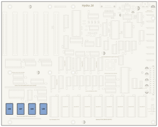
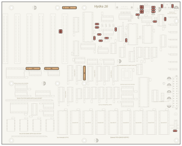
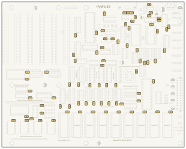
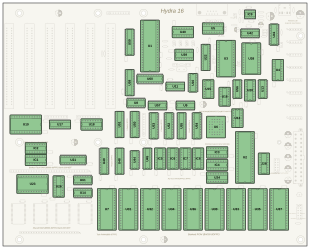
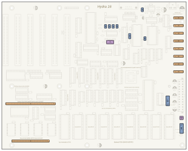
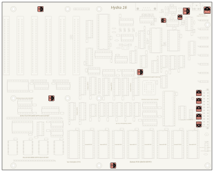
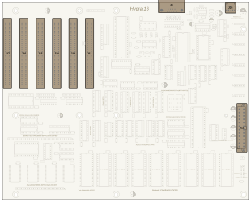
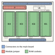
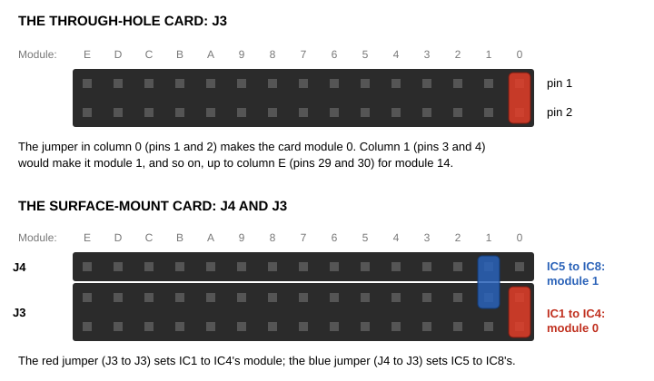
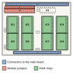

# Chapter 4. Building the Hydra, Step by Step

This is the chapter where your Hydra comes to life. You'll fit the parts in a careful order, test the board before
any chips go in, program the ROM chips, put the chips in their sockets, build the memory card, and connect the
power. Read the whole chapter once before you start, then come back and follow it step by step.

> **IN THIS CHAPTER:** You'll solder the main board in eight steps, test its power, program the ROM chips, fit the
> chips, set the jumpers, build a memory card, and wire the power. **You need:** all of Chapter 3; the kit and the
> tools; and fifteen to twenty hours, a little at a time.

> **CAUTION:** Never solder, insert chips, or change jumpers while the power supply is plugged in. Unplug it first,
> every time.

## 4.1 Getting ready

**Work in order.** The steps go from the lowest parts (the ones that sit closest to the board) to the tallest. If you
fit a tall part first, it gets in the way of the iron when you solder the small parts around it. When you put a part
in, turn the board over, and solder it, the board can rest on its taller parts... so do the short ones first.

**Hold parts in place.** When you turn the board over to solder, parts can fall out. Bend their leads outward a little
on the back of the board, or hold them with a piece of masking tape, or press the board face-down onto a piece of
foam so the parts are held against it.

**Solder one pin, then check.** For anything with many pins (sockets, headers, connectors), solder **one** pin at a
corner first. Then look at the part from the side: is it flat on the board, and straight? If not, melt that one joint
and push the part into place. Only when it's right, solder the opposite corner, and then all the rest.

**Tick them off.** Appendix I has a complete parts list with a box beside each part, and the *Student Companion*'s
build log has a box for every step. Tick each box as you fit the part. It's the best way to make sure nothing is
forgotten.

**Check the kit.** Before you start, sort the parts into groups (resistors, ceramic capacitors, electrolytic
capacitors, sockets, chips, connectors) and check them against the parts list. Leave the chips in their anti-static
foam until section 4.5.

## 4.2 Soldering the main board

Each step below has a drawing of the board with the step's parts coloured, so you can find their places. Every part's
place is also marked on the board itself, with its reference (like **R22**) printed beside it.

### Step 1: The shared RAM chips

<figure>

<figcaption>Figure 4-1. Step 1: the four surface-mount RAM chips.</figcaption>
</figure>

If your kit's shared RAM chips, **U25, U27, U28 and U29** (HM628512 chips in flat SOP packages), are already
soldered in, skip this step. Otherwise, solder them now, before anything else, following section 3.7. Each chip's
pin 1 matches the dot or bevelled corner on its outline. Inspect every leg with a magnifier before you go on.

### Step 2: The resistors and resistor networks

<figure>

<figcaption>Figure 4-2. Step 2: the resistors (red) and resistor networks (orange).</figcaption>
</figure>

Bend each resistor's leads at right angles, close to its body, so it fits its two holes, and push it down flat
against the board. Resistors can go either way round, but it's neat to point all their colour bands the same way.

| Value | Code | Parts |
|---|---|---|
| 22 Ω | 220 | R23, R24, R25, R26, R27 |
| 33 Ω | 330 | R30, R31 |
| 100 Ω | 101 | R3 |
| 330 Ω | 331 | R22 |
| 470 Ω | 471 | R2 |
| 10 kΩ | 103 | R4, R5, R6, R7, R13, R19, R20, R21, R28, R32, R33 |
| 1 MΩ | 105 | R1 |
| 0 Ω | 0 | R29 |

Then fit the four **resistor networks**. Their dotted end, the *common pin*, goes in the **square pad**:

| Value | Code | Parts |
|---|---|---|
| 3.3 kΩ | 332 | RN1, RN2, RN3 |
| 10 kΩ | 103 | RN4 |

### Step 3: The ceramic capacitors

<figure>

<figcaption>Figure 4-3. Step 3: the ceramic capacitors.</figcaption>
</figure>

There are 78 small ceramic capacitors, and they can go either way round. Most are 104s (0.1 µF), one beside each
chip. Push each one down as far as its leads allow.

| Value | Code | Parts |
|---|---|---|
| 33 pF | 330 | C47, C48 |
| 3.3 nF | 332 | C50, C52 |
| 100 nF | 104 | C1, C2, C3, C5, C6, C12 to C46, C57 to C64, C66 to C85 (68 in all) |
| 1 µF | 105 | C4, C7, C8, C9, C10 |
| 4.7 µF | 475 | C49 |

> **NOTE:** There is no C11 or C65 on the board, and no R8 to R12 or R14 to R18. Those numbers aren't used.

### Step 4: The chip sockets

<figure>

<figcaption>Figure 4-4. Step 4: the chip sockets.</figcaption>
</figure>

Now the sockets. **Match each socket's notch to the notch on the board's outline.** The socket doesn't care which way
it goes in, but the notch tells you, later, which way the chip goes. Solder two opposite corner pins first, check the
socket is flat on the board, then solder the rest.

| Socket | How many | Places |
|---|---|---|
| 8 pins | 1 | IC9 |
| 14 pins | 15 | U8, U9, U10, U11, U12, U13, U14, U15, U16, U39, U42, U44, U56, U57, U61 |
| 16 pins | 19 | IC1 to IC8, U4, U5, U17, U18, U20, U24, U26, U40, U41, U45, J28 |
| 20 pins | 13 | U21, U22, U48, U49, U50, U51, U52, U53, U54, U55, U58, U59, U60 |
| 24 pins (wide) | 3 | U19, U23, U38 |
| 28 pins (wide) | 1 | U3 |
| 32 pins (wide) | 9 | U7, U30 to U37 |
| 40 pins (wide) | 2 | U1, U2 |
| PLCC 32 (square) | 1 | U6 |

The **wide** sockets have their two rows of pins 15.24 mm (0.6 inch) apart; the others, 7.62 mm (0.3 inch).

The square **PLCC socket** for U6 has a bevelled corner: match it to the bevelled corner of U6's outline.

### Step 5: The crystal, the reset chip, and the headers

<figure>

<figcaption>Figure 4-5. Step 5: the crystal and reset chip (purple), the pin headers (blue), and the pin sockets (orange).</figcaption>
</figure>

* **Y1**, the 14.31818 MHz crystal. Either way round. Solder it quickly, without heating its can.
* **U43**, the DS1813 reset chip. Its **flat side** matches the flat side of its outline.
* **The pin headers**: J5, J6, J7 and J8 (2 pins each, the clock jumpers), J9 (2 pins), J29 (2 pins), J30 (3 pins),
  J10 (the front panel, 2 rows of 6) and J27 (the I/O header, 2 rows of 6). Solder one pin of each, check that it
  stands straight up, then solder the rest.
* **The pin sockets**: J18 to J25 (the SPI devices, 6 holes each), and J1 (32 holes) and J2 (24 holes) for the
  memory card. Make sure J1 and J2 are perfectly straight; the memory card plugs into both at once.

### Step 6: The electrolytic capacitors

<figure>

<figcaption>Figure 4-6. Step 6: the electrolytic capacitors.</figcaption>
</figure>

**These must go the right way round.** The longer leg is plus (+), and the stripe on the side marks minus (−). Match
the plus leg to the **+** on the board.

| Value | Code | Parts | Polarity |
|---|---|---|---|
| 10 µF | 106 | C90, C91 | Yes |
| 47 µF | 476 | C86, C87, C88, C89 | Yes |
| 100 µF | 107 | C51, C53, C54, C55, C56 | Yes |
| 220 µF non-polarized | 227 NP | C92, C93 | No: either way |

Check every one twice before you solder it.

### Step 7: The big connectors

<figure>

<figcaption>Figure 4-7. Step 7: the connectors.</figcaption>
</figure>

Last come the tallest parts:

* **J3**, the 9-pin serial connector. Solder its two big mounting lugs as well as its nine pins.
* **J26**, the audio jack.
* **J12 to J17**, the six expansion slots. Each has 62 pins. Solder the two end pins first and check that the slot
  is flat and straight, then solder the rest. Take your time: that's 372 joints!
* **J11**, the 24-pin ATX power connector. Match its latch to the outline printed on the board. These pins carry the
  most current on the board, so make sure each joint is full and shiny.

### Step 8: Inspect and clean

Now go over the whole back of the board with a magnifier, slowly, row by row. Look for joints you forgot, bridges
between neighbouring pins, and dull or lumpy joints. Fix anything you find. Then clean the flux off with isopropyl
alcohol and let the board dry.

## 4.3 The first power test

Before any chips go in, test the power. If something is wrong, a test now protects your chips.

**Check for short circuits.** Set your multimeter to measure resistance (ohms). Touch one probe to pin 8 of the U1
socket (the processor's +5 V pin) and the other to pin 21 (its ground pin). You should read *more* than about 100
ohms; the reading may slowly climb as the capacitors charge from the meter. A reading close to zero means a short
circuit between +5 V and ground: look for a solder bridge, or an electrolytic capacitor in backwards, before going
on.

**Connect the power supply and a switch.** Section 4.8 shows how: turn to it now, plug the ATX power supply into J11,
connect a power switch to J10, and come back here.

**Measure the voltages.** Switch on. Set the multimeter to DC volts, hold the black probe on pin 21 of the U1 socket
(ground), and touch the red probe to each of these socket pins in turn:

| Red probe on | Measures | Should read |
|---|---|---|
| U1 socket, pin 8 | +5 V, for the chips | +4.75 to +5.25 V |
| U42 socket, pin 4 | +12 V, for the sound circuit | about +12 V |
| U42 socket, pin 11 | −12 V, for the sound circuit | about −12 V |

If the power light is wired up (section 4.8), it lights.

Switch off again. If anything got hot or smelled of burning, or a voltage was missing, don't go on: find the problem
first. Appendix I and Chapter 5's troubleshooting section can help.

## 4.4 Programming the ROM chips

HydraOS lives in four flash ROM chips. If your kit's ROM chips came already programmed (they should have labels on
them), skip to section 4.5.

To program them yourself you need a **flash programmer** that connects to your PC by USB and supports SST39SF
chips, such as the XGecu TL866II Plus or T48, and its software. For the PLCC chip you'll also need the programmer's
**PLCC-32 adapter**.

The files are in the HydraOS folder `reborn/bin` (see Chapter 2):

| File | Chip type | Goes in | What it holds |
|---|---|---|---|
| `bios.bin` | SST39SF010A (128K, PLCC-32) | **U6** | The kernel, the heart of HydraOS |
| `prom0.bin` | SST39SF040 (512K, DIP-32) | **U31** | The paged ROM, part 1 |
| `prom1.bin` | SST39SF040 (512K, DIP-32) | **U32** | The paged ROM, part 2 |
| `prom2.bin` | SST39SF040 (512K, DIP-32) | **U34** | The paged ROM, part 3 |

Together, the three paged ROM chips hold the drivers, the shells, the languages and the ROM disk's files.

> **CAUTION:** Look at the serial chip, U3, before you program anything. The Hydra was designed for Rockwell's
> **R65C51**, and the files in `reborn/bin` are for it. But Rockwell stopped making it long ago, so your kit
> probably has WDC's **W65C51N** instead. That chip has a fault in the way it reports that it's ready to send, and
> HydraOS must be built to work around it: build HydraOS yourself (section 2.7) with
> `node reborn/build.js --acia wdc`, and program the files that makes. With the wrong files, the Hydra starts but
> its serial port sends nothing, or sends nonsense.

For each chip:

1. In the programmer's software, choose the chip type (for example *SST39SF040* or *SST39SF010A*).
2. Load the file.
3. Put the chip in the programmer (the PLCC chip in its adapter) with pin 1 where the programmer's picture shows it.
4. **Program** the chip, with *Verify* turned on. The software erases it, writes it, and reads it back to check.
5. Put a **label** on the chip with its file's name and its place (for example "prom1 → U32").

> **NOTE:** The other five paged ROM sockets, U30, U33, U35, U36 and U37, stay empty. They are there for HydraOS to
> grow into: the board can hold up to 4 MB of ROM.

> **TIP:** If you can only get a 512K SST39SF040 in a PLCC package for U6, you can use it instead of the 128K
> SST39SF010A, but you must program `bios.bin` into it **four times**: at addresses $00000, $20000, $40000 and
> $60000. (Most programmer software can load a file at a given address.) The board doesn't clear two of the chip's
> extra address lines when it starts, so the processor might start in any of the four copies.

## 4.5 Putting in the chips

> **CAUTION:** Put on your anti-static wrist strap. And check twice that the power supply is unplugged.

Chips' legs are made a little wider apart than their sockets, to grip them firmly. To straighten them, hold the chip
by its ends, rest one whole row of legs flat on the table, and gently roll the chip until the legs are straight up
and down. Do the other side the same way. Then:

1. Turn the chip so **its notch matches the socket's notch**.
2. Line up all its legs with the socket's holes, and check that none are folded under.
3. Press it straight down, firmly, with your thumb on the middle of the chip.
4. Look at all the legs from the side: each one should be in its hole, with none bent outward or under.

Put each chip in the socket with its reference:

| Chip | Places |
|---|---|
| W65C02S (processor) | U1 |
| R65C22 or W65C22N (VIA) | U2 |
| R65C51 or W65C51N (ACIA, serial) | U3 |
| MAX232 (serial levels) | U5 |
| SST39SF010A, programmed with `bios.bin` | U6 |
| HM628512 (task RAM), or a DS1747 for a real-time clock | U7 |
| SST39SF040, programmed with `prom0.bin`, `prom1.bin`, `prom2.bin` | U31, U32, U34 |
| YM2151 (sound) | U38 |
| YM3012 (sound converter) | U41 |
| TL074 (op-amps) | U42 |
| NJM4556A (headphone amplifier) | IC9 |
| SP720 (protection for the I/O header) | J28 |
| 74F138 | U4, U20, U24 |
| 74LS260 | U8, U9 |
| 74F20 | U10 |
| 74ACT08 | U11 |
| 74F86 | U12 |
| 74F32 | U13, U16, U56 |
| 74F30 | U14 |
| 74F00 | U15, U44 |
| 74LS148 | U17, U18 |
| 74LS154 | U19, U23 |
| 74F541 | U21, U49, U51, U53, U55, U58, U60 |
| 74ACT240 | U22 |
| 74F139 | U26 |
| 74ACT14 | U39 |
| 74F191 | U40 |
| 74F157 | U45 |
| 74F573 | U48, U50, U52, U54 |
| 74F02 | U57 |
| 74ACT245 | U59 |
| 74F125 | U61 |
| 74LS219 | IC1 to IC8 |

> **NOTE:** U3, the serial chip, can be a Rockwell **R65C51** or WDC's **W65C51N**, as long as the ROM chips were
> programmed for it (section 4.4). U2, the VIA, is a Rockwell **R65C22** on the schematic. It's out of production too,
> and WDC's **W65C22N** is a drop-in replacement that needs no change to HydraOS.

> **CAUTION:** Read each chip's markings carefully: some chips look alike. A 74F08 isn't a 74ACT08, and a 74LS139
> isn't a 74F139, even though they have the same number of pins. The letters between the "74" and the number tell
> you the chip's *family*, and the Hydra needs exactly the families in this table.

The **DS1747** is a special RAM chip with a built-in clock and battery, which fits U7's socket instead of the
HM628512. With it, the Hydra always knows the date and time, even when switched off. Without it, the Hydra's clock
starts at midnight on January 1, 2000 every time you switch on.

## 4.6 Setting the jumpers

A **jumper** is a tiny plastic cap with a metal clip inside. Pushed onto two pins of a header, it connects them.

**The clock jumpers, J5 to J8.** Fit **one** jumper, on **J7**, for the normal speed, 3.58 MHz.

| Jumper | Clock speed | Notes |
|---|---|---|
| J5 | 0.89 MHz | Very slow: for testing |
| J6 | 1.79 MHz | Slow: for testing |
| **J7** | **3.58 MHz** | **Normal** |
| J8 | 7.16 MHz | Not with these parts: see below |

> **CAUTION:** Fit only **one** clock jumper at a time. Two jumpers would connect two different clocks together.

The kernel needs to know how fast the processor runs, to keep time and run the serial port, and the ROM images are
built for 3.58 MHz. **With the parts in Appendix I, 3.58 MHz is the fastest speed the Hydra works at.** At J8's
7.16 MHz the memory chips and the bank registers can't answer within the processor's shorter cycle, and the self test
fails nearly every RAM test. J8 is there for a future board with faster parts, which would also need HydraOS built
for it (`node reborn/build.js --clock 2`). The two slower speeds, J5 and J6, work, but the clock and the serial port
then run slow (section 5.7).

**J30, the serial port's CTS.** Fit a jumper on pins **1 and 2** (the normal setting). If your serial cable has only
three wires (send, receive and ground), move the jumper to pins 2 and 3.

**J9 and J29: no jumpers.** J9 brings out two spare outputs of the sound chip, called CT1 and CT2, for your own
experiments. J29, *Audio In*, lets you mix sound from another device into the Hydra's sound (Chapter 15 shows how).
Never put a jumper on either of them.

## 4.7 The memory card

The **memory card** is a small board that plugs into J1 and J2 on the main board, and holds the Hydra's extra RAM.
Its RAM chips make up a **RAM module**: four 512K chips, 2 MB in all. A module gives each of the Hydra's sixteen
tasks 128K more memory of its own.

There are two kinds of memory card:

* The **through-hole card** has one module, in four chip sockets (Figure 4-8). This is the one to build first.
* The **surface-mount card** has two modules: eight RAM chips soldered to the card (Figure 4-10).

<figure>

<figcaption>Figure 4-8. The through-hole memory card.</figcaption>
</figure>

### Building the through-hole card

The card's parts are marked on it with their references, just like the main board's:

| Part | What it is |
|---|---|
| C1 to C5 | 100 nF ceramic capacitors (104) |
| U1 | 74LS139 chip (soldered straight to the card, or in a 16-pin socket if you have one) |
| IC1 to IC4 | 32-pin wide sockets, for the HM628512 RAM chips |
| J3 | Pin header, two rows of 15: the module number |
| J1 | Pin header, one row of 32: the connector to the main board |
| J2 | Pin header, one row of 24: the connector to the main board |

1. Fit and solder C1 to C5.
2. Fit U1 (or its socket), matching its notch to the outline.
3. Fit the four 32-pin sockets, matching their notches.
4. Fit J3, with its short pins through the card and its long pins standing up.
5. **J1 and J2 are fitted upside down**: their long pins point *down*, out of the bottom of the card, to plug into
   the main board. Here is an easy way to get them perfectly lined up. Push the long pins of the two headers into
   the main board's J1 and J2 sockets, so their short ends point up. Lower the card onto them, chips' side up, so the
   short ends come up through the card's J1 and J2 holes: the card's J1 over the main board's J1, and its J2 over
   J2. Now solder the headers from the top of the card. The main board holds them straight while you solder.
6. Lift the card off, inspect and clean it, and put the four RAM chips in their sockets, matching their notches.

### Setting the module number

Every RAM module has a number, from 0 to 14, set by a jumper on the card. When you have more than one module, each
one must have a different number. (They don't have to be in order: modules 0, 1 and 5 work just as well as 0, 1
and 2.)

On the through-hole card, the jumper goes on **J3**, across its two rows, in the column for the module's number.
The card has the numbers printed beside J3, in hex (section 1.6): 0 to 9 and then A to E, for 10 to 14.

**For your first memory card, put the jumper in column 0 (pins 1 and 2): module 0.**

<figure>

<figcaption>Figure 4-9. Setting the module numbers.</figcaption>
</figure>

### The surface-mount card

<figure>

<figcaption>Figure 4-10. The surface-mount memory card.</figcaption>
</figure>

The surface-mount card's eight RAM chips are soldered the same way as the main board's shared RAM chips in Step 1
(section 3.7 shows how). It has two modules, so it needs two module numbers, and two jumpers:

* **IC1 to IC4**: a jumper across J3's two rows, in the column for the module's number, just like the through-hole
  card.
* **IC5 to IC8**: a jumper from **J4**, the single row of pins beside J3, to the J3 pin next to it, in the column
  for the module's number.

Give the two modules different numbers, such as 0 and 1 (Figure 4-9).

### More than one card

The memory cards stack, one on top of another: each card's pins plug into the card below it. To build a card that
another card will plug into, use **stacking headers** for its J1 and J2 instead of plain pin headers. A stacking
header has a socket on top and long pins underneath. Fit them from the top of the card, so the long pins pass right
through the card and point down; then solder them underneath. The top card of the stack can use plain headers.

Remember: every module in the stack needs its own number.

### Plugging in the card

With the power off, push the memory card's J1 and J2 pins straight down into the main board's J1 and J2 sockets,
evenly, until the card is fully seated. When the Hydra starts, it tests every module it finds, and counts them. With
one module, it prints:

```text
RAM modules: 01
```

The count is in hex, so with three modules it prints `03`, and with eleven, `0B`.

## 4.8 Power, switch, reset and light

### The power supply

The Hydra uses a standard **ATX power supply**, the kind found in desktop PCs. Plug its 24-pin connector into
**J11**. (A supply with a "20+4" connector works too; keep the two parts together.) The Hydra uses the supply's
+5 V for everything, and its +12 V and −12 V for the sound circuit and the expansion slots.

An ATX supply doesn't turn on just because it's plugged into the wall: its **PS_ON** wire must be connected to ground.
On the Hydra, that wire comes to the front-panel header, J10.

### The front-panel header, J10

J10 has two rows of six pins. Pin 1 has a square pad; the odd-numbered pins are in one row and the even-numbered
pins in the other:

| Pins | What to connect |
|---|---|
| **11 and 9** | **Power switch.** A switch that *stays on* (a toggle or latching switch) between pins 11 and 9 turns the supply on and off. |
| **7 and 5** | **Reset button.** A push button between pins 7 and 5 resets the Hydra. |
| **12 (+) and 10 (−)** | **Power light.** An LED: its longer leg (+) to pin 12, its shorter leg (−) to pin 10. Its resistor is already on the board. |
| 8 | +5 V, for your own front-panel gadgets |
| 5, 6, 9, 10 | Ground |
| 1, 2, 3, 4 | Not used |

> **NOTE:** Use a switch that stays in place, not a push button. A PC's push button only "taps" its motherboard, which
> remembers whether the power should be on; the Hydra needs the switch to *stay* closed for as long as it's on. If you
> have no switch yet, a jumper across pins 11 and 9 works too; then use the switch on the back of the power supply.

> **CAUTION:** An ATX power supply has dangerous voltages inside. Never open its case.

## 4.9 Ready to go

Before you switch on for the first time, check:

* Every chip is in the right socket, the right way round, with no legs bent.
* The ROM chips are programmed and in U6, U31, U32 and U34.
* One clock jumper is on J7, and the J30 jumper is on pins 1 and 2.
* The memory card is plugged in, with its module jumper set.
* The power supply is plugged into J11, and the power switch into J10.

**The SD card reader.** If you have an SD card module, this is the time to connect it: six wires, to the SPI header
J18. Section 14.2 has the wiring, and shows how to get a new card ready. To start with HydraOS's sample card (its
example programs and songs), write its image, `reborn/bin/sdcard.img`, onto a card with your PC first (section 2.6).

Now turn to Chapter 5, connect the Hydra to your PC, and switch it on!
