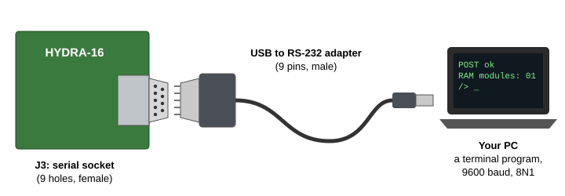

# Chapter 5. Switching On

Your Hydra is built. In this chapter you'll connect it to a PC, switch it on, watch it start, and check that it's all there. If something doesn't work, the last part of the chapter will help you find out why.

> **IN THIS CHAPTER:** You'll connect the Hydra to a PC, set up a terminal program, switch on, read the start-up
> messages, and find the fault if there is one. **You need:** a built Hydra (Chapter 4), a PC, and a USB to RS-232
> adapter. If you're using the emulator, skip to Chapter 6.

## 5.1 Talking to the Hydra

The Hydra doesn't need a screen and keyboard of its own. It talks to you through its **serial port**, J3: a
connector that sends and receives letters one *bit* at a time, down a cable, to a PC. On the PC, a **terminal
program** shows what the Hydra sends, and sends the Hydra what you type. The PC becomes the Hydra's screen and
keyboard.

(With a Vera X card in slot 0, the Hydra can have a screen and a keyboard of its own too. Chapter 16 shows how.)

<figure>

<figcaption>Figure 5-1. Connecting the Hydra to a PC.</figcaption>
</figure>

**The cable.** Modern PCs don't have serial ports any more, so you need a **USB to RS-232 adapter**: a cable with a
USB plug at one end and a 9-pin serial plug at the other. Its 9-pin plug has pins (it's *male*), and it pushes
straight into the Hydra's J3 socket. Tighten its two screws, gently.

> **CAUTION:** Be sure the adapter says **RS-232**. Some adapters, often sold for robot kits and small computer
> boards, are "TTL" or "3.3 V" serial adapters, with loose wires or a row of pins instead of a 9-pin plug. They use
> different voltages, and won't work with the Hydra's serial port.

If the adapter's cable doesn't reach, you can put a serial **extension cable** (a "straight-through" cable, with pins
at one end and holes at the other) between them. Don't use a **null-modem** cable: it swaps the wires over, and the
Hydra and the PC won't hear each other.

**Finding the port.** When you plug the adapter into the PC, the PC gives it a name:

| On | The port is called | Where to find it |
|---|---|---|
| Windows | `COM3`, `COM4`, ... | *Device Manager*, under *Ports (COM & LPT)* |
| macOS | `/dev/tty.usbserial-...` | type `ls /dev/tty.*` in the Terminal app |
| Linux | `/dev/ttyUSB0` | type `ls /dev/ttyUSB*` in a terminal |

## 5.2 A terminal program

You can use the Hydra's own **PC tool**, or almost any terminal program.

### The Hydra PC tool

The PC tool comes with HydraOS. It's a terminal, and it does one more thing: it lets the Hydra use a folder on
your PC as if it were one of its own disks, called `/pc` (Chapter 9). It needs Node.js, which you installed in
Chapter 2. The first time, install the part it uses to talk to serial ports:

```text
cd hydra-16/reborn/sim
npm install
```

Then, to see the PC's serial ports:

```text
node tools/hydrapc.js --list
```

and to start it, give it the port and a folder on your PC for the Hydra to use:

```text
node tools/hydrapc.js COM3 C:\hydra-files
```

In place of the folder you can give it an SD card **image file** (section 2.6):

```text
node tools/hydrapc.js COM3 C:\hydra-files\mycard.img
```

Then `/pc` is that card: the Hydra sees the files in the image, and what it writes there goes into the image. It's
a way to look at, or fill, a card's image from a real Hydra with no card reader on the PC, and to keep a set of
work in one file. The image is complete on your PC whenever the Hydra isn't writing to it, so you can copy it, or
write it to a real card (Appendix H). Don't open the same image in an emulator at the same time.

Everything you type now goes to the Hydra. The PC tool's own keys start with <kbd>CTRL</kbd>-<kbd>A</kbd>:

| Keys | What they do |
|---|---|
| <kbd>CTRL</kbd>-<kbd>A</kbd> then <kbd>X</kbd> | Quit the PC tool |
| <kbd>CTRL</kbd>-<kbd>A</kbd> then <kbd>L</kbd> | Turn the log on or off: a list of the Hydra's file requests |
| <kbd>CTRL</kbd>-<kbd>A</kbd> then <kbd>S</kbd> | Say the counts so far: the Hydra's requests, and any that came damaged, stopped part-way or had to be answered again (a bad cable shows here) |
| <kbd>CTRL</kbd>-<kbd>A</kbd> then <kbd>CTRL</kbd>-<kbd>A</kbd> | Send a <kbd>CTRL</kbd>-<kbd>A</kbd> to the Hydra |

It can also take these options, after the folder:

| Option | What it does |
|---|---|
| `--read-only` | The Hydra can read the folder's files (or the image's), but not change them |
| `--baud N` | The serial port's speed (9600 unless you say) |
| `--log` | Start with the log on (it lists what the Hydra asks for, and any frame that came damaged) |
| `--no-size` | Don't tell the Hydra the size of the window |
| `--win32-input` | For Windows Terminal: lets keys like <kbd>CTRL</kbd>-<kbd>TAB</kbd> reach the Hydra |

### Other terminal programs

Any terminal program that can use a serial port works too: **PuTTY** or **Tera Term** on Windows, or `screen` or
`minicom` on macOS and Linux. Set it up like this:

| Setting | Set it to |
|---|---|
| Speed (baud) | **9600** |
| Data bits | 8 |
| Parity | None |
| Stop bits | 1 |
| Flow control | **XON/XOFF** |
| Terminal type | VT100 or xterm |

The first four are often written **9600 8N1**. In PuTTY, choose *Serial* as the connection type, type the port's
name (like `COM3`) and the speed, and set *Connection → Serial → Flow control* to *XON/XOFF*. On macOS or Linux,
`screen /dev/ttyUSB0 9600,ixon` starts `screen` on the port (to leave it, press <kbd>CTRL</kbd>-<kbd>A</kbd>, then
<kbd>K</kbd>, then <kbd>Y</kbd>).

> **HOW IT WORKS:** **Flow control** is how the Hydra says "wait!" when keys come faster than it can take them,
> as they do when you paste a page of text. It sends one byte, called **XOFF**, to ask the terminal to stop, and
> another, **XON**, when it's ready for more. A terminal set to *XON/XOFF* obeys them, and nothing you paste is
> lost. With flow control set to *None* everything else still works, but a long paste may lose its end (section
> 13.6). The PC tool obeys XON and XOFF without being told.

> **HOW IT WORKS:** The Hydra's serial chip sends only while its *CTS* ("clear to send") line is on, and that line
> comes from the PC's *RTS* ("request to send"). The PC tool and most terminal programs turn RTS on as they open the
> port. If yours doesn't, move the jumper on J30 to pins 2 and 3, which turns CTS on for good.

## 5.3 Switching on

Start the terminal program first, and then switch on the Hydra. The power light comes on, and in about a second
the Hydra starts to talk:

<!-- session --boot
-->

```session
Hydra-16: kernel 0.1, ABI 1
POST ZP:0 ST:0 OS:0 HI:0 SH:S W:0
RAM U:0 F0:0/00/0000 F4:0/00/0000 F8:0/00/0000 FC:0/00/0000 00:0/00/0000 10:0/00/0000 20:0/00/0000
POST ok
RAM modules: 03
task F: cons
task E: storage
task D: kdev
task C: snd
task B: vid
task 1: init
HydraOS 1.0 for the Hydra-16
init: up in task 01
T ST FL PA CPU    NAME
0 01 00 FF 00004C kernel
1 01 00 FF 00001A init
C 04 01 FF 000004 snd
D 06 01 FF 00000D kdev
E 04 01 FF 000078 storage
F 08 01 FF 000043 cons
hello, from init
init: hello ended: code $07 (bye)
HyForth (Forth 2012), bye to end
/>
```

Congratulations: you've built a computer! Here's what the messages mean (Chapter 7 tells the whole story):

| Message | What it means |
|---|---|
| `Hydra-16: kernel 0.1, ABI 1` | The **kernel**, the heart of HydraOS, has started. |
| `POST ...` and `RAM ...` | The **power-on self test** has checked the Hydra's memory. A `0` everywhere means all is well... |
| `POST ok` | ...and so does this. |
| `RAM modules: 03` | It found three RAM modules, on the memory card. (Yours may have one or two.) |
| `task F: cons` ... `task B: vid` | The **drivers** have started: the programs that look after the Hydra's devices. (`vid` looks for a Vera X card and, finding none, ends at once, which is why task B isn't in the list below: section 7.4.) |
| `task 1: init` | The first program, **init**, has started. It sets up the system. |
| `HydraOS 1.0 for the Hydra-16` | HydraOS is running. |
| The table and `hello, from init` | A little program called **hello** says hello, and shows the tasks running. |
| `init: hello ended: code $07 (bye)` | hello has finished, as it should. It always ends with the code 7 and the word `bye`, so init can tell that a program ran from start to end. |
| `HyForth (Forth 2012), bye to end` | **HyForth**, the shell, has started, ready for your commands. |
| `/>` | The **prompt**: the Hydra is waiting for you to type. |

> **NOTE:** The numbers in the `CPU` column may be a little different on your Hydra. They count how much work each
> task has done so far.

## 5.4 Is it all there?

Type `date` and press <kbd>RETURN</kbd>. If the Hydra answers, its keyboard side works too:

```session
/> date
2000-01-01 00:00:04
```

The Hydra keeps the time, but without a clock chip (section 4.5) it doesn't know the date, so its clock starts at
midnight on January 1, 2000, each time you switch on. Chapter 11 shows how to set it.

Now ask it how much memory it found. `free` shows the memory each task can have, and the memory they share. This
Hydra has a memory card with three RAM modules:

```session
/> free
ram     384 KB a task (3 modules)
shared  1024 KB, 512 KB in segments (1), 512 KB free
```

Each RAM module gives every task 128 KB, so one module shows `128 KB a task (1 module)`, and two show 256 KB. If
the number of modules is less than the number you fitted, see section 5.7.

> **NOTE:** The board has 2 MB of shared RAM, but `free` shows 1024 KB. That's the half HydraOS hands out to
> programs, in pieces called *segments*: a segment is a stretch of the shared RAM that one program, or several
> together, can use (section 17.9 has more). One segment is in use already: the RAM disk `/sram`, of 512 KB.
> HydraOS 1.0 keeps the other half of the shared RAM in reserve.

Your Hydra works. **Chapter 6, First Steps**, is where you learn to use it: turn there now. The rest of this chapter
is about the serial line's speed, switching off, and what to do when something isn't right.

## 5.5 A faster line

At 9600 baud, the serial port sends about 900 letters a second: a screenful takes two seconds. It can go more than
ten times faster. Type:

```text
/> echo b115200 >/dev/serctl
```

Then switch your terminal program to 115200 baud too. (In the PC tool, quit with <kbd>CTRL</kbd>-<kbd>A</kbd>
<kbd>X</kbd> and start it again with `--baud 115200`.) The Hydra always starts at 9600, so you'll need to do this
each time you switch on. Chapter 13 shows the other speeds.

> **HOW IT WORKS:** The serial chip's speeds come from a clock of 1.79 MHz, and its speeds are about 3% slower than
> their names: "9600" is really 9,322 bits a second. That's close enough for a PC's serial port, which allows for
> small differences like this.

## 5.6 Switching off

You can switch the Hydra off at any time, but first:

* **Save your work, and finish with the files you're changing.** If you're in an editor, save and quit. A program
  writing to an SD card finishes the job as it closes the file.
* **Copy anything you want to keep off the RAM disks**, `/ram` and `/sram` (Chapter 9). They're made of memory, and
  they're empty again each time the Hydra starts.

The **reset button** starts the Hydra again without switching it off: it's the button to press when a program has
gone wrong and won't stop. A reset empties the RAM disks too.

## 5.7 When something goes wrong

Don't worry if your Hydra doesn't work the first time: most home-built computers don't! Finding out why is part of
the fun, and you'll learn a lot about how the Hydra works. **Always switch off before you touch the board.**

### Nothing appears in the terminal

1. Is the **power light** on? If not, check the power supply, its plug in J11, and the switch on J10.
2. Is the terminal program using the right **port**, at **9600** baud? Unplug the adapter and plug it in again, and
   check which port appears.
3. Was U6 programmed with the kernel ROM for your serial chip, U3 (section 4.4)? An R65C51 needs `bios_rockwell.bin`,
   a W65C51N `bios_wdc.bin`.
4. Is the cable a straight-through one, not a null-modem cable?
5. Press the **reset button**. The messages should appear again.
6. Try the jumper on **J30** on pins 2 and 3 (section 5.2).
7. Is there exactly one **clock jumper**, on J7?
8. Check the chips the Hydra needs to start: U1 (the processor), U6 (the kernel ROM), U3 and U5 (the serial port),
   U39 and U40 (the clock) and U43 (the reset chip). Are they in the right sockets, the right way round, with no
   legs bent under?
9. Then check the **address decoder**: U4, U8 to U16 and U19 to U22 (Appendix I). These small logic chips work out
   which chip answers each address, so one of them in the wrong socket, or backwards, can keep the ROM or the serial
   chip from ever being heard. Many of them look alike: read the number printed on each, and compare it with the
   number printed on the board beside its socket.
10. Check the joints on the back of the board around those chips, and around J3.

### Letters appear, but they're nonsense

The terminal's speed doesn't match the Hydra's. Set it to 9600 baud, 8N1, and press reset. If that doesn't help,
check the clock jumper: on J5 or J6 the Hydra runs slower, and its serial port does too.

### POST finds faults

When the power-on self test finds a fault, it says so instead of `POST ok`:

```text
POST found faults: shared RAM
```

The Hydra goes on starting if it can, leaving any bad memory unused, but you should find the fault. The numbers on
the `POST` and `RAM` lines point to it. Each one that isn't `0` is a fault (Chapter 7 explains them all):

| Part of the line | It tests | If it isn't 0, check |
|---|---|---|
| `ZP` `ST` `OS` `HI` | Keeping the tasks' memory apart | U7 (the task RAM), U21, and U48 (the task register) |
| `SH:X` (not `S`) | Sharing memory between tasks | The shared RAM chips U25, U27, U28, U29 |
| `W` | The kernel ROM's pages | U6 |
| `U` | The U register's lines to the shared RAM | The shared RAM chips, and their joints |
| `F0:` `F4:` `F8:` `FC:` | Each of the four shared RAM chips | U25, U27, U28, U29 |
| `00:` `10:` ... | Each RAM module | The memory card and its chips |

### `RAM modules: 00`

The Hydra didn't find a memory card. Is the card pushed all the way into J1 and J2? Is there a jumper on its J3?
Are its RAM chips in their sockets the right way round?

### The hardware test

HydraOS has a **hardware test** that checks each part of the Hydra in turn. There are two ways to start it:

* Hold down the <kbd>T</kbd> key in the terminal program, and press and let go of the reset button. Keep holding
  <kbd>T</kbd> until the test's menu appears. (This works even if HydraOS can't start.)
* Or, at the prompt, type `hwtest`.

The test shows a menu. Press <kbd>A</kbd> to run all its quick tests:

<!-- session-script --cycles 1500
hwtest
!quiet
!raw A
!wait 600
!end hwtest: all passed
-->

```session
/> hwtest
hwtest: the system starts again, into the hardware test

Hydra-16: kernel 0.1, ABI 1
POST ZP:0 ST:0 OS:0 HI:0 SH:S W:0
RAM U:0 F0:0/00/0000 F4:0/00/0000 F8:0/00/0000 FC:0/00/0000 00:0/00/0000 10:0/00/0000 20:0/00/0000
POST ok


Hydra-16 hardware test
It overwrites all of memory, and ends with a reset (R).
A  all tests (quick)   F  all, full memory   L  all, until a key   R  reset
1  CPU                   2  T U V W registers      3  shared RAM
4  RAM bank registers    5  task RAM               6  RAM modules
7  BIOS ROM              8  paged ROM              I  interrupts
V  VIA                   Y  sound chip (YM2151)    K  CPU clock
S  serial port (ACIA)    P  SPI devices            C  I2C bus
X  slot cards            H  hold a task (probe)
> A
CPU ................ ok
T U V W registers .. ok
shared RAM ......... ok
RAM bank registers . ok
task RAM ........... ok
RAM modules ........ 0 1 2 ok
BIOS ROM ........... ok
paged ROM .......... ok
interrupts .........   ok
VIA ................ ok
sound chip (YM2151) . ok
CPU clock .......... 3.58 MHz (first 16397, next 129) ok
serial port (ACIA) .    9600 baud ok
SPI devices ........ SD cards 0 ok
I2C bus ............ no devices ok
slot cards ......... all empty ok
hwtest: all passed
```

A test that fails says what it found, which tells you where to look. To leave the hardware test, press <kbd>R</kbd>:
the Hydra starts again. (The test uses all of the Hydra's memory, so anything in memory is lost.)

> **TIP:** If you get stuck, take a break, and then check the board again slowly with a magnifier, one joint at a
> time. A fresh pair of eyes, a friend's or your teacher's, often spots in a minute what you've looked past for an
> hour.
