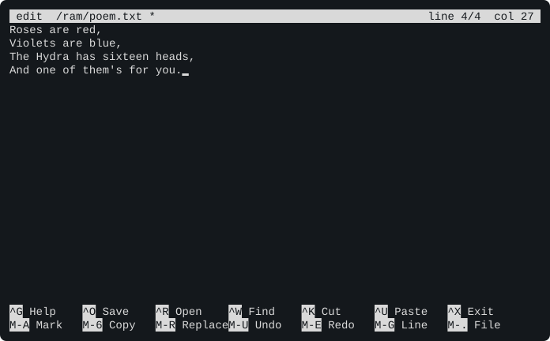
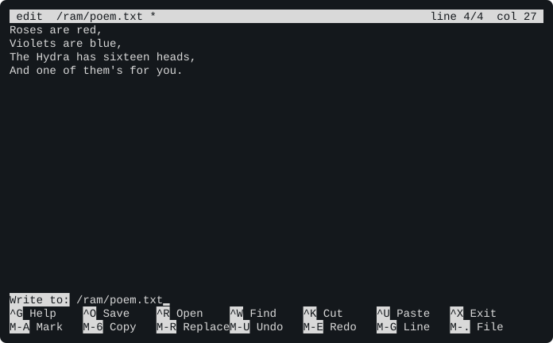

# Chapter 6. First Steps

You have a Hydra in front of you: a real one you've just switched on (Chapter 5), or the emulator on a PC (Chapter
2). Either way, it's showing you this, and waiting:

```text
/>
```

This chapter is your first hour with it. There's almost no theory here, just things to type. The chapters after
this one explain *why* it all works; this one makes sure you can find your way around, fix a mistake, save your work
and get out of trouble.

> **IN THIS CHAPTER:** You'll type your first commands, see what a mistake looks like and how to get out of one, make
> a file and keep it, run the sample programs, and say hello in three programming languages. **You need:** a Hydra
> at its `/>` prompt. Nothing else.

## 6.1 The prompt

The `/>` is the **prompt**. It's the Hydra's way of saying "your turn". You type a line, press <kbd>RETURN</kbd>,
the Hydra does what the line says, prints its answer, and shows the prompt again. That's the whole conversation, and
everything in this book is built from it.

The program that prints the prompt and reads your lines is called the **shell**. The `/` in the prompt tells you
where you are among the Hydra's files (section 6.5); the `>` is just a pointer to where your typing goes.

> **NOTE:** You can't hurt the Hydra by typing. Its system is kept in ROM chips, which a program can't change. If
> you get into a muddle that you can't get out of, press the reset button (in the web emulator, the **Reset**
> button), and the Hydra starts again, as good as new. So try things!

## 6.2 Your first commands

Type `date` and press <kbd>RETURN</kbd>:

```session
/> date
2000-01-01 00:00:04
```

`date` is a **command**: the name of a program. The Hydra found the program, ran it, and the program printed the
date and the time. (A Hydra without a clock chip starts its clock at midnight on January 1, 2000 each time it's
switched on. If yours shows today's date, it has a clock chip, as the web emulator's Hydra does.)

Most commands take more words after their name, which tell them what to work on. They're called **arguments**, and
there's a space between each. `echo` prints its arguments back to you:

```session
/> echo Hello, Hydra!
Hello, Hydra!
```

`ls` lists files. With no arguments, it lists the files where you are:

```session
/> ls
bin/
dev/
env/
lib/
mnt/
pc/
proc/
ram/
rom/
sd/
sram/
tmp/
```

Each name that ends with a `/` is a **directory**: a folder, with more files inside. Give `ls` a directory's name,
and it lists what's in there. The SD card is the directory `/sd/0`:

```session
/> ls /sd/0
bench/
sample/
songs/
```

And the Hydra can do arithmetic. Its shell is also a programming language called HyForth, where the numbers come
first, then what to do with them, and `.` ("dot") prints the answer:

```session
/> 2 3 + .
5
```

That looks back to front, but there's a good reason for it, which Chapter 19 explains. For now, notice the spaces:
each number and each sign is a separate word.

> **TRY THIS:** Type `free` to see how much memory your Hydra has, `ps` to see the programs that are running right
> now, and `ls /rom/bin` to see the names of all the programs on the Hydra's ROM disk. Every one of those names is a
> command you can type. Chapter 11 has a page or so about each.

## 6.3 Typing, and fixing what you typed

Nothing happens until you press <kbd>RETURN</kbd>, so until then you can change the line as much as you like:

| Keys | What they do |
|---|---|
| <kbd>BACKSPACE</kbd> or <kbd>DELETE</kbd> | Rub out the letter before the cursor |
| <kbd>←</kbd> and <kbd>→</kbd> | Move along the line |
| <kbd>HOME</kbd> or <kbd>CTRL</kbd>-<kbd>A</kbd> | Go to the start of the line |
| <kbd>END</kbd> or <kbd>CTRL</kbd>-<kbd>E</kbd> | Go to the end of the line |
| <kbd>CTRL</kbd>-<kbd>U</kbd> | Rub out the whole line, and start again |
| <kbd>↑</kbd> and <kbd>↓</kbd> | Bring back the lines you typed before (the last four) |
| <kbd>RETURN</kbd> | Send the line to the Hydra |

The <kbd>↑</kbd> key is the one you'll use most: when a line was nearly right, bring it back, fix it, and press
<kbd>RETURN</kbd> again.

Two more keys work at any time, whatever the Hydra is doing:

| Keys | What they do |
|---|---|
| <kbd>CTRL</kbd>-<kbd>C</kbd> | Stop the program that's running |
| <kbd>CTRL</kbd>-<kbd>]</kbd> | The **window key**: the start of the console's own commands (Chapter 10) |

> **TIP:** With the Hydra PC tool and the terminal emulator, <kbd>CTRL</kbd>-<kbd>A</kbd> is the tool's own key, so
> press it twice to go to the start of a line, or use <kbd>HOME</kbd>.

## 6.4 When the Hydra doesn't understand

Everybody mistypes. The Hydra can't guess what you meant, so it tells you what it didn't understand, and gives you
the prompt back. Nothing is harmed. Here are the mistakes everyone makes in their first hour:

```session
/> dat
rc: dat: not found
/> LS
rc: LS: not found
/> 2 3 plus .
plus ?
/> 2 3+ .
3+ ?
```

* **`rc: dat: not found`** means there's no program called `dat`. (`rc` is the part of the shell that looks for
  programs: Chapter 8.) Press <kbd>↑</kbd>, fix the name, and try again.
* **`rc: LS: not found`**: capital letters count. `ls` and `LS` are different names, and the Hydra's commands are in
  small letters.
* **`plus ?`** is HyForth asking "what's `plus`?". When a line starts with a number, or with a word that HyForth
  knows, the line is HyForth's, and every word in it has to be one that HyForth knows.
* **`3+ ?`**: without the space, `3+` is one word, and HyForth doesn't know it. Spaces matter!

Other programs say what's wrong in their own way, usually with their name, the file's name, and the trouble:

```session
/> cat /ram/nothing.txt
cat: /ram/nothing.txt: not found
```

Appendix G lists the messages, and what each one means.

### When the prompt doesn't come back

If you've pressed <kbd>RETURN</kbd> and there's no prompt, a program is still running. Either it's busy, or it's
waiting for *you*.

**It's busy.** `sleep 100` does nothing for a hundred seconds. <kbd>CTRL</kbd>-<kbd>C</kbd> stops it:

<!-- session-script
sleep 100
!wait 10
!raw ^C
!quiet
-->

```session
/> sleep 100

/>
```

**It's waiting for you.** Some programs read what you type. `cat` with no arguments copies each line you type back
to you, until you tell it there's no more by pressing <kbd>CTRL</kbd>-<kbd>D</kbd> at the start of a line.
(<kbd>CTRL</kbd>-<kbd>D</kbd> means "that's the end of my typing".)

<!-- session-script
cat
!line Is anybody there?
!raw ^D
!quiet
-->

```session
/> cat
Is anybody there?
Is anybody there?
/>
```

### When the prompt looks different

The prompt tells you which program is listening. If it isn't `/>`, you've started another program that reads lines,
and it's waiting for *its* kind of line:

| The prompt | Who's listening | To get back |
|---|---|---|
| `/>`, `/ram>`, `0:/work>` | HyForth, the Hydra's shell. This is home. | |
| Eight spaces, and no `>` | HyForth, in the middle of a definition you began with `:` | Type `;` |
| `%` | rc, the command shell (Chapter 8) | Type `exit` |
| `>` | HyBASIC (Chapter 23) | Type `SYSTEM` |
| `hylang>` | hylang (Chapter 21) | Type `exit` or `(exit)` |
| `*` | `ed`, the line editor (Chapter 11) | Type `q` |
| `db>` | `db`, the debugger (Chapter 29) | Type `q` |

And three programs take over the whole screen: `edit` (leave it with <kbd>CTRL</kbd>-<kbd>X</kbd>), `more` and `top`
(leave them with <kbd>Q</kbd>).

> **TIP:** Lost? Try <kbd>CTRL</kbd>-<kbd>C</kbd> first, then <kbd>CTRL</kbd>-<kbd>D</kbd>, then the table above. If
> nothing brings the prompt back, press the reset button. You'll lose what was in memory, but not what's on the SD
> card.

## 6.5 Looking around

The Hydra's files are arranged like a family tree, upside down. At the top is the **root**, written `/`. In it are
directories, in them are more directories and files, and so on. You're always *in* one directory, your **current
directory**, and the prompt shows which. `cd` ("change directory") moves you, and `pwd` ("print working directory")
tells you where you are:

```session
/> cd /sd/0/sample
0:/sample> ls
as/
c/
hi
nsum
tick
upper
0:/sample> pwd
/sd/0/sample
0:/sample> cd /
/>
```

On an SD card, the prompt is short: `0:/sample` means "card 0, in `/sample`". A file's full name is its **path**:
the directories you go through to reach it from the root, with a `/` between them. `/sd/0/sample/hi` is the file
`hi`, in `sample`, on card 0.

These are the places you'll use most:

| Directory | What's there |
|---|---|
| `/rom` | The ROM disk: HydraOS's own programs and libraries. You can read it, but nothing can change it. |
| `/ram` | A RAM disk: fast, and empty each time the Hydra starts. A scratch pad. |
| `/sd/0` | The first SD card. What you put here is kept. |
| `/bin` | Every program the Hydra can find, gathered from all the disks into one directory |
| `/pc` | A folder on your PC, if you're using the PC tool or the terminal emulator's `--pc-dir` |

Chapter 9 explores the whole tree.

## 6.6 Making a file

The quickest way to make a file is to send a command's output into one. A `>` and a file's name after a command
means "don't print it: put it in this file". `cat` shows what's in a file:

```session
/> echo Remember the milk >/ram/note.txt
/> cat /ram/note.txt
Remember the milk
/> echo Feed the cat >>/ram/note.txt
/> cat /ram/note.txt
Remember the milk
Feed the cat
```

`>` starts the file afresh each time. `>>` adds to the end of it.

### The screen editor

For anything longer than a line, use `edit`, the Hydra's **screen editor**. It works like a simple word processor.
Type `edit` and the name of the file you want to make (or change):

```text
/> edit /ram/poem.txt
```

The screen clears. Type your text. The arrow keys move around it, <kbd>BACKSPACE</kbd> rubs out, and
<kbd>RETURN</kbd> starts a new line:

<figure>

<figcaption>Figure 6-1. A poem in the screen editor. The star after the file's name means there are changes that haven't been saved.</figcaption>
</figure>

The two lines at the bottom of the screen remind you of the editor's keys. `^O` means <kbd>CTRL</kbd>-<kbd>O</kbd>.
You need only three to begin with:

| Keys | What they do |
|---|---|
| <kbd>CTRL</kbd>-<kbd>O</kbd>, then <kbd>RETURN</kbd> | **Save**: write the text out to the file. (It asks for the name: <kbd>RETURN</kbd> keeps the one it has.) |
| <kbd>CTRL</kbd>-<kbd>X</kbd> | **Leave** the editor. If you haven't saved, it asks whether you want to. |
| <kbd>CTRL</kbd>-<kbd>G</kbd> | Show **all** the keys: finding, cutting and pasting, undo, and more |

<figure>

<figcaption>Figure 6-2. Saving: after <kbd>CTRL</kbd>-<kbd>O</kbd>, the editor asks for the file's name.</figcaption>
</figure>

Back at the prompt, `cat /ram/poem.txt` shows your poem, and `edit /ram/poem.txt` opens it again to change it. The
`edit` entry in Chapter 11 has the whole story.

> **TRY THIS:** Write a four-line poem of your own with `edit`, save it, and leave. Show it with `cat`. Then open it
> again, change one word, and save it again.

### Tidying up

| Command | What it does |
|---|---|
| `ls -l` *directory* | List a directory the long way, with each file's size and date |
| `cp` *from* *to* | Copy a file |
| `mv` *from* *to* | Move a file, or give it a new name |
| `rm` *file* | Remove a file. There's no way to get it back! |
| `mkdir` *directory* | Make a new directory |

## 6.7 Keeping your work

Here's the most important thing in this chapter: **the RAM disk forgets**. `/ram` is made of memory, and it's
emptied whenever the Hydra is switched off or reset. It's a fine place to try things. It's a terrible place to keep
them.

Work you want to keep goes on the SD card, `/sd/0`. Make a directory of your own there, and copy your files into it:

<!-- session
echo Remember the milk >/ram/note.txt
-->

```session
/> mkdir /sd/0/work
/> cp /ram/note.txt /sd/0/work/note.txt
/> ls /sd/0/work
note.txt
```

Better still, make your files there in the first place: `edit /sd/0/work/poem.txt`.

Where the SD card really is depends on your Hydra:

| Your Hydra | `/sd/0` is | Kept until |
|---|---|---|
| A real Hydra with an SD card reader | The card in the reader | You erase it |
| A real Hydra with no reader | Not there. Use `/pc`, a folder on your PC (section 5.2) | |
| The web emulator | A card kept inside your browser, on that one computer | You press **New** or **Samples** in Setup, or clear the browser's stored data. **Save card** makes a copy you can keep anywhere. |
| The terminal emulator | The sample card, with your changes kept only until you quit | You quit. To keep your work, give it a card image of your own (section 2.6), or use `/pc` (section 2.5). |

> **CAUTION:** Before you switch off, reset, or close the emulator, ask yourself: is everything I want in `/sd/0` (or
> `/pc`)? If it's only in `/ram`, it's about to disappear.

**Working from your PC.** If you'd rather write your programs in an editor on your PC, let the Hydra see a folder of
yours as `/pc`: the PC tool does it for a real Hydra (section 5.2), and `--pc-dir` for the terminal emulator (section
2.5). Then you run and copy its files like any others. Pasting a program into the Hydra works too, as long as your
terminal program's flow control is set to XON/XOFF (section 5.2), so that the Hydra can ask it to wait. With no
flow control, paste a few lines at a time: keys beyond about 300 that the Hydra hasn't read yet are lost.

## 6.8 Running programs

A program is a file, and you run it by typing its name. For the programs in `/bin`, the name alone is enough, which
is how `date` and `ls` worked. For any other, type its path. The SD card that comes with HydraOS has a directory of
sample programs:

```session
/> /sd/0/sample/hi
Hello, you!
I'm task 4, in /.
/> /sd/0/sample/hi Ann Bob
Hello, Ann!
Hello, Bob!
I'm task 4, in /.
```

Or go to the program's directory first. The shell looks for a program where you are, and then in `/bin`:

```session
/> cd /sd/0/sample/c
0:/sample/c> hello world
hello from C, world
```

Here are the samples that are fun to watch. <kbd>CTRL</kbd>-<kbd>C</kbd> stops any of them.

| In `/sd/0/sample` | What it does |
|---|---|
| `hi` *names* | Says hello, and which of the Hydra's sixteen tasks it's running in |
| `tick` | Prints a dot each second until you press <kbd>CTRL</kbd>-<kbd>C</kbd>, then says how long that was |
| `upper` | Prints what you type in capitals, until <kbd>CTRL</kbd>-<kbd>D</kbd> |
| `nsum` *numbers* | Adds its arguments exactly (try `nsum 1/3 0.5 2`), and finds the sum's square root |
| `c/chorus` | Four programs at once print a line each of a song, a letter at a time. First they tangle; then they learn to take turns. |
| `c/race` | Four programs add to the same counter, and lose count, until they use a lock |
| `c/philo` | Five philosophers share five forks: a famous puzzle about sharing |
| `c/prodcons` | Two programs make things, two use them up, and nobody drops anything |
| `c/keys` | Shows the code of each key you press, and the terminal's colours. <kbd>Q</kbd> ends it. |
| `c/tones` | Plays scales, chords and drums on the sound chip (turn the sound on!) |
| `c/round` | Four programs sing "Row, Row, Row Your Boat" as a round, a voice each |
| `c/shapes -w` | Draws shapes on the Vera X's screen (it needs a Vera X) |
| `c/sketch` | A drawing program for the Vera X's mouse (it needs the Vera X's keyboard and mouse) |

The first four were written in assembly language, and their sources are there to read, in `/sd/0/sample/as` (Chapter
27). The others were written in C, on a PC. The ones with four or five programs at once show off what the Hydra is
named for: **multitasking** (Chapter 7).

And there's music. `play` plays a song file (in the emulator, press the **Sound** button first):

```text
/> play /rom/songs/scom.zsm
```

> **TRY THIS:** Run `/sd/0/sample/c/chorus` and watch what happens to the song when four programs print at once with
> nothing to keep them apart. Then watch the same four take turns. Chapter 7 explains what a task is, and why
> sharing takes care.

## 6.9 A taste of three languages

The Hydra has three programming languages built in. Part Four teaches each of them properly. Here's the same
little job in all three, so you can see how they feel: print the squares of some numbers.

**HyForth** is the language of the shell itself, so you're already in it. A new word is defined with `:` and ends
with `;`. This one makes a copy of the number on top (`dup`) and multiplies the two (`*`):

```session
/> : square dup * ;
/> 7 square .
49
/> : hi ." Hello, I'm a Hydra!" ;
/> hi
Hello, I'm a Hydra!
```

**HyBASIC** is the language most home computers of the 1980s had. Type `basic` to start it. Lines that begin with a
number are kept as a program, `RUN` runs it, and `SYSTEM` goes back to the shell:

```session
/> basic
> 10 FOR I = 1 TO 5
> 20 PRINT I; "squared is"; I * I
> 30 NEXT I
> RUN
 1 squared is 1
 2 squared is 4
 3 squared is 9
 4 squared is 16
 5 squared is 25
> SYSTEM
/>
```

**hylang** is the Hydra's own language, where everything is written in parentheses, with what to do first. Type
`hylang` to start it, and `(exit)` to leave:

```session
/> hylang
hylang (danlang on the Hydra-16)
Type 'exit' to Exit

hylang> (print "Hello!")
Hello!
=> NIL
hylang> (* 7 7)
=> 49
hylang> (exit)
=> exit
/>
```

Which should you learn first? If you've never programmed before, start with **HyBASIC** (Chapter 23): it reads
almost like English, and it's the gentlest. **HyForth** (Chapter 19) is the one you'll meet all through this book,
because it's the shell. **hylang** (Chapter 21) suits people who like mathematics and lists. And when you want to
know what the processor itself is doing, Part Five is waiting. Chapter 25 writes one game in all three languages,
side by side, if you'd like to compare them before you choose.

## 6.10 Finding help

The Hydra has no `help` command. This book is its help, and it's arranged for looking things up:

| You want to know | Look in |
|---|---|
| What a command does, and its options | Chapter 11, which has every command in alphabetical order |
| What an error message means | Appendix G |
| What a computer word means | Appendix J, the glossary |
| A word of HyForth, hylang or HyBASIC | Appendices A, B and C |
| Where anything is explained | The index, at the very back |

The Hydra can tell you a few things itself. A command with the wrong arguments usually shows its **usage**: the
arguments it takes, with the ones you can leave out in square brackets. And `whatis` says where a command's program
is:

```session
/> cp
usage: cp [-r] from to, or cp [-r] from ... dir
/> whatis date
/bin/date
```

`ls /bin` lists every command there is, and in HyForth, `words` lists every word it knows.

## 6.11 Stopping for the day

1. Save what you're working on, and leave the editor.
2. Copy anything worth keeping from `/ram` to `/sd/0` (section 6.7).
3. Switch off. On a real Hydra, use the power switch (section 5.6). In the web emulator, close the page: your SD card
   stays in the browser. In the terminal emulator, press <kbd>CTRL</kbd>-<kbd>A</kbd> and then <kbd>X</kbd>.

## 6.12 What you can do now

You can now:

* type a command and its arguments, and fix a line before and after you send it;
* tell from a message what the Hydra didn't understand;
* stop a program, end your input, and tell from the prompt which program is listening;
* move around the files with `ls`, `cd` and `pwd`;
* make a file with `echo` or `edit`, look at it with `cat`, and copy, rename and remove it;
* keep your work on the SD card, where it's safe;
* run a program by its name or its path;
* start and leave each of the three languages.

That's enough to follow everything else in this book. **Chapter 7** goes back to the moment of switching on, and
explains what the Hydra did in its first second. If you'd rather get on with *using* it, skip to **Chapter 8**, the
shells, and come back to Chapter 7 when you're curious. And if you can't wait to program, jump to **Part Four**:
you know enough already.
