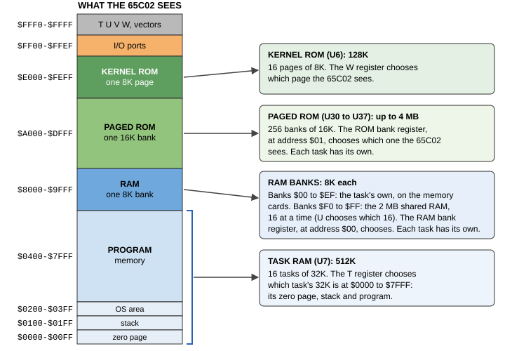

# Chapter 6. How the Hydra Starts

In Chapter 5 you watched the Hydra start, in about a second. In that second, a lot happens. This chapter follows it
step by step, from the moment the power comes on to the prompt. On the way, you'll meet the most important ideas in
HydraOS: memory and its banks, tasks, the kernel, drivers and the shell.

## 6.1 Waking up

When the power comes on, the Hydra's memory chips are full of random numbers, and the processor knows nothing at
all, except one thing: where to find its first instruction.

Every 65C02 processor does the same thing when it starts. It reads two bytes from the very top of its memory, at
addresses $FFFC and $FFFD. Together they make the **address** of the first instruction: the **reset vector**. The
processor jumps there and starts work.

But the processor doesn't start straight away. The little three-legged **reset chip**, U43, watches the +5 V supply.
It holds the processor's *reset* pin down until the power is steady, and then for 150 milliseconds (thousandths of a
second) more. The reset button works through it too: while the button is pressed, the processor waits, and 150
milliseconds after it's let go, the processor starts again from the reset vector.

## 6.2 The memory map

The 65C02 can only see 65,536 bytes of memory at once (that's 64K, or $10000 in hex). Each byte has an **address**,
from $0000 to $FFFF. But the Hydra has far more memory than that: 512K of task RAM, 2 MB of shared RAM, 2 MB more
on each RAM module, and up to 4 MB of ROM. How does the 65C02 reach it all?

The answer is **windows**. Parts of the 64K are windows onto bigger memories behind them. A **register** (a small
memory of a few bits, which the processor writes like any other address) chooses which part of the bigger memory
shows through the window. It's like reading a long scroll through a hole in a card: you can only see a little of it
at once, but you can slide the scroll to see any part.

<figure>

<figcaption>Figure 6-1. The Hydra's memory map: what the 65C02 sees, and the bigger memories behind its windows.</figcaption>
</figure>

| Addresses | What's there | Chosen by |
|---|---|---|
| $0000-$7FFF | **Task RAM**: 32K of U7, the running task's own | T |
| $8000-$9FFF | A **RAM bank**: 8K of the memory cards or the shared RAM | The RAM bank register ($00), and U |
| $A000-$DFFF | A **paged ROM bank**: 16K of the paged ROM chips | The ROM bank register ($01) |
| $E000-$FEFF | A **kernel ROM page**: 8K of U6 | W |
| $FF00-$FFEF | The **I/O ports**: the chips that talk to the world | (fixed) |
| $FFF0-$FFF3 | The registers **T, U, V, W** | (fixed) |
| $FFFE-$FFFF | The **vector RAM**: where interrupts go | V, or the interrupt |

The four registers at $FFF0 to $FFF3 are the Hydra's own:

| Register | Address | What it chooses |
|---|---|---|
| T | $FFF0 | The **task**: which 32K of U7 is at $0000-$7FFF |
| U | $FFF1 | Which 16 of the shared RAM's 256 banks are banks $F0-$FF |
| V | $FFF2 | Which interrupt address the 65C02 reads when no interrupt is waiting |
| W | $FFF3 | The **kernel ROM page** at $E000-$FEFF |

And two more registers belong to each task: the **RAM bank register**, written at address $00, and the **ROM bank
register**, written at $01. Each task has its own pair, so each task can look at a different bank. (On the board,
four 74LS219 chips, IC1 to IC4, are tiny memories that keep every task's bank registers. The other four, IC5 to
IC8, are the vector RAM.)

> **HOW IT WORKS:** Addresses $00 and $01 are also the first two bytes of each task's zero page. Writing them sets
> both the bank register and the RAM behind it, so a program can read back the bank it chose from the same address.

The I/O ports are the chips that do the Hydra's input and output:

| Port | Addresses | Chip | What it does |
|---|---|---|---|
| 0 | $FF00-$FF0F | 65C22 VIA (U2) | The tick (a timer), the SPI devices, the I/O header J27 |
| 1 | $FF10-$FF1F | 65C51 ACIA (U3) | The serial port |
| 2, 3 | $FF20-$FF3F | The card in slot 0 | The Vera X: screen, sound, SD card, keyboard |
| 4 | $FF40-$FF4F | YM2151 (U38) | Sound |
| 5-9 | $FF50-$FF9F | Slots 1 to 5 | Expansion cards (select A) |
| 10-14 | $FFA0-$FFEF | Slots 1 to 5 | Expansion cards (select B) |

## 6.3 Tasks: sixteen computers in one

The Hydra can run sixteen programs at once. Each program runs in a **task**, and each task has its own 32K of
memory at $0000-$7FFF, chosen by the T register. Each task has its own zero page, its own stack, its own bank
registers and its own program. A program in one task can't see or spoil the memory of another. It's almost like
having sixteen small computers, sharing one processor.

But the processor can only do one thing at a time, so the tasks take turns. Two hundred times a second, a timer
in the VIA gives the processor a nudge, called an **interrupt**, and the **scheduler** in the kernel decides whose
turn it is next. It saves where the running task was, writes the next task's number into T, and carries on with
that task where it left off. The turns are so short and so quick that the tasks seem to run all at once.

The tasks are numbered from 0 to 15, or in hex, 0 to F:

* **Task 0** is the **kernel's**: the heart of HydraOS, which looks after all the others. When nothing else needs
  to run, it puts the processor to sleep until the next interrupt.
* **Task 1** is **init**, the first program.
* **Programs** take the lowest free task: 2, 3, 4, and so on.
* **Drivers** take the highest: F, E, D, and so on down.

A task's 32K is laid out like this:

| Addresses | What's there |
|---|---|
| $00-$01 | The bank registers |
| $02-$21 | r0 to r15, sixteen 2-byte **call registers**: how a program passes values to HydraOS and gets answers back |
| $22-$7F | The program's own zero page |
| $80-$FF | HydraOS's zero page for this task |
| $0100-$01FF | The stack |
| $0200-$03FF | HydraOS's area for this task: its open files, its name, and more |
| $0400-$7FFF | The program's memory: its code (unless it runs from ROM) and its data |

## 6.4 Step by step

Here is everything the Hydra does, from the reset to the prompt.

### Step 1: The reset

The reset vector points to address $E000, in the kernel ROM. But which kernel ROM page is there? The W register
isn't cleared by a reset, so it could be any of the sixteen. That's why every page has the same instruction at
$E000: `STZ W_REGISTER`, which stores zero in W. The very next instruction comes from page 0, wherever the
processor started, and page 0 goes on with the start.

The kernel turns off interrupts, chooses task 0 (it stores 0 in T), and sets up its stack.

### Step 2: Every task made ready

T, U, V, the bank registers and all the RAM start with random values, so the kernel sets every one before it's used.
It visits each of the sixteen tasks in turn, writing T, and clears its bank registers and HydraOS's part of its zero
page. Then it marks each task "free", and clears its own tables.

### Step 3: The self test

Next the kernel starts a simple way of printing on the serial port, the **bring-up console**, and prints its
greeting:

```text
Hydra-16: kernel 0.1, ABI 1
```

(*ABI 1* is the version of the way programs call HydraOS, so that a program can check it's talking to a kernel it
understands.)

Then it runs the **power-on self test**, or **POST**, which checks the memory and the registers that everything
else depends on, and prints what it found:

```text
POST ZP:0 ST:0 OS:0 HI:0 SH:S W:0
RAM U:0 F0:0/00/0000 F4:0/00/0000 F8:0/00/0000 FC:0/00/0000 00:0/00/0000
POST ok
```

The first line tests the task registers and the kernel ROM pages:

| Item | What POST did | What's printed |
|---|---|---|
| `ZP` | Tasks 8, 4, 2, 1 and 0 each wrote their own number into address $00FF, in their zero page, then read it back | The T lines (in hex: bit 0 is T0) that didn't keep the tasks apart. 0 is good. |
| `ST` | The same, at $0100, in the stack | The same |
| `OS` | The same, at $03FF, in HydraOS's area | The same |
| `HI` | The same, at $7FF0, near the top of the task's 32K | The same |
| `SH` | Shared bank $F0, written by task 0 and read by task 1 | `S` if it's shared, as it should be; `X` if not |
| `W` | Each kernel ROM page has its own number at $FDFF; POST chose each page with W and read it | The W lines that didn't choose their page. 0 is good. |

The second line tests the RAM banks. `U:` is the U register's lines. Then comes one item for each RAM chip and
module it tested: the first bank of each shared RAM chip (banks $F0, $F4, $F8 and $FC) and the first bank of each
RAM module it found ($00 for module 0, $10 for module 1, and so on). Each item looks like `bb:x/dd/aaaa`:

| Part | What it shows |
|---|---|
| `bb` | The bank tested |
| `x` | The bank register's lines that don't work |
| `dd` | The **data lines** (D0 to D7, one bit each) that don't work |
| `aaaa` | The **address lines** (A0 to A12, one bit each) that don't work |

So `F4:0/00/0000` means "bank $F4: all good." If POST finds a fault it prints `POST found faults:` and names them
(Chapter 5 has a table of where to look), and leaves any bad memory unused.

> **HOW IT WORKS:** Testing the lines one at a time finds the faults a builder is most likely to make: a missing
> joint or a bridge between two pins. A data line that doesn't work changes the same bit of every byte, so writing
> $01, $02, $04 ... and reading them back finds it. An address line that doesn't work makes two addresses into one,
> so writing different values to address $0000 and address $0001, $0002, $0004 ... and reading them back finds it.

POST also counts the RAM modules on the memory cards (it tries each of the 15 possible module numbers), and prints
how many it found, in hex:

```text
RAM modules: 01
```

If a <kbd>T</kbd> was typed while POST ran, the Hydra starts the **hardware test** now, instead of HydraOS (section
5.8).

The kernel keeps a copy of everything it prints from here on. Any time later, you can read it again:

<!-- session --modules 1
-->

```session
/> cat /dev/kmesg

Hydra-16: kernel 0.1, ABI 1
POST ZP:0 ST:0 OS:0 HI:0 SH:S W:0
RAM U:0 F0:0/00/0000 F4:0/00/0000 F8:0/00/0000 FC:0/00/0000 00:0/00/0000
POST ok
RAM modules: 01
task F: cons
task E: storage
task D: kdev
task C: snd
task B: gpio
task A: vid
task 1: init
```

### Step 4: Interrupts

An **interrupt** is a signal from a chip that says "I need attention now": a key has arrived at the serial port, a
timer has run out, the sound chip has finished a note. The Hydra has sixteen interrupt lines, numbered 0 to 15. When
one is active, a chip on the board (U17 and U18 find the most urgent line) makes the 65C02 read the interrupt's own
address from the vector RAM, so each line goes straight to its own code. The lower the number, the more urgent:

| Line | Comes from |
|---|---|
| 0 | The VIA: its timers (the tick) and CA1 |
| 1 | The ACIA: the serial port |
| 2, 3 | Slot 0: the Vera X |
| 4 | The YM2151: its timers |
| 5-9 | Slots 1 to 5 (select A) |
| 10-14 | Slots 1 to 5 (select B) |
| 15 | Nothing: used for `BRK` |

The kernel sets up the vector RAM, and gives itself line 0, for the tick.

### Step 5: The drivers

A **driver** is a program that looks after a device: the serial port, the SD cards, the sound chip. Programs don't
touch the devices themselves; they ask the drivers. The kernel starts the **boot drivers**, each in its own task,
from the highest down, and prints each one's name:

| Task | Driver | What it looks after |
|---|---|---|
| F | `cons` | The console: the serial port, its windows, and `/pc` |
| E | `storage` | The SPI bus, the SD cards, the RAM disks and the ROM disk, and their files |
| D | `kdev` | The kernel's own devices: the top of the file tree, the tasks (`/proc`), pipes, and more |
| C | `snd` | The sound chips: the YM2151, and the Vera X's |
| B | `gpio` | The I/O header J27 and the I²C bus on it |
| A | `vid` | The Vera X's screen. With no Vera X, it finds nothing to do and ends |

Like most of HydraOS, the drivers live in the paged ROM, in **modules**. A module runs *in place*: its task's ROM
bank register shows its bank at $A000-$DFFF, so its code never needs copying into RAM. A big module has a bank (or
several) of its own; small ones share a bank, each in its own part of it.

Chapter 11 explains how drivers work, and Part Three describes each one.

### Step 6: The tick, and init

The kernel starts timer 1 in the VIA, set to interrupt **200 times a second**: the **tick**, which drives the
scheduler and the clock. It turns interrupts on, and the drivers run their start-up code. When they're ready, the
kernel starts the first program, **init**, in task 1, and then becomes the **idle task**: whenever no other task
needs the processor, it lets the processor sleep (the 65C02's `WAI` instruction) until the next interrupt.

### Step 7: init sets up the system

init does everything needed to make the Hydra ready for you:

1. It opens the **console**: window 0 of the `cons` driver. Its output now goes there.
2. It starts the two **RAM disks**: `r`, 256K of RAM banks on the memory cards, and `s`, 512K of the shared RAM.
   (With less memory, it makes them smaller.)
3. It builds its **namespace**, its tree of files, from the file `/rom/lib/namespace` (and from `/lib/namespace` on
   an SD card, if there is one). Chapter 8 explains namespaces.
4. It sets up the console's **windows** from `/lib/windows` (Chapter 9).
5. It prints `HydraOS 1.0 for the Hydra-16`, and which task it's in, and lists the tasks:

```text
init: up in task 01
T ST FL PA CPU    NAME
0 01 00 FF 00004D kernel
1 01 00 FF 000017 init
B 04 01 FF 000003 gpio
C 04 01 FF 000003 snd
D 04 01 FF 00000E kdev
E 04 01 FF 000077 storage
F 04 01 FF 00004C cons
```

The columns are all in hex:

| Column | What it shows |
|---|---|
| `T` | The task's number |
| `ST` | Its **state**: 01 ready to run, 02 waiting, 03 calling a driver, 04 a driver waiting for work, 06 asleep, 07 waiting for a busy driver, 08 waiting for a driver to have news |
| `FL` | Its **flags**: 01 means it's a driver |
| `PA` | Its **parent**, the task that started it (FF: none) |
| `CPU` | How much of the processor's time it has had, in ticks (200 a second) |
| `NAME` | The program running in it |

(Task A isn't there: without a Vera X, `vid` has already ended.)

6. It runs a small program, **hello**, and waits for it to end. hello greets its arguments, `from init`, and ends
   with the code 7 and the message `bye`. It's a quick check that programs can start, run and end:

```text
hello, from init
init: hello ended: code $07 (bye)
```

7. It starts the **shell** in window 0. Which shell? The one named in `/lib/shell`. On the ROM disk, that file
   says `/bin/forth -l`: HyForth, as a login shell.
8. It starts **wstart**, which waits for you to ask for a new window (Chapter 9), and **input**, the driver for a Vera
   X's keyboard and mouse (which ends at once if there isn't one).

Then init waits. If the shell or wstart ever ends, init starts it again, so there's always a shell to type at.

### Step 8: The shell starts

HyForth starts, and loads its start-up file, `/lib/forth/startup.fs`, which adds four sets of words to its
**dictionary**: the Core Extension, Exception, File Access and Programming-Tools word sets (Chapter 18). Because it
was started with `-l`, as a **login shell**, it then reads `/lib/forth/profile.fs`, which turns HyForth into a
shell: it loads `shell.fl`, the words that let it run commands, and sets up the window. Then it says hello, and
prints its prompt:

```text
HyForth (Forth 2012), bye to end
/>
```

The prompt shows where you are in the file tree: `/` is the top. The Hydra is ready.

## 6.5 What's running now

The `ps` command lists the tasks, in a friendlier form than init's table, with the task numbers in decimal:

```session
/> ps
task  state   parent     cpu group  name
   0  ready   -          1.5     0  kernel
   1  wait    -          0.2     1  init
   2  wait     1         0.3     2  forth
   3  event    1         0.0     1  wstart
   4  ready    2         0.0     2  ps
  11  idle    -          0.0    11  gpio
  12  idle    -          0.0    12  snd
  13  idle    -          0.1    13  kdev
  14  idle    -          1.6    14  storage
  15  idle    -          0.5    15  cons
```

You can see init (task 1), the shell, `forth` (task 2), wstart (task 3), `ps` itself (task 4: the shell started
it, so its parent is 2), and the five drivers in tasks 11 to 15 (B to F). The `cpu` column is in seconds. Chapter 10
explains the `group` column.

> **TRY THIS:** Run `ps` again. Has anything changed? Which task do you think did most of the work while the Hydra
> started?
