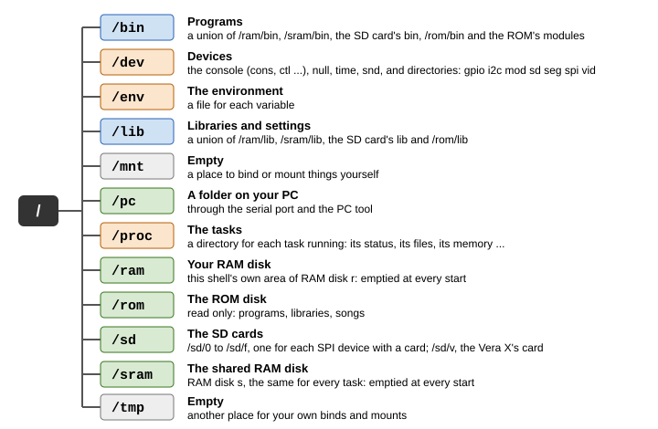

# Chapter 9. Files and Namespaces

Everything the Hydra keeps, it keeps in **files**: programs, songs, your notes, its settings. Even its devices look
like files. This chapter shows how the files are arranged, where they live, and how HydraOS builds the "tree" of
names that you see, which it calls a **namespace**.

> **IN THIS CHAPTER:** You'll learn paths, the disks, how devices appear as files, and how each task gets a tree of
> names of its own: binding, unions, and a namespace that you arrange yourself. **You need:** Chapter 6, and a little
> rc (sections 8.1 to 8.6).

## 9.1 Files and directories

A **file** is a named collection of bytes: a program, a picture, a story. A **directory** is a file that holds other
files (it's like a folder on a PC). Directories can hold directories, which hold more files and directories, and so
on, making a **tree**. The directory at the top, which holds everything, is the **root**, and is written `/`.

A file's **path** is the list of directories you go through to reach it from the root, with a `/` between each
name. `/rom/lib/forth/startup.fs` is the file `startup.fs`, in the directory `forth`, in `lib`, in `rom`, in the
root.

A name can be up to 31 characters long, and can use any character but `/`. Capital letters count: `Notes` and
`notes` are two different names.

**Where you are.** Every task has a **current directory**: the directory it's "in". `pwd` shows it, and `cd` changes
it. HyForth's prompt shows it too:

```session
/> cd /rom/lib/forth
/rom/lib/forth> pwd
/rom/lib/forth
```

A path that doesn't start with `/` starts from the current directory. And every directory has two special names:
`.` is the directory itself, and `..` is the directory it's in.

<!-- session
cd /rom/lib/forth
-->

```session
/rom/lib/forth> cd ..
/rom/lib> pwd
/rom/lib
/rom/lib> ls ../songs
scom.zsm
```

## 9.2 Looking at files

`ls` lists a directory's files, with a `/` after each directory. `ls -l` gives a **long** listing:

```session
/> ls -l /rom
--r--r--r-- fx     1955 2000-01-01 00:00 README
d-r--r--r-- fx        0 2000-01-01 00:00 bin
d-r--r--r-- fx        0 2000-01-01 00:00 doc
d-r--r--r-- fx        0 2000-01-01 00:00 lib
d-r--r--r-- fx        0 2000-01-01 00:00 songs
```

Each line has five parts:

| Part | Example | Means |
|---|---|---|
| The mode | `d-r--r--r--` | `d` for a directory; `a` next if the file is append-only (writes always go on its end); then who may read (`r`), write (`w`) and run (`x`) it |
| The device | `fx` | Which driver keeps the file (`f`: HydraFS), and which disk (`x`: the ROM disk) |
| The length | `1955` | How many bytes it holds |
| The time | `2000-01-01 00:00` | When it was last changed |
| The name | `README` | |

> **NOTE:** The mode's `r`, `w` and `x` come in three groups, for the file's owner, its group and everyone else, as
> on many other systems. HydraOS doesn't have separate users, so all three groups are the same.

To see what's in a file, `cat` it. `more` shows a long file a screenful at a time, and `xd` shows a file's bytes as
hex. Chapter 11 has all the commands for files: `cp` copies a file, `mv` moves or renames one, `rm` removes one,
`mkdir` makes a directory, and so on.

```session
/> mkdir /ram/notes
/> cd /ram/notes
/ram/notes> echo remember the milk >list
/ram/notes> ls -l
--rw-rw-rw- fr       18 2000-01-01 00:00 list
```

## 9.3 The disks

The Hydra's files are kept on several **disks**. (A disk here means any place that keeps a file system, even if it
isn't round!) Each one is part of the tree:

| Path | Disk | What it is |
|---|---|---|
| `/rom` | `x` | The **ROM disk**: in the paged ROM. HydraOS's programs, libraries and settings. It can't be changed. |
| `/sd/0` ... `/sd/f` | `0` ... `f` | The **SD cards**, one for each SPI device that has a card (`/sd/0` is the card on SPI header J18) |
| `/sd/v` | `v` | The SD card in a Vera X |
| `/ram` | `r` | Your **RAM disk**: an area of RAM disk `r` that's only this shell's |
| `/sram` | `s` | The **shared RAM disk**: the same for every task |
| `/pc` | | A folder on your PC, while the PC tool is running (section 9.9) |

`df` lists the disks, and how much space each one has free:

```session
/> df
disk  kind   size        free        label
0     sdhc   16380 KB    15956 KB    HYDRA-16
x     rom    623 KB      10 KB       ROM
r     ram    255 KB      252 KB      RAM
s     sram   511 KB      510 KB      SRAM
```

The **RAM disks** are made of memory, so they're very fast, but they're emptied each time the Hydra starts. Use them
for work in progress, and keep what matters on an SD card.

All of these disks use the Hydra's own way of arranging files on a disk, called **HydraFS**. To use a new SD card,
you make an empty HydraFS on it with `mkfs` (Chapter 11). Chapter 14 tells you more about the disks and HydraFS.

## 9.4 Devices as files

On the Hydra, devices look like files too. The console, the sound chip, the SD cards' raw blocks, the clock, the
tasks: each has a directory of files, and you use the device by reading and writing them. For example, the file
`/dev/time` is the clock:

```session
/> cat /dev/time
2000-01-01 00:00:04
```

Every driver gives its files a **device name** that starts with `#`, such as `#c` for the console and `#f` for
HydraFS. Here are the Hydra's devices:

| Device | Driver | Its files | Usually at |
|---|---|---|---|
| `#/` | kdev | The root: an empty directory for each top-level name | `/` |
| `#c` | cons | The console: `cons`, `consctl`, `ser`, `serctl`, `wctl` ... | `/dev` |
| `#n` | kdev | `null`, `zero` and `kmesg` | `/dev` |
| `#t` | kdev | `ticks`, `time` and `rtc`: the clock | `/dev` |
| `#a` | snd | The sound chips: `snd`, `sndctl`, `bell`, `psg` | `/dev` |
| `#g` | gpio | The I/O header J27's pins | `/dev/gpio` |
| `#i` | gpio | The I²C bus's devices | `/dev/i2c` |
| `#v` | vid | The Vera X's screen | `/dev/vid` |
| `#d` | storage | The disks' raw data, and their control files | `/dev/sd` |
| `#S` | storage | The SPI devices | `/dev/spi` |
| `#m` | kdev | The modules in the paged ROM | `/dev/mod` |
| `#s` | kdev | Shared memory segments, by name | `/dev/seg` |
| `#e` | kdev | The environment: a file for each variable | `/env` |
| `#p` | kdev | The tasks: a directory for each | `/proc` |
| `#f` | storage | HydraFS: the files on the disks | `/sd`, `/rom`, `/ram`, `/sram` |
| `#P` | cons | A folder on the PC | `/pc` |
| `#|` | kdev | Pipes | |

Part Three describes each device's files.

## 9.5 Namespaces

So far the tree looks like one big tree. But it's really put together from pieces, and each task has its own. The
tree a task sees is its **namespace**. HydraOS builds namespaces the way the Plan 9 operating system does, with two
operations:

* **bind** puts one part of the tree at another place. `bind /rom/songs /mnt` makes `/mnt` show the files of
  `/rom/songs`.
* **mount** puts a device's files at a place in the tree. `mount '#f' /rom x` puts HydraFS's disk `x`, the ROM disk,
  at `/rom`.

```session
/> bind /rom/songs /mnt
/> ls /mnt
scom.zsm
/> unmount /mnt
/> ls /mnt
/>
```

`unmount` takes it away again.

Each task starts with a copy of the namespace of the task that started it. If it changes its namespace, only its own
copy changes. That's why a `bind` typed in rc (which runs as a task of its own) doesn't change HyForth's
namespace:

```session
/> rc
% bind -a /rom/lib /mnt
% ls /mnt
as/
basic/
edit/
font/
forth/
hylang/
namespace
profile
shell
windows
% exit
/> ls /mnt
/>
```

HyForth has its own `bind`, `mount` and `unmount` words, for changing its own namespace (Chapter 8).

## 9.6 The Hydra's tree

When a shell starts, it builds its namespace from the file `/rom/lib/namespace`. Figure 9-1 shows the tree it makes.

<figure>

<figcaption>Figure 9-1. The Hydra's file tree.</figcaption>
</figure>

Here is the namespace file. Each line is a `bind` or a `mount` (and `#` starts a comment):

```text
# the root and the devices
bind '#/' /
bind -a '#c' /dev           # cons consctl ser serctl
bind -a '#n' /dev           # null zero kmesg
bind -a '#t' /dev           # ticks
bind '#g' /dev/gpio         # 0-7 port ctl ca1: the VIA's port A on J27
bind '#i' /dev/i2c          # ctl, and a file each I2C device on PA0 and PA1
bind -a '#a' /dev           # snd sndctl bell psg
bind '#v' /dev/vid          # ctl term vram pal sprites font frame psg pcm pcmctl
bind '#d' /dev/sd
bind '#S' /dev/spi
bind '#m' /dev/mod
bind '#s' /dev/seg          # shared segments by name
mount '#e' /env            # the environment
mount '#p' /proc

# the disks
mount '#f' /sd              # the cards: /sd/0 ... /sd/f
mount '#f' /rom x           # the ROM disk
mount '#f' /sram s          # the shared RAM disk
mount -c '#f' /ram r/$task  # this shell's own area of the RAM disk

# programs and libraries: unions, the caches first
bind -c /ram/bin /bin
bind -a /sram/bin /bin
bind -a /sd/0/bin /bin      # (added only if the card has one)
bind -a /rom/bin /bin       # programs on the ROM disk
bind -a '#m/bin' /bin       # the ROM's program modules
bind -c /ram/lib /lib
bind -a /sram/lib /lib
bind -a /sd/0/lib /lib
bind -a /rom/lib /lib

# the PC
mount '#P' /pc              # a folder on the PC, through the serial port
```

(It's shortened a little here: the real file has some more comments at its top.) Notice `$task` in the `/ram`
line: each shell's `/ram` is its own directory of RAM disk `r`, named after its task. Your RAM disk is yours alone,
and no other shell's files get in its way.

## 9.7 Unions

Look at the `/bin` lines. The first binds `/ram/bin` at `/bin`; each of the others adds (`-a`, for "after") another
directory to it. Now `/bin` is a **union directory**: a directory made of several. When you look for a file in
`/bin`, HydraOS looks in each of its members in order, and the first one that has the file wins. When you list
`/bin`, you see the files of all of them.

So the Hydra's programs can come from five places: your RAM disk, the shared RAM disk, the SD card, the ROM disk,
and the ROM's own modules. A program on the RAM disk or the SD card is found before the ROM's, so you can put a new
version of a program there, and it takes the old one's place.

The `-c` on the first `/bin` line says where new files go: a file you make in `/bin` is made in `/ram/bin`.

```session
/> echo '#!/bin/rc' >/bin/greet
/> echo 'echo Hello from a script in /bin' >>/bin/greet
/> greet
Hello from a script in /bin
/> ls /ram/bin
greet
```

`/lib` is built the same way, which is how the files that set up the system, like `/lib/shell` and
`/lib/namespace`, can be replaced by your own: put your version on the SD card, and it's found first.

The options for `bind` and `mount` are:

| Option | Means |
|---|---|
| (none) | Replace what's at the place |
| `-a` | Add after what's there: looked at last |
| `-b` | Add before what's there: looked at first |
| `-c` | New files made in the union go here |

## 9.8 Your own namespace

You can change the namespace of any shell with `bind`, `mount` and `unmount`. To start again with the standard
one, type `newns`. And `ns` shows your shell's namespace, as the binds and mounts that would make it:

```session
/> ns
bind '#/' /
bind '#/dev' /dev
bind -a '#n' /dev
bind -a '#t' /dev
bind -a '#a' /dev
bind -a '#c' /dev
bind '#g' /dev/gpio
bind '#i' /dev/i2c
bind '#d' /dev/sd
bind '#S' /dev/spi
bind '#m' /dev/mod
bind '#s' /dev/seg
bind '#e' /env
bind '#p' /proc
bind '#f' /sd
mount '#f' /rom x
mount '#f' /sram s
mount -c '#f' /ram r/2
bind -c '#fr/2/bin' /bin
bind -a '#fs/bin' /bin
bind -a '#fx/bin' /bin
bind -a '#m/bin' /bin
bind -c '#fr/2/lib' /lib
bind -a '#fs/lib' /lib
bind -a '#fx/lib' /lib
bind '#P' /pc
```

It looks a little different from the namespace file: `ns` shows each part of the tree by its device's own name,
like `'#fr/2/bin'` (directory `2/bin` of HydraFS disk `r`). The SD card's lines aren't there, because this card
has no `bin` or `lib` directory. And the `/dev` directory starts with `#/dev`, which gives it its subdirectories:
`gpio`, `i2c`, `mod`, `sd`, `seg`, `spi` and `vid`.

`ns 5` shows the namespace of task 5.

To change every shell's namespace, write your own namespace file, and put it on your SD card as
`/sd/0/lib/namespace`. Each shell reads it after the ROM's, and does its lines too. For example, a card with this
file:

```text
bind -a /sd/0/games /bin
```

makes every shell look for programs in the card's `games` directory too.

## 9.9 /pc: a folder on your PC

When the Hydra is connected to a PC running the PC tool (section 5.2), the folder you gave the tool appears on the
Hydra at `/pc`. You can copy files to and from it, and run programs from it, just like any other disk:

```text
/> cp /pc/hello.hyx /ram/bin/hello2
/> cp /ram/notes/list /pc/list.txt
```

The files travel over the serial port, mixed in with the console's text (the PC tool takes them out, so you won't
see them). They go no faster than the serial port allows, so switch to 115200 baud (section 5.5) before you copy
big files. The PC tool's `--read-only` option stops the Hydra changing the folder's files.

Without the PC tool, the Hydra waits a second for an answer from the PC, then gives up:

```text
/> ls /pc
ls: /pc: i/o error
```

With an ordinary terminal program, you may see a few odd characters just before the error: they're the Hydra's
message to the PC tool, which isn't there to take it.
