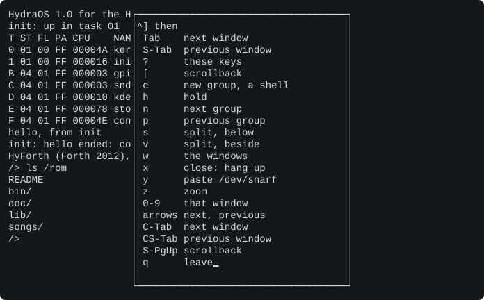
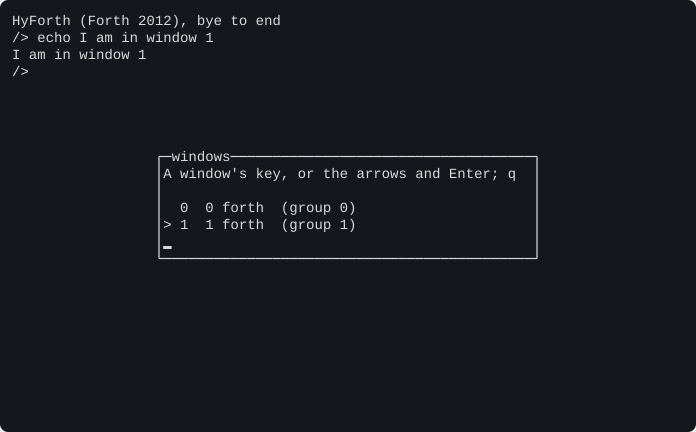
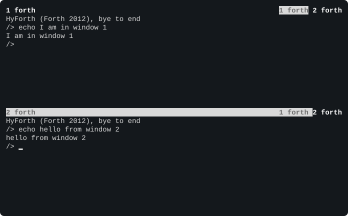
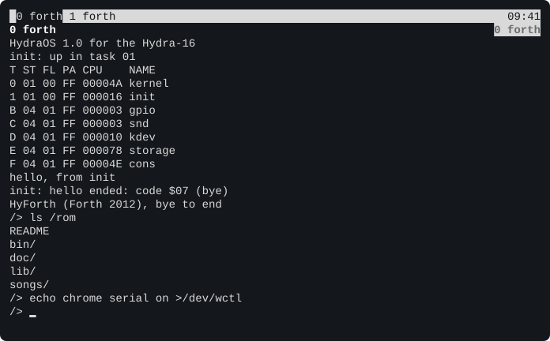

# Chapter 10. The Console and Its Windows

The Hydra can run sixteen programs at once, but you have only one terminal. How do you talk to more than one of
them? With **windows**. The console can keep up to sixteen windows, each with its own shell and its own screen,
and show you any of them, or several side by side.

> **IN THIS CHAPTER:** You'll open, switch, split, scroll and label the console's windows, and learn the files that
> control them. **You need:** Chapter 6, and the window key: <kbd>CTRL</kbd>-<kbd>]</kbd>.

## 10.1 Windows on a terminal

Each window is like a separate terminal: it has its own screen, its own line being typed, its own history, and its
own programs. One window at a time is **shown**, and gets your keys. The others carry on working, out of sight:
what their programs print goes to their own screens, ready for when you look at them again, and a program that
asks for a key waits until you show its window.

When the Hydra starts, there's just **window 0**, with HyForth in it. You make more, and move between them, with
the **window key**, <kbd>CTRL</kbd>-<kbd>]</kbd>, and then one more key. For example, <kbd>CTRL</kbd>-<kbd>]</kbd>
<kbd>?</kbd> shows a list of all the window keys:

<figure>

<figcaption>Figure 10-1. <kbd>CTRL</kbd>-<kbd>]</kbd> <kbd>?</kbd>: the window keys.</figcaption>
</figure>

Press <kbd>Q</kbd> to put it away.

## 10.2 A new window

<kbd>CTRL</kbd>-<kbd>]</kbd> <kbd>C</kbd> makes a new window (in a group of its own: section 10.3) with a new shell in
it, and shows it. The screen
clears, and the new shell says hello:

```text
HyForth (Forth 2012), bye to end
/>
```

This is window 1. Everything you do here is separate from window 0. Type a command, then go back to window 0 with
<kbd>CTRL</kbd>-<kbd>]</kbd> <kbd>0</kbd>: window 0's screen comes back, just as you left it. <kbd>CTRL</kbd>-<kbd>]</kbd>
<kbd>1</kbd> shows window 1 again.

To see all the windows, press <kbd>CTRL</kbd>-<kbd>]</kbd> <kbd>W</kbd>:

<figure>

<figcaption>Figure 10-2. <kbd>CTRL</kbd>-<kbd>]</kbd> <kbd>W</kbd>: the window list.</figcaption>
</figure>

The list shows each window's number, its group (section 10.3), and the program running in it. The `>` marks the
window that was shown. Press a window's number to show it, or move with the arrow keys and press
<kbd>RETURN</kbd>; <kbd>Q</kbd> leaves the list.

When a window's shell ends (type `bye` in HyForth, or `exit` in rc), the window goes away. Window 0 is special,
because it never goes away. When its shell ends, the kernel starts init again, and init becomes a new shell in it.

## 10.3 Groups

Windows belong to **groups**. A group is like a desk you're working at: one shell session, with all the windows it
has opened. <kbd>CTRL</kbd>-<kbd>]</kbd> <kbd>C</kbd> starts a new group, with a new shell. A program can open more
windows in its own group, with the command `new-window` (Chapter 11).

| Keys | What they do |
|---|---|
| <kbd>CTRL</kbd>-<kbd>]</kbd> <kbd>0</kbd> ... <kbd>9</kbd> | Show window 0 to 9 |
| <kbd>CTRL</kbd>-<kbd>]</kbd> <kbd>TAB</kbd> | Show the group's next window |
| <kbd>CTRL</kbd>-<kbd>]</kbd> <kbd>SHIFT</kbd>-<kbd>TAB</kbd> | Show the group's previous window |
| <kbd>CTRL</kbd>-<kbd>]</kbd> and an arrow | The group's previous (<kbd>↑</kbd> <kbd>←</kbd>) or next (<kbd>↓</kbd> <kbd>→</kbd>) window |
| <kbd>CTRL</kbd>-<kbd>]</kbd> <kbd>N</kbd> | Show the next group |
| <kbd>CTRL</kbd>-<kbd>]</kbd> <kbd>P</kbd> | Show the previous group |
| <kbd>CTRL</kbd>-<kbd>]</kbd> <kbd>C</kbd> | A new group, with a shell |
| <kbd>CTRL</kbd>-<kbd>]</kbd> <kbd>X</kbd> | Close the group shown: its programs are told to stop ("hang up") |
| <kbd>CTRL</kbd>-<kbd>]</kbd> <kbd>W</kbd> | The window list |
| <kbd>CTRL</kbd>-<kbd>]</kbd> <kbd>?</kbd> | The window keys |
| <kbd>CTRL</kbd>-<kbd>]</kbd> <kbd>CTRL</kbd>-<kbd>]</kbd> | Type a <kbd>CTRL</kbd>-<kbd>]</kbd> |

<kbd>CTRL</kbd>-<kbd>TAB</kbd> and <kbd>CTRL</kbd>-<kbd>SHIFT</kbd>-<kbd>TAB</kbd> also move to the group's next and
previous windows, if your terminal sends them. (With Windows Terminal, start the PC tool with `--win32-input`.)

## 10.4 Side by side

A group's windows can be shown together, **tiled**, each in its own part of the screen.
<kbd>CTRL</kbd>-<kbd>]</kbd> <kbd>S</kbd> makes a new window with a shell, below the one shown, and
<kbd>CTRL</kbd>-<kbd>]</kbd> <kbd>V</kbd> makes one beside it. Each tiled window has a heading, with its number and
program at the left, and the group's windows at the right, the one with the keys marked:

<figure>

<figcaption>Figure 10-3. <kbd>CTRL</kbd>-<kbd>]</kbd> <kbd>S</kbd>: a window below.</figcaption>
</figure>

The keys go to one window at a time: move between them with <kbd>CTRL</kbd>-<kbd>]</kbd> and the arrow keys.
<kbd>CTRL</kbd>-<kbd>]</kbd> <kbd>Z</kbd> **zooms** the window with the keys, so it has the whole screen to itself;
press it again to tile the group again.

The group's **layout** can be changed by writing to its `wctl` file:

| Command | Layout |
|---|---|
| `echo layout tabs >/dev/wctl` | One window at a time |
| `echo layout rows >/dev/wctl` | One above another |
| `echo layout columns >/dev/wctl` | Side by side |
| `echo layout grid >/dev/wctl` | In a grid |

## 10.5 Scrolling back

Each window remembers some of the lines that have scrolled off the top of its screen. To look back at them, press
<kbd>CTRL</kbd>-<kbd>]</kbd> <kbd>[</kbd> (or <kbd>SHIFT</kbd>-<kbd>PAGE UP</kbd>). The program in the window carries
on; you're just looking. In the scrollback view:

| Keys | What they do |
|---|---|
| The arrows, <kbd>PAGE UP</kbd>, <kbd>PAGE DOWN</kbd>, <kbd>HOME</kbd>, <kbd>END</kbd> | Move around |
| <kbd>SPACE</kbd> | Mark the start of a piece to copy |
| <kbd>RETURN</kbd> | Copy the marked lines (or the line you're on) to the **snarf buffer**, and leave |
| <kbd>Q</kbd>, or <kbd>ESC</kbd> twice | Leave |

The **snarf buffer**, `/dev/snarf`, is the console's clipboard. <kbd>CTRL</kbd>-<kbd>]</kbd> <kbd>Y</kbd> types
whatever is in it into the window shown, as if you'd typed it. So you can copy a command or a result from one window,
and paste it into another. Programs can read and write `/dev/snarf` too.

## 10.6 Holding the output

When a program prints faster than you can read, <kbd>CTRL</kbd>-<kbd>]</kbd> <kbd>H</kbd> **holds** the window: its
program waits, mid-line, until you press <kbd>CTRL</kbd>-<kbd>]</kbd> <kbd>H</kbd> again.

## 10.7 Bars, headings and footers

The console can show extra lines around the windows, which it calls the **chrome**:

* the **bar**, a line at the top (or the bottom) of the screen, with the groups and the time;
* each window's **header**, a line above it, with its number and name, and the group's windows;
* each window's **footer**, a line below it, with its **status**: a message its program can set.

On the Vera X's screen they're all shown. On the serial terminal they're off, to leave you as many lines as
possible, but you can turn them on for a window:

```text
/> echo chrome serial on >/dev/wctl
```

<figure>

<figcaption>Figure 10-4. The bar and the header, on the serial terminal.</figcaption>
</figure>

The bar shows the groups (the one shown is in a different colour) and the time; the header shows the window's
number and program, and the group's windows. What each line shows is set by a **format**, as HyForth's prompt is
(section 8.15). The ROM disk's `/lib/windows` sets them up as the Hydra starts:

```text
bar top
bar %[7] %G%=%t
default header %[1]%n %l%=%w
default footer %s
default chrome screen on
default chrome serial off
```

The codes in a format are:

| Code | Shows |
|---|---|
| `%n` | The window's number |
| `%l` | The window's **label**: its name (normally its program's name) |
| `%p` | Its program's name |
| `%s` | Its status line |
| `%g` | The group's number |
| `%w` | The group's windows |
| `%G` | The groups |
| `%c` `%r` | Its size: columns and rows |
| `%m` | Its modes |
| `%t` `%d` | The time and the date |
| `%L` | The keyboard's lights |
| `%y` | Where the scrollback view is |
| `%=` | Everything after this goes at the right-hand end |
| `%[...]` | A change of colour or style, as in a terminal's SGR sequence (Chapter 13): `%[7]` is reverse, `%[1;33;44]` bold yellow on blue, `%[0]` normal |
| `%%` | A `%` |

To use your own, put a file called `windows` in the `lib` directory of your SD card: it's read before the ROM
disk's.

## 10.8 A window's files

Each window has its own console files. A program running in a window finds them at `/dev`:

| File | What it is |
|---|---|
| `cons` | The window's console: read your typing from it, write to its screen |
| `consctl` | Control: raw mode, the keys' codes, where it's shown, and more (Chapter 13) |
| `wctl` | The windows' control: new windows, layouts, the chrome, the keys (Chapter 13) |
| `label` | The window's name: read it, or write a new one |
| `text` | Everything in the window's scrollback and screen, as text |
| `wnew` | Reading it waits for <kbd>CTRL</kbd>-<kbd>]</kbd> <kbd>C</kbd>, then makes the new window: for a program that wants to start the windows' shells itself. With nobody reading it, the console makes the window and the kernel starts init in it |
| `kbdin` | What's written here is typed into the window, as if from the keyboard |

And these are the same in every window: `snarf` (the snarf buffer), `ser` and `serctl` (the serial port itself),
and `kbin` (the Vera X keyboard's keys).

```session
/> echo my window >/dev/label
/> cat /dev/label; echo
my window
```

(The label has no new line at its end, so `echo` adds one.)

Reading `wctl` lists the windows: each one's number, group, columns and rows, with a `*` after the one with your
keys:

```session
/> cat /dev/wctl
0 0 80 24 *
```

Each window's files are also the console device's, `#c`, with the window's number after it: window 2's console is
`#c2/cons`. HyForth's `send` word uses `#cN/kbdin` to type a line into another window's shell:

```text
/> send 1 ls /rom
```

types `ls /rom` and <kbd>RETURN</kbd> into window 1.
