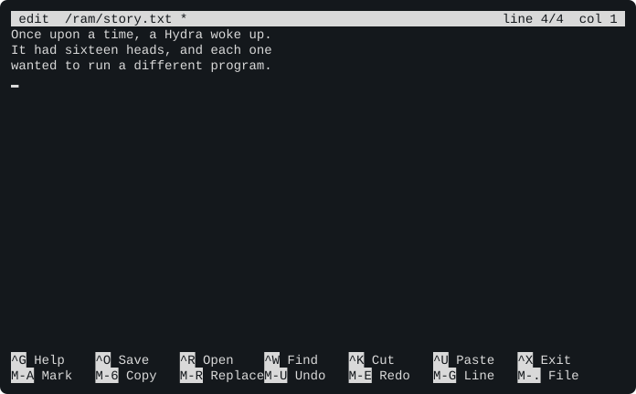
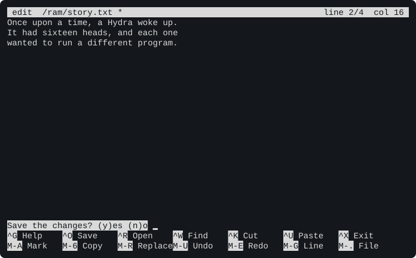
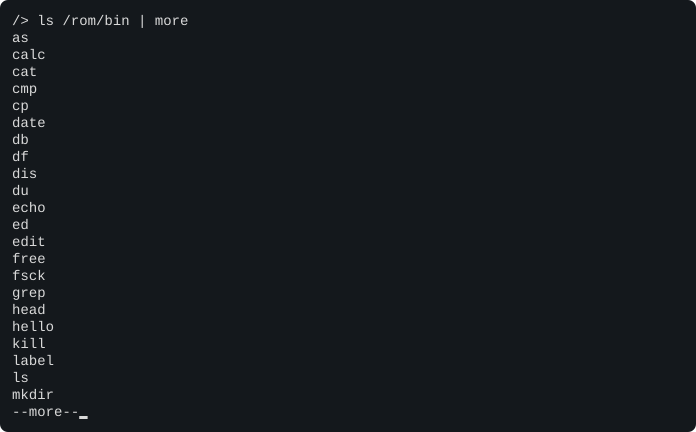
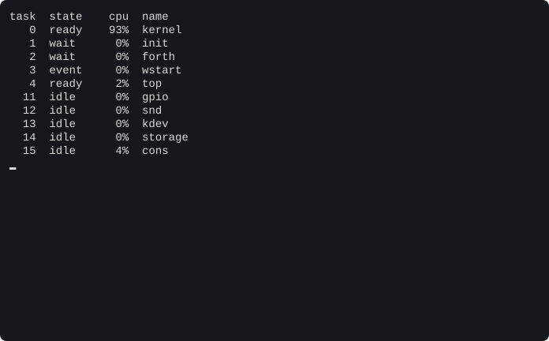

# Chapter 11. Commands from A to Z

This chapter is a guide to every program on the Hydra, in alphabetical order, followed by the shell's built-in
commands. Each entry shows how to type the command, what its options mean, and an example of it at work.

> **IN THIS CHAPTER:** This is a chapter for looking things up: every program and every shell command, with its
> options and an example. **You need:** Chapter 6. Don't read it through; dip into it.

**How to read the usage lines.** Each entry starts with a line like this one:

```text
ls [-ld] [name ...]
```

Words in `this type` are typed as they are. Words in *italics*, like *name*, stand for something you choose. Square
brackets, `[ ]`, mark something you can leave out, and `...` means "as many as you like". So `ls`, `ls /rom`,
`ls -l /rom /ram` and `ls -ld /rom` are all ways to use `ls`. Options can be joined: `-ld` is the same as `-l -d`.
A program typed with no arguments, or with ones it doesn't understand, prints its usage line, so you never need to
remember one.

**When things go wrong.** A program that can't do what you asked says why, with its own name first:

```session
/> ls /nothing
ls: /nothing: not found
```

and ends with a **status** that isn't success, so a shell can tell (section 8.9).

Most of the examples use a few small files. To make them, type:

```session
/> echo apple >/ram/fruits
/> echo cherry >>/ram/fruits
/> echo banana >>/ram/fruits
/> echo apple >>/ram/fruits
```

## as: the assembler

```text
as [-bl] file.s|- [out|-]
```

Turns a program written in 65C02 **assembly language** into a program the Hydra can run (`-`: standard input, or
standard output, for a pipe). Chapter 27 is all about it.

## basic: HyBASIC

```text
basic [-l] [file]
```

Starts HyBASIC, the Hydra's BASIC. Chapters 23 and 24, and Appendix C, are all about it.

## calc: the calculator

```text
calc [-b base] [-d digits] [expression ...]
```

Works out an **expression**, exactly, and prints the answer. The expression is the rest of the line; with none,
`calc` works out each line you type, until <kbd>CTRL</kbd>-<kbd>D</kbd>.

| Option | What it does |
|---|---|
| `-b` *base* | Print the answer in another base: `x` for hex, `b` binary, `o` octal, and more (Chapter 18) |
| `-d` *digits* | How many digits to work out for answers like square roots, which never end (12 unless you say) |

`calc` knows the Hydra's whole number system, which Chapter 18 explains: fractions stay exact, whole numbers can be
as big as you like, and numbers can be written in any base. It has:

* the operators `+` `-` `*` `/`, `%` (the remainder after dividing whole numbers), `^` (a power), and parentheses;
* the functions `sqrt` `exp` `log` `sin` `cos` `tan` `atan` `abs` `floor` `round` `truncate` `fib` `numerator`
  `denominator` `re` `im` `rational` `random`, and, with two numbers in parentheses, `gcd` `pow` `complex` `fixed`;
* the constants `pi`, `e` and `i`.

```session
/> calc 2/3 + 0.5
7/6
/> calc 1/3 + 1/6
1/2
/> calc sqrt 2
1.41421356237
/> calc -d 30 pi
3.14159265358979323846264338328
/> calc '2^100'
1267650600228229401496703205376
/> calc 17 % 5
2
/> calc -b x 255
FF
/> calc '#xFF + #b101'
260
/> calc 'gcd(12, 18)'
6
/> calc 1/0
calc: division by zero
```

> **NOTE:** Characters that mean something to the shell, like `^`, `(`, `)` and `#`, must be inside quotes, as in
> `calc '2^100'`.

## cat: show files

```text
cat [file ...]
```

Copies each file to the standard output, one after another; its name means "con**cat**enate" (join together). With
no file, it copies its standard input.

<!-- session
echo apple >/ram/fruits
echo cherry >>/ram/fruits
echo banana >>/ram/fruits
echo apple >>/ram/fruits
-->

```session
/> cat /rom/lib/shell
/bin/forth -l
/> cat /ram/fruits
apple
cherry
banana
apple
```

## cmp: compare two files

```text
cmp file1 file2
```

Compares two files, byte by byte. If they're the same, it says nothing, and ends with success; if not, it says where
the first difference is.

```session
/> echo hello >/ram/a
/> echo help >/ram/b
/> cmp /ram/a /ram/b
/ram/a /ram/b differ: byte 4
/> cmp /ram/a /ram/a
```

The first byte of a file is byte 1, so byte 4 is the fourth letter: `l` in one file, `p` in the other.

## cp: copy files

```text
cp [-r] from to
cp [-r] from ... dir
```

Copies the file *from* to a new file *to*. If the last name is a directory, it copies each file into it, keeping
their names. A file that's already at *to* is replaced.

| Option | What it does |
|---|---|
| `-r` | Copy whole directories too, with everything in them |

```session
/> cp /rom/lib/shell /ram/shell
/> cp -r /rom/lib/forth /ram/forth
/> ls /ram
bin/
lib/
shell
forth/
```

## date: the date and time

```text
date [-n]
```

Shows the date and time. With `-n`, it shows the time as the number of seconds since the start of January 1, 2000.

```session
/> date
2000-01-01 00:00:04
/> date -n
5
```

To set the clock, write the date and time to `/dev/time`, in the same form:

```text
/> echo 2026-10-12 09:41:00 >/dev/time
```

With a DS1747 clock chip fitted (section 4.5), this sets the chip's clock too, and the Hydra remembers the time
when it's switched off. `cat /dev/rtc` says whether there's a clock chip: `running`, `stopped` (its clock needs
setting), or `none`.

## db: the debugger

```text
db [-p task | program [arg ...]]
```

Runs a program one instruction at a time, so you can watch what it does. Chapter 29 is all about it.

## df: free disk space

```text
df
```

Lists the disks that have started, with each one's kind, size, free space and label:

```session
/> df
disk  kind   size        free        label
0     sdhc   16380 KB    15956 KB    HYDRA-16
x     rom    623 KB      13 KB       ROM
r     ram    255 KB      253 KB      RAM
s     sram   511 KB      510 KB      SRAM
```

The kinds are `sdhc` and `sdsc` (big and small SD cards), `rom` (the ROM disk), `ram` and `sram` (the RAM
disks).

## dis: the disassembler

```text
dis [-cnw] [-l labels] [-o addr] file
```

Turns a program back into assembly language, so you can read it. Chapter 28 is all about it.

## du: disk usage

```text
du [-a] [name ...]
```

Shows how many kilobytes each directory takes, with everything in it, deepest first. With no name, it looks at
the current directory.

| Option | What it does |
|---|---|
| `-a` | A line for each file too |

```session
/> du /rom/lib
173     /rom/lib/as
1       /rom/lib/basic
2       /rom/lib/edit
4       /rom/lib/font
83      /rom/lib/forth
58      /rom/lib/hylang
327     /rom/lib
```

## echo: print words

```text
echo [-n] [word ...]
```

Prints its words, with a space between each, and a new line at the end.

| Option | What it does |
|---|---|
| `-n` | No new line at the end |

```session
/> echo Hello there
Hello there
```

`echo` is most useful for writing small files, and for writing commands to devices' control files: `echo
b115200 >/dev/serctl`.

## ed: the line editor

```text
ed [file]
```

`ed` is a **line editor**: you change a file by typing commands, each about some of its lines, by their numbers.
It's simpler than a screen editor, and it works on any terminal, even a printing one. Its prompt is `*`. Lines you
add are typed after an `a`, `i` or `c` command, and you end them with a line holding just a `.`.

| Command | What it does |
|---|---|
| `p` [*a*[,*b*]] | Print lines *a* to *b*, with their numbers (`p` alone: all of them) |
| `a` [*n*] | Add lines after line *n* (`a` alone: after the last) |
| `i` [*n*] | Insert lines before line *n* (`i` alone: before the first) |
| `c` *a*[,*b*] | Change lines *a* to *b*: they go, and the lines you type take their place |
| `d` *a*[,*b*] | Delete lines *a* to *b* |
| `w` [*file*] | Write the text to the file (or to another one, which then becomes the file) |
| `q` | Quit (if you haven't written your changes, it asks you to type `q` again) |
| `Q` | Quit at once, without writing |
| `h` | Help |

A line number can be `$`, meaning the last line. When something goes wrong, `ed` prints a `?` and why.

```session *
/> ed /ram/poem
/ram/poem: new file
*a
» Roses are red,
» Violets are blue,
» The Hydra has sixteen tasks,
» And so could you.
» .
*p
   1 Roses are red,
   2 Violets are blue,
   3 The Hydra has sixteen tasks,
   4 And so could you.
*c 4
» Each one waiting for you.
» .
*p 3,4
   3 The Hydra has sixteen tasks,
   4 Each one waiting for you.
*w
/ram/poem: 88 bytes
*q
```

## edit: the screen editor

```text
edit [+n] [file ...]
```

`edit` is a **screen editor**: it shows a screenful of the file, and you move around it with the arrow keys and
type where the cursor is, as in a word processor. It works like the `nano` editor found on many other systems.
`+`*n* starts at line *n*.

<figure>

<figcaption>Figure 11-1. The screen editor.</figcaption>
</figure>

The top line shows the file's name (with a `*` if it has changes you haven't saved), and where the cursor is. The
two lines at the bottom list the most useful keys: `^` means <kbd>CTRL</kbd>, so `^O` is <kbd>CTRL</kbd>-<kbd>O</kbd>,
and `M-` means <kbd>ESC</kbd> and then the key (or <kbd>ALT</kbd> with it, if your terminal sends it), so `M-U` is
<kbd>ESC</kbd> then <kbd>U</kbd>. <kbd>CTRL</kbd>-<kbd>G</kbd> shows all the keys:

| Keys | What they do |
|---|---|
| <kbd>CTRL</kbd>-<kbd>G</kbd> | Show all the keys |
| <kbd>CTRL</kbd>-<kbd>O</kbd> | Save, asking for the file's name (<kbd>CTRL</kbd>-<kbd>S</kbd>: save without asking) |
| <kbd>CTRL</kbd>-<kbd>R</kbd> | Open another file (up to six at once); `M-,` and `M-.` go between them |
| <kbd>CTRL</kbd>-<kbd>X</kbd> | Close the file (if it's the last one, `edit` ends) |
| <kbd>CTRL</kbd>-<kbd>W</kbd> | Find some text; `M-W` finds it again, `M-Q` backwards |
| `M-R` | Replace: find some text, and replace it with other text (asking each time: yes, no, or all) |
| `M-G` | Go to a line (`$`: the last) |
| <kbd>CTRL</kbd>-<kbd>K</kbd> | Cut the line (press it again to cut the next line too), or the marked block |
| `M-A` | Mark the start of a block |
| `M-6` | Copy the line, or the marked block |
| <kbd>CTRL</kbd>-<kbd>U</kbd> | Paste what was cut or copied (in any of the files) |
| `M-U`, `M-E` | Undo, and redo |
| The arrows, <kbd>HOME</kbd>, <kbd>END</kbd>, <kbd>PAGE UP</kbd>, <kbd>PAGE DOWN</kbd> | Move (also <kbd>CTRL</kbd>-<kbd>B</kbd> <kbd>F</kbd> <kbd>P</kbd> <kbd>N</kbd>, <kbd>A</kbd> <kbd>E</kbd>, <kbd>Y</kbd> <kbd>V</kbd>) |
| `M-\` and `M-/` | Go to the text's start, or end |
| <kbd>DELETE</kbd> or <kbd>CTRL</kbd>-<kbd>D</kbd>, <kbd>BACKSPACE</kbd> | Delete the letter at the cursor; rub out the one before it |
| `M-I` | Turn auto-indent on or off: a new line starts as far in as the one before |
| `M-X` | Turn the two help lines on or off |
| <kbd>CTRL</kbd>-<kbd>L</kbd> | Draw the screen again |

When you close a file with changes, `edit` asks whether to save them:

<figure>

<figcaption>Figure 11-2. Closing a changed file.</figcaption>
</figure>

Press <kbd>Y</kbd>, then <kbd>RETURN</kbd> to keep the file's name (or type another).

> **NOTE:** <kbd>CTRL</kbd>-<kbd>C</kbd> doesn't stop `edit`: it would lose your work. Use <kbd>CTRL</kbd>-<kbd>X</kbd>.
> And `edit` keeps the files' text in RAM banks, so it can edit files much bigger than a task's memory.

## forth: HyForth

```text
forth [-l] [file [arg ...]]
```

Starts HyForth. With a file, it runs the file as a Forth program. `-l` makes it a login shell (section 8.16).
Chapters 19 and 20, and Appendix A, are all about it.

## free: memory

```text
free
```

Shows how much memory there is. The first line is each task's own RAM, in banks on the memory cards; the second is
the shared RAM that tasks can share as **segments**, and how much of it is in use:

```session
/> free
ram     384 KB a task (3 modules)
shared  1024 KB, 512 KB in segments (1), 512 KB free
```

(Here, the one segment in use is the shared RAM disk.)

## fsck: check a disk

```text
fsck [-f] disk
```

Checks the HydraFS on a disk, and shows what it found. *disk* is the disk's name, as `df` shows it: `0`, `r`, `s`
and so on.

| Option | What it does |
|---|---|
| `-f` | Fix what it finds wrong |

```session
/> fsck s
hydrafs label=SRAM
free 510 KB of 511 KB
check: lost 0, unmarked 0, twice 0
segment 15
```

`lost` counts space that's marked as used but belongs to no file; `unmarked`, space a file uses that isn't marked
as used; and `twice`, space that two files think is theirs. All three should be 0. Chapter 14 explains more.

## grep: find lines

```text
grep [-chilnsv] [-e] pattern [file ...]
```

Prints the lines of the files (or of its standard input) that match a **pattern**. The pattern is a **regular
expression**, a small language for describing text:

| Pattern | Matches |
|---|---|
| `c` | The letter c (any letter but the ones below) |
| `\c` | The letter c, even one of these special ones: `\.` is a dot |
| `.` | Any letter |
| `[abc]`, `[a-z]` | One of the letters in the brackets |
| `[^abc]` | One letter that isn't in the brackets |
| `^` | The start of the line |
| `$` | The end of the line |
| *e*`*` | *e* any number of times (even none) |
| *e*`+` | *e* once or more |
| *e*`?` | *e* once, or not at all |
| *e1*`|`*e2* | Either *e1* or *e2* |
| `(`*e*`)` | *e*: parentheses group a pattern |

| Option | What it does |
|---|---|
| `-c` | Count the matching lines, instead of printing them |
| `-h` | Don't print the file's name before each line (when there are several files) |
| `-i` | Ignore the difference between capital and small letters |
| `-l` | Print only the names of the files with a matching line |
| `-n` | Print each line's number before it |
| `-s` | Say nothing about files that can't be read |
| `-v` | Print the lines that *don't* match |
| `-e` | The pattern comes next (for a pattern that starts with `-`) |

<!-- session
echo apple >/ram/fruits
echo cherry >>/ram/fruits
echo banana >>/ram/fruits
echo apple >>/ram/fruits
-->

```session
/> grep an /ram/fruits
banana
/> grep -n '^a' /ram/fruits
1:apple
4:apple
/> grep -c e /ram/fruits
3
/> grep -v e /ram/fruits
banana
```

Put patterns in quotes, so the shell leaves their special characters alone.

## head: the first lines

```text
head [-N] [file ...]
```

Prints the first 10 lines of each file (or of its standard input), or the first *N* (`head -3`).

```session
/> ls /rom/bin | head -3
as
calc
cat
```

## hello: say hello

```text
hello [word]
```

A tiny program that greets its first argument. init runs it as the Hydra starts, to check that programs work.

```session
/> hello there
hello, there
```

## hwtest: the hardware test

```text
hwtest
```

Starts the Hydra again, into the hardware test (section 5.7). Everything running stops.

## hylang

```text
hylang [-l] [file]
```

Starts hylang, the Hydra's Lisp-like language. Chapters 21 and 22, and Appendix B, are all about it.

## kill: stop a task

```text
kill [-i] task ...
```

Stops each task, by its number (`ps` shows them). The task can't refuse.

| Option | What it does |
|---|---|
| `-i` | Interrupt the task instead, as <kbd>CTRL</kbd>-<kbd>C</kbd> does: a program can catch an interrupt and carry on |

```session
/> kill 99
kill: 99: no such task
```

## label: a disk's name

```text
label disk [text ...]
```

Shows a disk's **label** (its name), or sets it to the words after the disk's name.

```session
/> label s
SRAM
/> label s scratch
/> label s
scratch
```

## ls: list files

```text
ls [-ld] [name ...]
```

Lists each directory's files, with a `/` after each directory's name, or shows each file. With no name, it lists
the current directory.

| Option | What it does |
|---|---|
| `-l` | A long listing: each file's mode, device, length and time (section 9.2) |
| `-d` | A directory itself, not its files |

```session
/> ls /rom
README
bin/
doc/
lib/
songs/
/> ls -l /rom/lib/shell
--r--r--r-- fx       14 2000-01-01 00:00 /rom/lib/shell
```

## mkdir: make directories

```text
mkdir [-p] dir ...
```

Makes each directory.

| Option | What it does |
|---|---|
| `-p` | Make the directories it's in too, if they aren't there; and don't complain if it's there already |

```session
/> mkdir -p /ram/a/b/c
/> ls /ram/a/b
c/
```

## mkfs: make a file system

```text
mkfs [-fp] disk [label ...]
```

Makes a new, empty HydraFS on a disk, ready for files. Everything that was on the disk is lost! Use it on a new SD
card before you use it with the Hydra (Chapter 14). The words after the disk's name are its label.

| Option | What it does |
|---|---|
| `-f` | A full format: every part of the disk's map of free space is written now (slower) |
| `-p` | Put the file system in a **partition** of its own, after the card's others |

```session
/> mkfs s
/> df
disk  kind   size        free        label
0     sdhc   16380 KB    15956 KB    HYDRA-16
x     rom    623 KB      13 KB       ROM
r     ram    255 KB      253 KB      RAM
s     sram   511 KB      511 KB
```

## mods: the ROM's modules

```text
mods
```

Lists the **modules** in the paged ROM: for each, the banks it's in, its kind, and its name. A small module shares a
bank with others: `4+33` means bank 4, starting $33 pages (256 bytes each) into it. A `boot` module is a driver the
kernel starts as the Hydra starts; a `library` is code that programs share. (The tools, like `ls`, aren't modules:
they're programs in files, on the ROM disk in `/rom/bin`.)

```session
/> mods
bank   type     name
  4+33 program  init
  2- 4 boot     cons
  5- 6 boot     storage
 31    boot     kdev
  4+0A boot     snd
  0+0A boot     vid
 28    program  rc
  7- 8 program  play
 30    program  forth
  9-13 program  basic
 14-21 program  hylang
 22-23 library  hysnap
 24-25 library  numbers
 26-27 library  math
 29    library  asm
```

## more: a screen at a time

```text
more [file ...]
```

Shows each file (or its standard input) 22 lines at a time. After each screenful it shows `--more--`; press
<kbd>RETURN</kbd> for the next, or <kbd>Q</kbd> and <kbd>RETURN</kbd> to stop.

<figure>

<figcaption>Figure 11-3. <code>ls /rom/bin | more</code></figcaption>
</figure>

## mv: move or rename

```text
mv from to
mv from ... dir
```

Moves a file or directory to *to*, or, if the last name is a directory, into it. Moved within the same directory,
a file is just **renamed**. A directory can only be renamed, not moved to another disk.

```session
/> echo hello >/ram/old
/> mv /ram/old /ram/new
/> cat /ram/new
hello
```

## new-window: open a window

```text
new-window [-g] [command ...]
```

Makes a new window in this window's group (Chapter 10), shows it, and runs the command in it (or, with no command, a
shell). The window goes away when the command ends.

| Option | What it does |
|---|---|
| `-g` | Put the window in a new group of its own |

```text
/> new-window edit /ram/notes
```

## ns: show the namespace

```text
ns [task]
```

Shows a task's namespace (or this shell's), as the `bind` and `mount` commands that would build it (section 9.8).

## play: play a song

```text
play [-l] song [n]
play -o score.mml song.zsm
play [-lx] -m channel mml ...
play [-lx] -c channel notes ...
```

Plays a song on the sound chips. *song* can be a ZSM file (the music format of the Commander X16, which music
programs like Furnace can make), a score in MML, the Hydra's music language, or a WAV file (on a Vera X).

| Option | What it does |
|---|---|
| `-l` | Play the song again and again, until you press <kbd>CTRL</kbd>-<kbd>C</kbd> |
| *n* | Play the song's repeating part *n* more times |
| `-o` | Turn an MML score into a ZSM file, instead of playing it |
| `-m` *channel* | Play a line of MML on one channel |
| `-c` *channel* | Play a chord: a note on each channel from *channel* on |
| `-x` | Use the Commander X16's version of MML |

```text
/> play /rom/songs/scom.zsm
```

Chapter 15 tells you all about the Hydra's sound, and MML.

## ps: the tasks

```text
ps [-a]
```

Lists the tasks running: each one's number, state, parent, how much processor time it has had (in seconds), its
note group, and its program.

| Option | What it does |
|---|---|
| `-a` | Show each program's arguments too |

```session
/> ps -a
task  state   parent     cpu group  name
   0  ready   -          1.6     0  kernel
   1  wait    -          0.4     1  forth -l
   2  ready    1         0.0     1  ps -a
  12  idle    -          0.0    12  snd
  13  idle    -          0.1    13  kdev
  14  idle    -          1.5    14  storage
  15  event   -          0.5    15  cons
```

| State | Means |
|---|---|
| `ready` | Running, or ready to run |
| `wait` | Waiting for something: a key, a program to end ... |
| `call` | Waiting for a driver to answer it |
| `idle` | A driver, waiting for work |
| `sleep` | Asleep until a time |
| `blocked` | Waiting for a busy driver |
| `event` | Waiting for news from a driver |

A **note group** is the tasks that get a note together: <kbd>CTRL</kbd>-<kbd>C</kbd> interrupts every task in the
window's group. A command run in the background (`&`) gets a group of its own, so <kbd>CTRL</kbd>-<kbd>C</kbd> doesn't
stop it.

## pwd: where you are

```text
pwd
```

Prints the current directory.

```session
/> cd /rom/lib
/rom/lib> pwd
/rom/lib
```

## rc: the shell

```text
rc [-l] [-i] [-c command | file [arg ...]]
```

Starts the rc shell. Chapter 8 is all about it.

## rm: remove files

```text
rm [-rf] name ...
```

Removes each file, or empty directory. There's no wastebasket: a removed file is gone.

| Option | What it does |
|---|---|
| `-r` | Remove directories with everything in them |
| `-f` | Say nothing about what can't be removed |

```session
/> mkdir -p /ram/junk/more
/> echo rubbish >/ram/junk/more/file
/> rm /ram/junk
rm: /ram/junk: directory not empty
/> rm -r /ram/junk
```

## rmdir: remove directories

```text
rmdir dir ...
```

Removes each directory, which must be empty.

```session
/> mkdir /ram/x
/> rmdir /ram/x
```

## scom: a song

```text
scom [-l | n]
```

Plays a short tune, the first song the Hydra ever played. With `-l` it plays until you press <kbd>CTRL</kbd>-<kbd>C</kbd>.
It's a script: look at it with `cat /bin/scom`.

## slay: stop a program by its name

```text
slay [-i] name ...
```

Like `kill`, but stops every task running a program of that name.

```session
/> sleep 30 &
/> slay sleep
```

## sleep: wait

```text
sleep seconds
```

Does nothing for that many seconds. <kbd>CTRL</kbd>-<kbd>C</kbd> ends it sooner. It's useful in scripts, and for
trying out background tasks.

## sort: sort lines

```text
sort [-bfnru] [file ...]
```

Prints the lines of the files (or of its standard input) in order.

| Option | What it does |
|---|---|
| `-n` | Sort by the number each line starts with |
| `-f` | Treat capital and small letters the same |
| `-b` | Ignore spaces at the start of the lines |
| `-r` | Sort the other way round |
| `-u` | Print each different line only once |

```session
/> echo 10 >/ram/n
/> echo 9 >>/ram/n
/> echo 100 >>/ram/n
/> sort /ram/n
10
100
9
/> sort -n /ram/n
9
10
100
```

Without `-n`, `sort` compares the lines letter by letter, so `100` comes before `9`, as "ab" comes before "b" in a
dictionary.

## tail: the last lines

```text
tail [-N] [file]
```

Prints the last 10 lines of the file (or of its standard input), or the last *N* (`tail -20`).

<!-- session
echo apple >/ram/fruits
echo cherry >>/ram/fruits
echo banana >>/ram/fruits
echo apple >>/ram/fruits
-->

```session
/> tail -2 /ram/fruits
banana
apple
```

## tee: copy to a file too

```text
tee [-a] [file ...]
```

Copies its standard input to its standard output and to each file, like a T-shaped pipe fitting. It's handy in
the middle of a pipeline, to keep a copy of what's passing through.

| Option | What it does |
|---|---|
| `-a` | Add to the end of the files, instead of replacing them |

```session
/> ls /rom/bin | tee /ram/progs | wc -l
     45
/> head -2 /ram/progs
as
calc
```

## top: the busiest tasks

```text
top
```

Shows the tasks every second, with how much of the processor each one used in that second. Press
<kbd>CTRL</kbd>-<kbd>C</kbd> to stop it.

<figure>

<figcaption>Figure 11-4. <code>top</code>. The kernel's share is mostly the idle task: time when nothing needed the processor.</figcaption>
</figure>

## touch: make a file, or change its time

```text
touch name ...
```

Makes each file, empty, if it isn't there; if it is, sets its time to now.

```session
/> touch /ram/empty
/> ls -l /ram/empty
--rw-rw-rw- fr        0 2000-01-01 00:00 /ram/empty
```

## uniq: remove repeats

```text
uniq [-c] [file]
```

Prints the lines of the file (or of its standard input), but each run of the same line only once. It's usually
used after `sort`, which puts the same lines together.

| Option | What it does |
|---|---|
| `-c` | Print how many times each line came, before it |

<!-- session
echo apple >/ram/fruits
echo cherry >>/ram/fruits
echo banana >>/ram/fruits
echo apple >>/ram/fruits
-->

```session
/> sort /ram/fruits | uniq -c
      2 apple
      1 banana
      1 cherry
```

## wc: count lines, words and bytes

```text
wc [-lwc] [file ...]
```

Counts the lines, words and bytes in each file (or in its standard input), with a total when there are several.

| Option | What it does |
|---|---|
| `-l` | Count only the lines |
| `-w` | Count only the words |
| `-c` | Count only the bytes |

<!-- session
echo apple >/ram/fruits
echo cherry >>/ram/fruits
echo banana >>/ram/fruits
echo apple >>/ram/fruits
-->

```session
/> wc /ram/fruits
      4       4      26 /ram/fruits
/> wc -l /ram/fruits
      4 /ram/fruits
```

## xd: hex dump

```text
xd [file ...]
```

Shows each byte of the files (or of its standard input) as two hex digits, 16 to a line, after their position in
the file; then the same bytes as letters, with a `.` for any that can't be shown. It's the way to see exactly
what's in a file.

<!-- session
echo apple >/ram/fruits
echo cherry >>/ram/fruits
echo banana >>/ram/fruits
echo apple >>/ram/fruits
-->

```session
/> xd /ram/fruits
0000000  61 70 70 6c 65 0a 63 68 65 72 72 79 0a 62 61 6e  apple.cherry.ban
0000010  61 6e 61 0a 61 70 70 6c 65 0a                    ana.apple.
```

The `0a` bytes are the new lines.

## xmodem: send and receive files

```text
xmodem -r file
xmodem -s [-k] file
```

Sends or receives a file over the serial port, with **XMODEM**, a way of sending files that checks each block of
the file as it arrives, and sends it again if it was damaged. Your terminal program must speak XMODEM too: Tera
Term and minicom do, for example.

| Option | What it does |
|---|---|
| `-r` *file* | Receive the file: start `xmodem -r`, then tell your terminal program to send |
| `-s` *file* | Send the file: start `xmodem -s`, then tell your terminal program to receive |
| `-k` | Send in 1K blocks, which is faster (your terminal program must allow it) |

`xmodem` waits a minute for the PC to start, and says how many bytes it sent or received when it's done. With the
PC tool, it's simpler to copy files through `/pc` (section 9.9).

## The system's own programs

This program is started by the system itself, and you won't type it:

| Program | What it does |
|---|---|
| `init` | The first program: sets up the system, and becomes the shell; the kernel starts it again for each new window (section 7.4) |

## The shell's own commands

These commands are built into rc (section 8.14). Each one changes the shell itself, which is why it can't be a
program.

### cd: change directory

```text
cd [dir]
```

Makes *dir* the current directory. With no *dir*, it goes to `$home` (or `/`, if `$home` isn't set).

```session
% cd /rom/lib
% pwd
/rom/lib
```

### eval: run words as a command

```text
eval word ...
```

Joins its words into a command line, and runs it. Variables in the words are looked at twice: once as `eval` is
typed, and again as the command runs.

```session
% eval echo '$path'
. /bin
```

### exec: replace the shell

```text
exec command [arg ...]
```

Runs the command in the shell's place: the shell ends, and the command takes over its task. Typed at an `rc`
started from HyForth, the command runs and, when it ends, you're back at HyForth:

```session
/> rc
% exec echo replaced
replaced
/>
```

### exit: leave the shell

```text
exit [status]
```

Ends the shell, with a status (success if there's none).

### shift: drop arguments

```text
shift [n]
```

In a script or function, removes the first *n* (or 1) words from `$*`.

```session
% fn hi { echo hi $*; shift; echo now $* }
% hi one two three
hi one two three
now two three
```

### wait: wait for the background

```text
wait [task]
```

Waits for the commands running in the background (`&`) to end, or just for one task.

```session
% sleep 2 &
% wait
% echo done
done
```

### whatis: what is this name?

```text
whatis name ...
```

Says what each name is to rc: a variable (with its value), a function (with its body), a built-in, or the program
that would run (section 8.12).

### builtin, ., bind, mount, unmount and newns

| Command | What it does |
|---|---|
| `builtin command [arg ...]` | Runs a built-in or a program, even when a function has the same name |
| `. file [arg ...]` | Runs the file's commands in this shell (section 8.13) |
| `bind`, `mount`, `unmount`, `newns` | Change the namespace (sections 9.5 to 9.8) |
