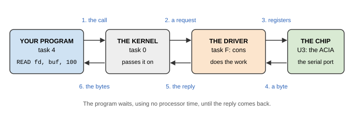

# Chapter 12. How Drivers Work

Every device on the Hydra is looked after by a **driver**: a program that knows how to talk to the device's chips.
Other programs never touch the chips themselves. Instead, the driver makes the device look like a few files, and
programs read and write those. This chapter explains how that works, and how to use any device from the shell.

> **IN THIS CHAPTER:** You'll learn how a driver turns a device into files, how to command any device by writing to
> its control file, what the `#` device names mean, and what happens when a device is busy. **You need:** Chapter 6,
> and section 9.4.

## 12.1 Devices are files

Think about what a program wants from the serial port: to send some bytes, and to receive some. That's exactly
what it wants from a file on a disk, too: to write some bytes, and read some. So HydraOS makes them the same. The
serial port is the file `/dev/ser`; the sound chip is `/dev/snd`; the clock is `/dev/time`. To use a device, a
program opens its file and reads or writes it, with the same few **system calls** it uses for every file:

| Call | What it does |
|---|---|
| `OPEN` | Open a file by its name, for reading, writing, or both; it gives a **file descriptor** (a small number for the open file) |
| `READ`, `WRITE` | Read or write bytes |
| `SEEK` | Move to a place in the file |
| `CLOSE` | Finished with the file |
| `CREATE`, `REMOVE` | Make a new file, or remove one |
| `STAT`, `WSTAT` | Read a file's details (its name, length, time ...), or change them |

The idea comes from the Plan 9 operating system, and from Unix before it. It makes every device easy to use from
any language, and from the shell, with nothing but `cat` and `echo`:

```session
/> cat /dev/time
2000-01-01 00:00:04
```

## 12.2 Drivers are servers

Each driver runs in a task of its own (the boot drivers are in tasks F, E, D, C, B and A). A driver is a **file
server**: it waits for **requests**, and answers them.

When a program calls `READ` on a device's file, the kernel turns the call into a request, and hands it to the
driver's task: "read 100 bytes of file 3, from offset 0". The driver does the work, perhaps waiting for the device,
and gives back the bytes. The kernel copies them into the program's memory, and the program carries on.

<figure>

<figcaption>Figure 12-1. A program reads a device's file.</figcaption>
</figure>

Because a driver is just a program serving files, a driver doesn't have to be in the ROM, or started as the
Hydra starts. `input`, the Vera X keyboard's driver, is an ordinary program that init starts; and the PC tool,
which serves `/pc`, is a program on your PC.

> **HOW IT WORKS:** A driver also owns its device's **interrupt line**. When the device needs attention (a byte
> arrived, a timer ran out), the kernel runs the driver's **interrupt entry**: a few instructions that collect the
> byte or note the event, then tell the tasks that were waiting for it. So a program can wait for a key without
> using the processor at all.

## 12.3 Device names

Each driver gives its files a **device name**: a `#`, a letter, and sometimes a **spec** after it, which chooses
one of the driver's devices. You can use a device name anywhere you'd use a path:

```session
/> ls '#t'
ticks
time
rtc
/> cat '#fx/lib/shell'
/bin/forth -l
```

(`#` starts a comment in rc, so device names must be in quotes.) `#fx` is HydraFS's disk `x`, the ROM disk. But
you'll rarely need device names, because the namespace (Chapter 9) puts every device at a friendlier path: `#t` is
bound at `/dev`, so its `time` file is `/dev/time`.

| Device | Driver | Usually at | Chapter |
|---|---|---|---|
| `#c` | cons | `/dev`: `cons`, `consctl`, `wctl` ... | 13 |
| `#P` | cons | `/pc` | 9, 13 |
| `#S` | storage | `/dev/spi` | 14, 17 |
| `#d` | storage | `/dev/sd` | 14 |
| `#f` | storage | `/sd`, `/rom`, `/ram`, `/sram` | 14 |
| `#a` | snd | `/dev`: `snd`, `sndctl`, `psg`, `bell` | 15 |
| `#v` | vid | `/dev/vid` | 16 |
| `#g` | gpio | `/dev/gpio` | 17 |
| `#i` | gpio | `/dev/i2c` | 17 |
| `#/` | kdev | `/` | 9 |
| `#n` | kdev | `/dev`: `null`, `zero`, `kmesg` | 17 |
| `#t` | kdev | `/dev`: `ticks`, `time`, `rtc` | 17 |
| `#m` | kdev | `/dev/mod` | 17 |
| `#s` | kdev | `/dev/seg` | 17 |
| `#e` | kdev | `/env` | 17 |
| `#p` | kdev | `/proc` | 17 |
| `#|` | kdev | (pipes: made by the shell's `|`) | 17 |

## 12.4 Control files

Most devices have a **control file**, usually called `ctl` (the console's is `consctl`, the sound's `sndctl`). It
works in two directions:

* **Write a command to it**, as a line of text, to tell the driver to do something or change a setting.
* **Read it**, to see the driver's settings, as lines of text.

For example, the serial port's control file sets its speed and its flow control (section 13.6):

```session
/> cat /dev/serctl
b9600
x1
```

and `echo b115200 >/dev/serctl` would change the speed. Because commands are plain text, any program can send them, and
you can try them out at the shell before you use them in a program. A command the driver doesn't understand gives
the error `invalid argument`:

```session
/> echo fly >/dev/gpio/ctl
echo: write error: invalid argument
```

The following chapters list every command each control file understands.

## 12.5 When it goes wrong

Every system call either succeeds, or fails with an **error code**: a number from 1 to 255, which says what went
wrong. Programs print its message, like `not found` or `busy`. Appendix G lists them all. The ones you'll see most
from devices are:

| Message | Means |
|---|---|
| `invalid argument` | The driver didn't understand the command, or a number was out of range |
| `busy` | Someone else is using the device (or the channel, or the file) |
| `no such device` | The device isn't there: no Vera X, no SD card ... |
| `not allowed` | That file can't be read (or written) |
| `i/o error` | The device didn't answer, or answered wrongly |
| `not yet: try again` | Nothing is ready yet, and the program asked not to wait |

## 12.6 Claims

Some devices can only do one thing at a time. A program can **claim** them: the sound driver's channels, the Vera
X's chip, an SPI device. While a program has a claim, other programs' requests are refused (with `busy`), or, for
sound, quietly ignored. The claim ends when the program releases it, or when it closes the device's files, which
happens anyway when the program ends. So a program that crashes can never leave a device stuck.
