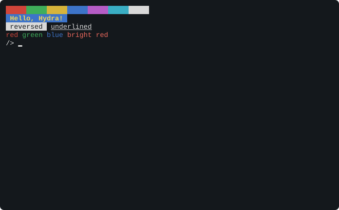

# Chapter 13. The Console and the Terminal

The **console** is how you and your programs talk: your keys in, and text out to your screen. Its driver, `cons`,
looks after the serial port and the console's windows (Chapter 10), and serves `/pc` too. This chapter describes all
of its files, and the **escape sequences** that programs use to move the cursor, clear the screen and change
colours.

> **IN THIS CHAPTER:** You'll learn the console's files, how a program reads lines or single keys, the escape
> sequences that move the cursor and set colours, the serial port's settings, and `/pc`. **You need:** Chapter 12. The
> examples are single lines of rc and HyForth that you can type just as they are: you don't need to know either
> language yet.

## 13.1 The console's files

`cons` is device `#c`. Each window has its own set of files (window *n*'s are `#c`*n*), and a shell finds its own
window's at `/dev`. A few files are the whole console's, the same in every window.

| File | Whose | What it is |
|---|---|---|
| `cons` | The window's | Read: your typing. Write: text for the window's screen |
| `consctl` | The window's | The window's settings: raw mode, keys, where it's shown (section 13.4) |
| `wctl` | The window's | The windows: new ones, layouts, the chrome, the keys (section 13.5) |
| `label` | The window's | The window's name |
| `text` | The window's | The window's scrollback and screen, as text |
| `kbdin` | The window's | Bytes written here are typed into the window |
| `wnew` | The window's | A read waits for <kbd>CTRL</kbd>-<kbd>]</kbd> <kbd>C</kbd>, and gives the new window's number |
| `snarf` | The console's | The snarf buffer: the console's clipboard |
| `ser` | The console's | The serial port itself, byte by byte (section 13.6) |
| `serctl` | The console's | The serial port's speed |
| `kbin` | The console's | The Vera X keyboard's keys, from the `input` program (Chapter 16) |

## 13.2 Reading lines

Normally, the console is in **cooked mode**: a program that reads `cons` gets a whole line at a time, after you've
typed it and pressed <kbd>RETURN</kbd>. Until then, the console itself lets you edit the line, with the keys in
section 6.3, and keeps the last four lines you typed for <kbd>↑</kbd> and <kbd>↓</kbd> to bring back. A line can be
up to 127 characters long; a line longer than the window is wide goes on to the next rows.

<kbd>CTRL</kbd>-<kbd>D</kbd>, typed at the start of a line, is the **end of the input**: the program's read gets
nothing, which tells it there's no more. `cat`, typed alone, copies what you type to the screen until you press
<kbd>CTRL</kbd>-<kbd>D</kbd>.

You don't have to wait for a prompt before you type. The console keeps the keys that come while a program is busy
(about 300 of them from a terminal, 60 from the Vera X's keyboard), and hands them over when the program next
reads: so you can type the next command while one is still running, or paste a whole program from your PC. When
it's holding about half of what it can, it asks the terminal to wait (section 13.6), so a paste of any length
arrives whole, as long as your terminal's flow control is set to XON/XOFF (section 5.2).

## 13.3 Raw mode and keys

A program like the screen editor needs each key as it's pressed, without waiting for <kbd>RETURN</kbd>. It writes
`rawon` to `consctl`, and the console goes into **raw mode**: each read gets the keys typed so far, as they are, and
the console doesn't show them (the program does that itself). Raw mode lasts until the program writes `rawoff`, or
closes `consctl`: so when the program ends, the console goes back to cooked mode by itself.

In raw mode, the keys that send more than one byte, like the arrows, can come in two ways, which the program chooses
with `consctl`'s `keys` command:

* `keys hydra` (the usual): each key is **one byte**. The ordinary keys are their characters, and the special
  keys are these codes:

| Code | Key | Code | Key | Code | Key |
|---|---|---|---|---|---|
| $80 | <kbd>↑</kbd> | $87 | <kbd>DELETE</kbd> | $8E | <kbd>F5</kbd> |
| $81 | <kbd>↓</kbd> | $88 | <kbd>PAGE UP</kbd> | $8F | <kbd>F6</kbd> |
| $82 | <kbd>→</kbd> | $89 | <kbd>PAGE DOWN</kbd> | $90 | <kbd>F7</kbd> |
| $83 | <kbd>←</kbd> | $8A | <kbd>F1</kbd> | $91 | <kbd>F8</kbd> |
| $84 | <kbd>HOME</kbd> | $8B | <kbd>F2</kbd> | $92 | <kbd>F9</kbd> |
| $85 | <kbd>END</kbd> | $8C | <kbd>F3</kbd> | $93 | <kbd>F10</kbd> |
| $86 | <kbd>INSERT</kbd> | $8D | <kbd>F4</kbd> | $94, $95 | <kbd>F11</kbd>, <kbd>F12</kbd> |

  And three more that aren't keys: $96 means the window has changed size (read `consctl` for the new size); $97
  means you've moved to another window of the program's group, and the next byte is its number; and $98 comes
  before a key typed with <kbd>SHIFT</kbd>, <kbd>ALT</kbd> or <kbd>CTRL</kbd> held down, if the program asked for
  them with `keys mods`: the next byte says which (1 <kbd>SHIFT</kbd>, 2 <kbd>ALT</kbd>, 4 <kbd>CTRL</kbd>, added
  together), and then comes the key.

* `keys vt`: each key comes as the bytes a VT100 terminal would send: <kbd>↑</kbd> is <kbd>ESC</kbd> `[A`, for
  example. This is for programs written for other terminals.

An <kbd>ESC</kbd> key on its own reaches the program a tenth of a second after it's pressed, once the console is
sure it isn't the start of a longer sequence.

## 13.4 consctl: the window's settings

| Command | What it does |
|---|---|
| `rawon` | Raw mode: each key as it comes (section 13.3) |
| `rawoff` | Cooked mode: a line at a time |
| `keys hydra` | Raw mode's special keys as one byte each |
| `keys vt` | Raw mode's special keys as a VT100 sends them |
| `keys mods` | As `keys hydra`, and the keys typed with <kbd>SHIFT</kbd>, <kbd>ALT</kbd> or <kbd>CTRL</kbd> marked |
| `scroll smooth` | On the serial port, every byte the window's programs write is sent, and they wait for it |
| `scroll jump` | On the serial port, the programs don't wait: the terminal shows the screen as it is, skipping what it missed |
| `group` | <kbd>CTRL</kbd>-<kbd>C</kbd> in this window goes to the writer's note group (the shell's profile does this) |
| `serial` | Show the windows on the serial terminal |
| `screen` | Show the windows on the Vera X's screen |
| `both` | Show the windows on both |
| `seats` | Both terminals, each a **seat** of its own: its own window shown, and its own keys (Chapter 16) |
| `terminal size` *c r* | Tell the console the serial terminal's size: *c* columns, *r* rows |
| `terminal size` | Ask the serial terminal its size (with the sequence <kbd>ESC</kbd> `[18t`) |

Reading `consctl` shows the window's settings, its number and its size:

```session
/> cat /dev/consctl
rawoff
keys hydra
scroll smooth
group 2
window 0
size 80 24
terminal serial
```

The console starts with an 80 by 24 terminal, and asks the terminal for its real size. Terminals that answer
(xterm, Windows Terminal, the PC tool) get windows that fit; the PC tool tells the Hydra each time you resize its
window, too. A window is never more than 127 columns by 64 rows.

## 13.5 wctl: the windows

| Command | What it does |
|---|---|
| `new` | Make a window in the writer's group; a read of the same file then gives its number |
| `new group` | Make a window in a new group |
| `current` *n* | Show window *n* |
| `layout tabs` \| `rows` \| `columns` \| `grid` | The group's windows one at a time, or tiled (section 10.4) |
| `float` *x y c r* | Show the window as a pop-up box, *c* by *r*, at column *x*, row *y* |
| `float` *c r* | The same, in the middle of the screen |
| `float off` | The window isn't a pop-up any more |
| `bar top` \| `bottom` \| `off` | Where the bar is (or none) |
| `bar` *format* | What the bar shows (section 10.7) |
| `header` *format*, `footer` *format* | What the window's header and footer show |
| `header on` \| `off`, `footer on` \| `off` | The window's header and footer on or off |
| `chrome screen` \| `serial` \| `both on` \| `off` [`bar`] [`header`] [`footer`] | The chrome on or off, on a terminal (all of it, or the parts named) |
| `default header` *format*, `default footer` *format*, `default chrome ...` | The same, for new windows |
| `status` *text* | The window's status line (the footer's `%s`) |
| `monitor on` \| `off` | Mark the window with `+` in the bar's list when it's written to while it isn't shown |
| `history` *n* | Keep *n* more rows of scrollback (64 at a time, up to 128) |
| `key prefix` *key* | Change the window key from <kbd>CTRL</kbd>-<kbd>]</kbd> to another control key, written `ctrl-X` or `^X` (not <kbd>CTRL</kbd>-<kbd>C</kbd>, <kbd>CTRL</kbd>-<kbd>\\</kbd>, <kbd>ESC</kbd>, <kbd>RETURN</kbd> or <kbd>CTRL</kbd>-<kbd>J</kbd>) |
| `key` *key action* | What a key after the window key does (below) |

The **actions** a key can have are `next`, `previous` (the group's windows), `next-group`, `previous-group`, `new`
(a group), `list`, `hold`, `close`, `paste`, `scrollback`, `split`, `vsplit`, `zoom`, `help` and `none`. The key
is a character, `ctrl-X`, `tab` or `shift-tab`; and `key ctrl-tab` *action*, `key ctrl-shift-tab` *action* and
`key shift-pgup` *action* set the keys that work without the window key. For example, to make
<kbd>CTRL</kbd>-<kbd>]</kbd> <kbd>K</kbd> close a group:

```text
/> echo key k close >/dev/wctl
```

Reading `wctl` lists the windows, one a line: each one's number, group, columns and rows, with a `*` after the one
with the keys (section 10.8).

## 13.6 The serial port

The console normally owns the serial port, sending each window's text to your terminal. Two files give programs the
port itself:

* `ser` is the serial port, byte by byte, exactly as the bytes come and go. While a program has `ser` open for
  reading, every byte that arrives is its, even <kbd>CTRL</kbd>-<kbd>C</kbd>, and the windows wait. `xmodem` works
  this way.
* `serctl` sets the port's speed and its flow control. Writing a speed changes it at once (so change your
  terminal's speed too); reading shows both settings, a line each.

| Command | Speed | Really |
|---|---|---|
| `b300` | 300 baud | 291 |
| `b600` | 600 baud | 583 |
| `b1200` | 1200 baud | 1,165 |
| `b2400` | 2400 baud | 2,330 |
| `b4800` | 4800 baud | 4,661 |
| `b9600` | 9600 baud (as the Hydra starts) | 9,322 |
| `b19200` | 19200 baud | 18,644 |
| `b115200` | 115200 baud | 111,861 |

(The serial chip's clock is a little slower than the speeds' names assume, section 5.5.) The port always sends 8
data bits, no parity and 1 stop bit.

**Flow control** keeps a fast sender from getting ahead of the Hydra. The console can hold about 300 keys that no
program has read yet. With `x1`, which is how it starts, it sends the terminal an **XOFF** (the byte $13) when 96
bytes are waiting in its receive buffer, and an **XON** ($11) when a program has read them down to 32. A terminal
that's set to *XON/XOFF* stops sending between the two, so nothing is lost, however much you paste.

| Command | Flow control |
|---|---|
| `x1` | XON/XOFF (as the Hydra starts) |
| `x0` | None: the console never asks the terminal to wait |

```session
/> cat /dev/serctl
b9600
x1
```

Three things to know about it:

* **A terminal that isn't set to XON/XOFF** takes no notice (it doesn't show the two bytes either), and then a
  long paste into a busy program loses its end, after the 300 keys the console can hold. What came first is kept.
* **A stopped terminal holds everything back**, even <kbd>CTRL</kbd>-<kbd>C</kbd>. So the console never leaves a
  terminal stopped for more than five seconds: if no program has read anything by then, it sends XON anyway, your
  <kbd>CTRL</kbd>-<kbd>C</kbd> arrives, and what was pasted behind it may be lost. (The PC tool sends
  <kbd>CTRL</kbd>-<kbd>C</kbd> at once, stopped or not.)
* **`xmodem` and `ser`** send and receive every byte as it is, with no XON or XOFF added. Turn your terminal's
  flow control off for a file transfer if it doesn't do so itself: the file's own $11 and $13 bytes are data.

> **HOW IT WORKS:** Many computers use two more wires for this, called RTS and CTS, and the Hydra's serial socket
> has both. But the Hydra's serial chip, the R65C51, turns its own transmitter off whenever it raises RTS to say
> "wait", so the Hydra could say nothing at all while it held the PC back: not even the echo of your keys. XON
> and XOFF are ordinary bytes sent on the ordinary wire, and have no such trouble.

## 13.7 The terminal

When a program writes to the console, most bytes are characters to show. But some are **control characters**, and
some start **escape sequences**: commands to the terminal, to move the cursor, clear the screen, or change colours.
Each window's screen is kept by the console itself, which understands the commands of the **VT100**, a famous
terminal of 1978, and the VT102 after it; and each window's commands go on to your terminal program, which
understands them too.

Escape sequences start with the <kbd>ESC</kbd> character (27, or $1B). Most of the useful ones are **CSI**
sequences: <kbd>ESC</kbd> and `[`, then some numbers separated by `;`, then a letter that says what to do. In the
tables, *n*, *r* and *c* stand for numbers; most can be left out, and then they're 1 (or 0, for `J`, `K` and `m`).

Here are the colours from HyForth (Chapter 19 explains the Forth):

```text
: esc 27 emit ;
: rainbow 8 1 do esc ." [4" i 48 + emit ." m     " loop esc ." [0m" cr ;
: hello esc ." [1;33;44m Hello, Hydra! " esc ." [0m" cr ;
: styles esc ." [7m reversed " esc ." [0m " esc ." [4munderlined" esc ." [0m" cr ;
: colours esc ." [31mred " esc ." [32mgreen " esc ." [34mblue " esc ." [91mbright red" esc ." [0m" cr ;
: cls esc ." [2J" esc ." [H" ;
cls rainbow hello styles colours
```

<figure>

<figcaption>Figure 13-1. Colours and styles from escape sequences.</figcaption>
</figure>

### Control characters

| Byte | Name | What it does |
|---|---|---|
| 7 | BEL | Rings the bell: a short beep from the sound chip |
| 8 | BS | Moves the cursor one column left |
| 9 | HT | Moves the cursor to the next tab stop (every 8 columns, unless they've been changed) |
| 10 | LF | A new line: down a row (scrolling at the bottom), to the first column |
| 11, 12 | VT, FF | As LF |
| 13 | CR | Back to the first column |
| 14, 15 | SO, SI | Use character set G1, or G0 (below) |
| 24, 26 | CAN, SUB | Cancel the escape sequence being sent |
| 27 | ESC | Starts an escape sequence |

### Moving the cursor

| Sequence | What it does |
|---|---|
| `ESC [` *n* `A` | Up *n* rows |
| `ESC [` *n* `B` | Down *n* rows |
| `ESC [` *n* `C` | Right *n* columns |
| `ESC [` *n* `D` | Left *n* columns |
| `ESC [` *n* `E` | Down *n* rows, to the first column |
| `ESC [` *n* `F` | Up *n* rows, to the first column |
| `ESC [` *c* `G`, `ESC [` *c* `` ` `` | To column *c* |
| `ESC [` *r* `d` | To row *r* |
| `ESC [` *r* `;` *c* `H`, `ESC [` *r* `;` *c* `f` | To row *r*, column *c* (counting from 1: `ESC [H` is the top left) |
| `ESC [` *n* `a`, `ESC [` *n* `e` | Right *n* columns; down *n* rows |
| `ESC [s`, `ESC 7` | Save the cursor (`ESC 7` saves its colours and character sets too) |
| `ESC [u`, `ESC 8` | Back to the saved cursor |
| `ESC D` | Down a row, scrolling at the bottom |
| `ESC M` | Up a row, scrolling down at the top |
| `ESC E` | To the first column of the next row |

### Erasing, inserting and scrolling

| Sequence | What it does |
|---|---|
| `ESC [` *n* `J` | Erase the screen: 0, from the cursor to the end; 1, from the start to the cursor; 2, all of it |
| `ESC [` *n* `K` | Erase the line: 0, from the cursor to its end; 1, from its start; 2, all of it |
| `ESC [` *n* `X` | Erase *n* characters from the cursor |
| `ESC [` *n* `@` | Insert *n* blanks at the cursor |
| `ESC [` *n* `P` | Delete *n* characters at the cursor |
| `ESC [` *n* `L` | Insert *n* blank lines at the cursor's row |
| `ESC [` *n* `M` | Delete *n* lines at the cursor's row |
| `ESC [` *n* `S`, `ESC [` *n* `T` | Scroll up, or down, *n* rows |
| `ESC [` *n* `b` | Repeat the last character *n* times |
| `ESC [` *t* `;` *b* `r` | The **scrolling region**: only rows *t* to *b* scroll (`ESC [r`: the whole screen) |
| `ESC #8` | Fill the screen with `E`s (the VT100's alignment test) |

### Tab stops

| Sequence | What it does |
|---|---|
| `ESC H` | Set a tab stop at the cursor's column |
| `ESC [g`, `ESC [3g` | Clear the tab stop at the cursor; clear them all |
| `ESC [` *n* `I`, `ESC [` *n* `Z` | Forward, or back, *n* tab stops |

### Colours and styles

`ESC [` *n* `;` *n* ... `m` sets the **graphic rendition**: the colours and styles of the characters that follow.
Each *n* is one of these:

| *n* | Means | *n* | Means |
|---|---|---|---|
| 0 | Back to normal | 22 | Not bold or dim |
| 1 | Bold (on a screen, bright) | 24 | Not underlined |
| 2 | Dim | 25 | Not blinking |
| 4 | Underlined | 27 | Not reversed |
| 5 | Blinking | 28 | Not hidden |
| 7 | Reversed: the colours swapped | 30-37 | The text's colour (below) |
| 8 | Hidden | 39 | The text's normal colour |
| 90-97 | A bright text colour | 40-47 | The background colour |
| 100-107 | A bright background colour | 49 | The normal background |
| 38;5;*n*, 48;5;*n* | One of 256 colours | 38;2;*r*;*g*;*b*, 48;2;... | Any colour, by its red, green and blue |

The colours are: 0 black, 1 red, 2 green, 3 yellow, 4 blue, 5 magenta, 6 cyan, 7 white. So `ESC [31m` is red text,
`ESC [44m` a blue background, and `ESC [1;33;44m` bold yellow on blue. The window keeps 16 colours: a colour given by
number or by red, green and blue is kept as the nearest of them.

### Modes

`ESC [` *n* `h` sets a mode, and `ESC [` *n* `l` resets it; `ESC [?` *n* `h` and `ESC [?` *n* `l` are DEC's private
modes.

| Mode | When set |
|---|---|
| 4 | Insert: characters push the rest of the line right |
| 20 | Each LF is also a CR |
| ?1 | The cursor keys send application codes (`keys vt`) |
| ?3 | (132 columns: not on the Hydra; the screen is cleared) |
| ?6 | Origin mode: row numbers count from the scrolling region's top |
| ?7 | Auto-wrap: text reaching the last column goes on to the next line (set as it starts) |
| ?25 | The cursor is shown (set as it starts) |
| ?47, ?1047 | The **alternate screen**: a second screen, without scrollback, for full-screen programs |
| ?1049 | As ?1047, saving the cursor first (and back, when reset) |
| ?1000 | Report the mouse's buttons to the program (Chapter 16) |
| ?2004 | Bracketed paste: a paste comes between `ESC [200~` and `ESC [201~` |

`ESC =` and `ESC >` set the keypad's application and numeric modes; `ESC [?2l` switches to the VT52's older
sequences, and `ESC <` back.

### Character sets

`ESC (` *x* chooses the character set G0, and `ESC )` *x* G1, where *x* is `B` (ASCII), `A` (British: `#` is `£`)
or `0` (the **DEC Special Graphics**, with line-drawing characters). SO and SI switch between G1 and G0. In the
Special Graphics, the lower-case letters draw lines and boxes:

| Byte | `j` | `k` | `l` | `m` | `n` | `q` | `t` | `u` | `v` | `w` | `x` |
|---|---|---|---|---|---|---|---|---|---|---|---|
| Draws | ┘ | ┐ | ┌ | └ | ┼ | ─ | ├ | ┤ | ┴ | ┬ | │ |

So `ESC (0lqqqkESC (B` draws the top of a box, `┌───┐`.

### Questions and answers

A program can ask the terminal things; the console answers into the program's keys, as if they'd been typed.

| Sequence | Asks | The answer |
|---|---|---|
| `ESC [c`, `ESC Z` | What are you? | `ESC [?6c`: a VT102 |
| `ESC [5n` | Are you all right? | `ESC [0n` |
| `ESC [6n` | Where's the cursor? | `ESC [` *r* `;` *c* `R` |

### Titles, status lines and lights

| Sequence | What it does |
|---|---|
| `ESC ]0;` *text* BEL, `ESC ]2;` *text* BEL | Set the window's label (as writing `/dev/label` does) |
| `ESC [` *n* `$~` | The status line: 0 none, 1 the terminal's own, 2 the program's |
| `ESC [1$}`, `ESC [0$}` | Write into the status line from now on; back to the screen |
| `ESC [` *n* `q` | The keyboard's four lights: 0 all off, 1 to 4 one on, 21 to 24 one off |

### Resetting

| Sequence | What it does |
|---|---|
| `ESC c` | Reset the terminal completely, and clear the screen |
| `ESC [!p` | A soft reset: the modes, the margins and the rendition as they start, without clearing |

## 13.8 /pc

`cons` also serves `/pc`, device `#P`, a folder on the PC (section 9.9). Its requests and the PC tool's replies go
over the serial port as **frames**, mixed in with the text; each frame starts with the byte $1E, and has a check
number (a CRC) at its end, so a damaged frame is sent again. The PC tool takes the frames out, so you never see
them.
