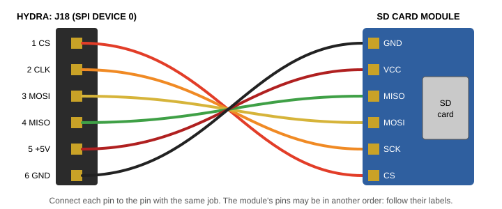

# Chapter 14. Disks and HydraFS

The **storage** driver, in task E, looks after everything that keeps files: the SD cards, the RAM disks and the ROM
disk, and HydraFS, the way files are arranged on them. This chapter explains them all, and the files that control
them.

> **IN THIS CHAPTER:** You'll connect an SD card reader, get a card ready and check it, use the RAM disks and the ROM
> disk, learn how HydraFS arranges a disk, and move files to and from a PC. **You need:** Chapters 9 and 12.

## 14.1 Three devices

`storage` serves three devices, one inside the other:

| Device | At | What it is |
|---|---|---|
| `#S` | `/dev/spi` | The **SPI bus**: the eight SPI headers and the slots' SPI devices, byte by byte (Chapter 17) |
| `#d` | `/dev/sd` | The **disks**: each one as a long row of bytes, with a control file |
| `#f` | `/sd`, `/rom`, `/ram`, `/sram` | **HydraFS**: the files and directories on the disks |

Most of the time you use `#f`, through the paths in the namespace, and never think about the others.

## 14.2 SD cards

An **SD card** is the little memory card used in cameras and phones. The Hydra can use up to sixteen of them: one
on each of its eight SPI headers, J18 to J25, and eight more on expansion cards in the slots. A Vera X card has an SD
card socket of its own, too.

The SPI headers have six pins:

| Pin | Name | Job |
|---|---|---|
| 1 | CS | Chip select: the Hydra chooses this device |
| 2 | CLK | The clock: one pulse for each bit |
| 3 | MOSI | Data from the Hydra to the device |
| 4 | MISO | Data from the device to the Hydra |
| 5 | +5V | Power |
| 6 | GND | Ground |

The Hydra's SPI bus works at 5 volts, but SD cards work at 3.3 volts, so a card needs an **SD card module**
between them: a small board with a card socket, a voltage regulator and a level shifter. Modules sold for 5-volt
boards, like the Arduino, are just right. Connect each of the module's pins to the header's pin with the same job:

<figure>

<figcaption>Figure 14-1. An SD card module on SPI header J18.</figcaption>
</figure>

| SPI header | SPI device | The card's name | Its files |
|---|---|---|---|
| J18 | 0 | `0` | `/sd/0` |
| J19 | 1 | `1` | `/sd/1` |
| J20 ... J25 | 2 ... 7 | `2` ... `7` | `/sd/2` ... `/sd/7` |
| On cards in the slots | 8 ... 15 | `8` ... `f` | `/sd/8` ... `/sd/f` |
| The Vera X's socket | | `v` | `/sd/v` |

The card in device 0 is special: the namespace looks there for programs (`/sd/0/bin`), libraries and settings
(`/sd/0/lib`), so it's the best place for your own.

**Card types.** SD cards up to 2 GB are **SDSC** cards; bigger ones are **SDHC** (up to 32 GB) or **SDXC** (the Hydra
shows both as `sdhc`). A card of any size works, and HydraFS can use all of it, but a small one is plenty: the
Hydra's files are small. A card has to have a HydraFS on it before the Hydra can keep files there.

**A new card.** To use a new card, put it in the module, and make an empty HydraFS on it:

```text
/> mkfs 0 MYCARD
```

This erases everything that was on the card! If the card has partitions (a PC's card usually has one), `mkfs -p`
puts HydraFS in a partition of its own after the others, and leaves the rest of the card alone.

You can also prepare a card on your PC, with the tools in Chapter 2: `hydrafs.js` makes a card image with your files
in it, and `sdwrite.js` writes an image onto a card.

**Taking a card out.** The Hydra keeps the last piece of a file it's writing until the file is closed, so make sure
no program is writing to a card before you take it out. A card can be changed while the Hydra runs: write `init`
to the card's control file (section 14.4) after you put the new one in.

**Speed.** The Hydra's SPI bus is worked by its processor, one bit at a time, so it isn't fast: under 20 kilobytes a
second for reading, and about half that for writing. A card in a Vera X is faster, as the Vera X has SPI hardware of its
own.

## 14.3 The RAM disks and the ROM disk

**The RAM disks** keep files in memory. init starts both as the Hydra starts (section 7.4):

| Disk | Size | Kept in | At |
|---|---|---|---|
| `r` | 256K | RAM banks on the memory cards (the storage driver's own) | `/ram`: each shell has its own directory of it |
| `s` | 512K | A segment of the shared RAM | `/sram`: one for everybody |

With less memory, they're made smaller. They're very fast, but they're empty again each time the Hydra starts.

**The ROM disk**, `x`, is part of the paged ROM, after the modules. It's made when HydraOS is built, and can't be
changed (a program that tries is told `read-only`). It holds HydraOS's own files: the programs in `/rom/bin`, the
libraries and settings in `/rom/lib`, a song, and a README.

## 14.4 The disks' control files

Each disk that has started is a directory in `#d` (bound at `/dev/sd`), with two files: `data`, the disk as one long
file of bytes (its first 4 GB), and `ctl`, its control file.

```session
/> ls /dev/sd
0/
x/
r/
s/
/> cat /dev/sd/0/ctl
sdhc 17 MB 34816 blocks
hydrafs label=HYDRA-16
partition at block 2048
free 15788 KB of 16380 KB
```

Reading a disk's `ctl` gives:

* its kind, size and number of **blocks** (pieces of 512 bytes: a disk is read and written a block at a time);
* `hydrafs label=`, and the disk's label, if it has a HydraFS;
* where its HydraFS partition starts, if it's in one;
* how much space is free;
* for a RAM disk, which banks or which segment it's in;
* after a check, what the check found.

The commands it understands are:

| Command | What it does |
|---|---|
| `init` | Start the card again: after it's been changed for another |
| `sync` | Write the block the driver is keeping back now, without waiting for its file to close |
| `format` [`-f`] [`-p`] [`-s` *size*] [*label*] | Make a new, empty HydraFS (as `mkfs`): `-f` a full format; `-p` in a partition of its own; `-s` *size* only that many megabytes of the card (or gigabytes, with a G: `-s 4G`) |
| `label` *text* | Set the disk's label (as `label`) |
| `check` | Check the HydraFS (as `fsck`) |
| `check fix` | Check it, and fix what's wrong (as `fsck -f`) |
| `start` *size* [*from*-*to*] | Start a RAM disk of *size* 8K banks (or *size*`K`, *size*`M`), with an empty HydraFS |
| `stop` | Stop a RAM disk, and give its memory back (not while one of its files is open) |

A **full format** writes the disk's whole map of free space at once; a **quick format** (the usual) writes it a piece
at a time, as the space is first used. A full format of a 32 GB card takes about a minute and a half.

> **CAUTION:** Writing to a disk's `data` file changes its blocks directly, underneath HydraFS. It's a quick way to
> spoil a disk. Reading it is harmless, though: `xd /dev/sd/0/data | more` shows a card's first blocks.

## 14.5 HydraFS

**HydraFS** is the Hydra's own way of arranging files on a disk. Every disk uses it: the cards, the RAM disks and the
ROM disk. Here's how it works.

A disk is a row of **blocks**, of 512 bytes each. The first block of the HydraFS (block 0 of the card, or of its
partition) is the **superblock**. It starts with the word `HYDRAFS1`, and says where everything else is: the **free
map**, which has one bit for each **cluster** of the disk, saying whether it's in use; and the **data area**, where
the files and directories are. Space is given to files a cluster at a time: 4K (8 blocks) on a card, or 1K (2 blocks)
on the RAM disks and the ROM disk, so a disk with lots of small files wastes less.

A **directory** is a file of **entries**, 64 bytes each. An entry holds a file's:

* name (up to 31 characters);
* **mode**: whether it's a directory, append-only or read-only;
* length, in bytes (up to 4 GB);
* time it was last changed, in seconds since the start of 2000;
* where its clusters are: up to two **extents** (runs of clusters, one after another) in the entry itself, and, for a
  file in many pieces, more in **extent blocks**, of 84 extents each.

A file can have **holes**: parts that were never written (because the program writing it skipped ahead with `SEEK`).
A hole takes no space on the disk, and reads as zeros.

| HydraFS's limits | |
|---|---|
| A name | 31 characters: any but `/`; capital and small letters are different |
| A path (on any disk) | 63 characters |
| A file | 4 GB |
| Files open at once | 32, on all the disks together |

**Partitions.** A PC's SD card has a **partition table** in its first block, dividing it into parts. HydraFS can live
in a partition of its own (its type number is $7F), so a card can have a PC's files in one partition and the Hydra's
in another. `mkfs -p` makes one, starting on a 1 MB boundary.

## 14.6 Checking a disk

If the power goes off while a disk is being written, or a card is taken out too soon, its HydraFS may be left with
small mistakes. `fsck` (or the `check` command) looks at every directory and every file, and compares the space they
use with the free map:

```session
/> fsck s
hydrafs label=SRAM
free 510 KB of 511 KB
check: lost 0, unmarked 0, twice 0
segment 15
```

| Count | What it is | What `fsck -f` does |
|---|---|---|
| `lost` | Clusters marked in use, that no file has | Marks them free |
| `unmarked` | Clusters a file has, that aren't marked in use | Marks them in use |
| `twice` | Clusters that two files both claim | (Reports them: copy the files, and remove one) |

All three should be 0. `lost` space is harmless, just wasted; `unmarked` space is dangerous, because a new file could
be given it and overwrite the old one, so fix it straight away.

## 14.7 Moving files to and from a PC

There are four ways:

| Way | How |
|---|---|
| `/pc` | With the PC tool running, copy files to and from `/pc` (section 9.9) |
| `xmodem` | With a terminal program that speaks XMODEM (Chapter 11) |
| A card image | On the PC, put files into a card image with `hydrafs.js`, and write it to a card with `sdwrite.js` (Chapter 2) |
| The emulator | The emulator can use a card image, or a folder on the PC as `/pc` (Chapter 2) |
