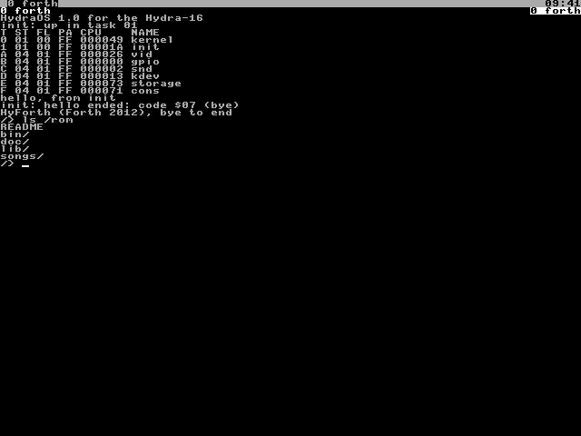
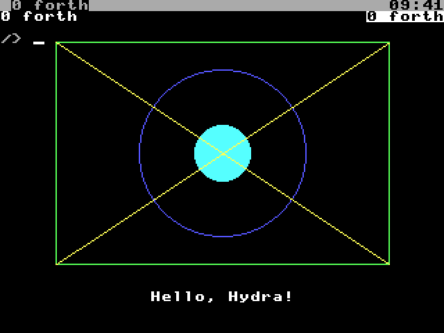

# Chapter 16. The Vera X: Screen, Keyboard and Mouse

With a **Vera X** card, the Hydra has a screen of its own, a keyboard and a mouse, more sound, and another SD card.
This chapter shows how to use them, and describes the files of the two drivers that look after them: `vid`, for the
screen, and `kdev`, for the keyboard and mouse.

> **IN THIS CHAPTER:** You'll put the console on a screen of its own, draw on it, and read its keyboard and mouse,
> through the files of the `vid` and `kdev` drivers. **You need:** Chapter 12, and a Vera X: the emulator has one.

## 16.1 The Vera X

The **VERA** (Video Embedded Retro Adapter) is the graphics chip of the Commander X16, a modern 8-bit computer. It's
built in an **FPGA**, a chip that can be programmed to be any kind of circuit, and it does a lot:

* a picture of 640 by 480 pixels, for a VGA monitor (or a TV, through its composite or S-video output);
* 128K of **video RAM** (VRAM), which holds everything on the screen;
* two **layers**, each a screen of text (tiles) or a **bitmap** (a picture made of dots), one over the other;
* 128 **sprites**: small pictures that can be moved around the screen on their own;
* a **palette** of 256 colours, chosen from 4,096;
* the **PSG**, with 16 voices, and **PCM**, for recorded sound (Chapter 15);
* an SD card socket.

The **Vera X** is a VERA on a small card of its own. On the Hydra, it's wired to **slot 0**, through the bus breakout
card, as I/O ports 2 and 3 ($FF20 to $FF3F), with interrupt line 2. A PS/2 keyboard and mouse connect to the
Commander X16's **SMC**, a little microcontroller that reads them, which talks to the Hydra on the I²C bus, at
address $42. (The wiring is in the Vera X's schematic, in the `board/vera-x` folder.)

The emulator has a Vera X too (Chapter 2). In the web emulator it's there unless you turn it off in Setup; in the
terminal emulator, add `--vera`.

> **NOTE:** The Vera X isn't part of the Hydra-16 kit, and this book doesn't show how to build one or wire it up: the
> design documents do (`docs/02-hardware/cards.md` has the breakout card's wiring, pin by pin, and how to bring the
> card up). If you don't have one, use the emulator's: everything in this chapter works there.

## 16.2 The console on the screen

When the Hydra starts with a Vera X, the console's windows are shown on its screen as well as on the serial
terminal. The screen shows 80 columns and 60 rows of text, and the chrome: the bar at the top, with the groups and
the time, and the window's header:

<figure>

<figcaption>Figure 16-1. The console on the Vera X's screen, in its 80 by 60 mode.</figcaption>
</figure>

With a keyboard, you can type at the screen just as at the terminal. `consctl` chooses where the windows are shown:

| Command | The windows are shown |
|---|---|
| `echo screen >/dev/consctl` | Only on the Vera X's screen |
| `echo serial >/dev/consctl` | Only on the serial terminal |
| `echo both >/dev/consctl` | On both (as the Hydra starts) |
| `echo seats >/dev/consctl` | On both, each a **seat** of its own (section 16.9) |

## 16.3 /dev/vid/ctl: the screen's settings

| Command | What it does |
|---|---|
| `mode 80x60` | 80 columns and 60 rows of text (the screen cleared) |
| `mode 80x30` | 80 columns and 30 taller rows |
| `mode 40x30` | 40 columns and 30 rows: big letters |
| `cursor blink` \| `on` \| `off` | The cursor blinking, steady, or hidden |
| `border` *n* | The border's colour, 0 to 255 |
| `bitmap 320` *d* | A bitmap under the text: 320 by 240 dots, *d* bits a dot (1, 2, 4 or 8: 2, 4, 16 or 256 colours); the text becomes 40 by 30 |
| `bitmap 640` *d* | A bitmap of 640 by 480 dots (*d*: 1 or 2); the text 80 by 60 |
| `bitmap off` | No bitmap |
| `output vga` | The picture for a VGA monitor (as it starts) |
| `output ntsc` [`mono`] [`240p`] | For a TV: `mono` without colour, `240p` without interlace |
| `output rgb` [`240p`] | For an RGB monitor |
| `claim` | Take the chip for this program alone (section 16.6) |
| `claim all` | The same, and all of VRAM too, even the console's text and font |
| `release` | Give the chip back |
| `reset` | Set the chip up again for the console, and clear the screen |

Reading it shows the settings:

<!-- session --vera
-->

```session
/> cat /dev/vid/ctl
vera 47.0.2
mode 80x60
cursor blink
border 0
bitmap off
output vga
claimed
```

The first line is the version of the VERA's FPGA program (its **gateware**). The last line, `claimed`, names the
program that has the chip, if one has (section 16.6).

## 16.4 Drawing

`/dev/vid/draw` draws on the bitmap, under the text. Turn a bitmap on with `ctl`'s `bitmap` command, then write
commands to `draw`:

| Command | What it does |
|---|---|
| `pen` *c* | Draw in colour *c* from now on |
| `plot` *x y* | A dot |
| `line` *x0 y0 x1 y1* | A line |
| `box` *x0 y0 x1 y1* | A rectangle's outline |
| `bar` *x0 y0 x1 y1* | A filled rectangle |
| `circle` *x y r* | A circle's outline, of radius *r* |
| `disc` *x y r* | A filled circle |
| `clear` [*c*] | Fill the whole bitmap with colour 0, or *c* |
| `text` *x y words* | Write the words, in the console's font, at *x*, *y* |

The dots are numbered from 0, with *x* across from the left and *y* down from the top: in a 320 bitmap, *x* goes from
0 to 319 and *y* from 0 to 239. Anything off the edge isn't drawn. Reading `draw` shows the pen's colour.

```text
/> echo bitmap 320 8 >/dev/vid/ctl
/> echo clear 0 >/dev/vid/draw
/> echo pen 12 >/dev/vid/draw
/> echo circle 160 110 60 >/dev/vid/draw
/> echo pen 10 >/dev/vid/draw
/> echo box 40 30 280 190 >/dev/vid/draw
/> echo pen 14 >/dev/vid/draw
/> echo disc 160 110 20 >/dev/vid/draw
/> echo pen 11 >/dev/vid/draw
/> echo line 40 30 280 190 >/dev/vid/draw
/> echo line 40 190 280 30 >/dev/vid/draw
/> echo pen 15 >/dev/vid/draw
/> echo text 108 210 Hello, Hydra! >/dev/vid/draw
```

<figure>

<figcaption>Figure 16-2. Drawing on the bitmap (the text screen cleared first).</figcaption>
</figure>

The colours are the palette's: 0 to 15 are the console's 16 colours (in the order of section 13.7's colours, then
their bright versions: 8 grey, 9 bright red, 10 bright green, 11 bright yellow, 12 bright blue, 13 bright magenta, 14
bright cyan, 15 white), and 16 to 255 the VERA's own.

## 16.5 The screen's other files

| File | What it is |
|---|---|
| `term` | The screen as a terminal: what's written is shown there, as the console does (below). A read gives the screen's text |
| `vram` | The VERA's 128K of video RAM: the file's offset is the address |
| `pal` | The palette: 256 colours, 2 bytes each (the first: green in the high 4 bits, blue in the low; the second: red) |
| `sprites` | The 128 sprites' settings, 8 bytes each. Sprite 0 is the console's cursor, and sprite 1 the mouse's pointer |
| `font` | The console's font: 256 characters, 8 bytes each, a byte a row of dots |
| `frame` | A read waits for the next **frame** (the screen is drawn 59.5 times a second), then gives the number of frames so far |
| `psg` | The PSG's registers (the sound driver uses it: section 15.5) |
| `pcm`, `pcmctl` | Recorded sound (section 16.7) |
| `mouse`, `mousein`, `mousectl` | The mouse (section 16.8) |
| `draw` | Drawing on the bitmap (section 16.4) |

The console's font is ISO-8859-15: ASCII, and the letters of Western European languages. The ROM disk has the PC's
font too, with its line-drawing characters; to use it:

```text
/> cat /lib/font/cp437 >/dev/vid/font
```

**The screen's terminal.** The console draws its windows on the screen through `term`, which understands this part
of the terminal's language (section 13.7): the printable characters, CR, LF, BS, TAB and FF; `ESC 7`, `ESC 8`, `ESC
c`, `ESC D`, `ESC E` and `ESC M`; the scrolling region (`ESC [`*t*`;`*b*`r`); the character sets (`ESC (` and `ESC )`
with `0` or `B`, SO and SI); the cursor moves (`ESC [` with `A` to `H`, `d` and `f`); erasing (`J` and `K`); the
colours (`m`: 0, 1, 7, 22, 27, 30-37, 39, 40-47, 49, 90-97, 100-107); saving the cursor (`s`, `u`); and showing or
hiding the cursor (`?25h`, `?25l`). Anything else is ignored.

**VRAM.** The console uses the top of the video RAM; the rest is free for programs:

| Addresses | What's there |
|---|---|
| $00000-$1AFFF | Free for programs (a bitmap starts at $00000) |
| $1B000-$1EFFF | The console's text: 128 by 64 characters, 2 bytes each |
| $1F000-$1F7FF | The console's font |
| $1F800-$1F9BF | The cursor's and the pointer's pictures |
| $1F9C0-$1F9FF | The PSG's registers |
| $1FA00-$1FBFF | The palette |
| $1FC00-$1FFFF | The sprites' settings |

## 16.6 Taking over the chip

A program that wants to drive the VERA itself, the way an X16 program does (for a game, perhaps), writes `claim` to
`/dev/vid/ctl`. While it has the chip, the driver leaves it alone, and the console stops drawing on the screen; the
program can write the VERA's registers at $FF20 to $FF3F directly. `claim all` lets it use all of the video RAM too.
When the program writes `release` (or ends), the driver sets the chip up for the console again, and the console
draws its window again. The VERA's registers have the same names and meanings as on the Commander X16, so the X16's
documentation (its *Programmer's Reference*, in its VERA chapter) describes them; only their address is different.

## 16.7 Recorded sound: pcm and pcmctl

The VERA's PCM plays samples from a **FIFO**: a 4K queue that it empties at the sample rate. A program writes its
samples to `pcm`; the driver puts them in the FIFO as it has room, and the program waits when it's full. Only one
program at a time can have `pcm` open.

| `pcmctl` command | What it does |
|---|---|
| `rate` *hz* | The sample rate, up to 48,828 a second (in steps of 381; 0 stops) |
| `bits 8` \| `16` | 8-bit or 16-bit samples (signed: 16-bit ones low byte first) |
| `mono` \| `stereo` | One channel, or two (left first) |
| `volume` *n* | 0 to 15 |
| `reset` | Empty the FIFO |
| `drain` | Wait until the FIFO has played out |

Reading `pcmctl` shows the settings, and who has `pcm`. `play` plays WAV files this way (Chapter 15).

## 16.8 The mouse

The `kdev` driver reads the mouse (it's on the I²C bus, which is `kdev`'s) and writes its moves to
`/dev/vid/mousein`. The video driver moves the **pointer**, sprite 1, and keeps the mouse's state in `/dev/vid/mouse`, which works like Plan 9's: a read waits until the mouse
changes, then gives five numbers, each 11 characters wide:

| Number | What it is |
|---|---|
| `m` | (Always `m`: it's a mouse record) |
| *x*, *y* | The pointer's position, in the screen's dots (from the top left) |
| *buttons* | The buttons held down: 1 left, 2 middle, 4 right, added together; 8 and 16 the wheel, up and down |
| *ms* | The time, in milliseconds |

Writing `m` *x y* to `mouse` moves the pointer. `mousectl` has two commands: `pointer on` or `off` (the pointer is
shown once the mouse has moved), and `swap on` or `off` (swap the left and right buttons).

The mouse works in the console too: clicking a tiled window gives it the keys, and a program that asks (with
`ESC [?1000h`, section 13.7) gets each click as a report, as xterm sends them.

## 16.9 The keyboard

`kdev` also reads the keyboard, and writes each key to the console's keyboard file, `/dev/kbin`, as
the bytes a PC's terminal would send for it. So everything works the same from the keyboard as from the serial
terminal: <kbd>CTRL</kbd>-<kbd>C</kbd>, the window keys, the arrows, the function keys.

| Keys | Send |
|---|---|
| Letters, digits, symbols | Their characters, for the US keyboard layout, with <kbd>SHIFT</kbd> and <kbd>CAPS LOCK</kbd> |
| <kbd>CTRL</kbd> and a letter | Its control character: <kbd>CTRL</kbd>-<kbd>C</kbd> is 3 |
| <kbd>ALT</kbd> and a key | <kbd>ESC</kbd>, then the key |
| <kbd>ENTER</kbd>, <kbd>BACKSPACE</kbd>, <kbd>TAB</kbd> | CR, DEL, TAB (<kbd>SHIFT</kbd>-<kbd>TAB</kbd>: `ESC [Z`) |
| The arrows, <kbd>HOME</kbd>, <kbd>END</kbd>, <kbd>INSERT</kbd>, <kbd>DELETE</kbd>, <kbd>PAGE UP</kbd>, <kbd>PAGE DOWN</kbd>, <kbd>F1</kbd>-<kbd>F12</kbd> | As xterm sends them |
| The keypad | Digits with <kbd>NUM LOCK</kbd> on, the cursor keys with it off |
| <kbd>SCROLL LOCK</kbd> | Holds the window (as <kbd>CTRL</kbd>-<kbd>]</kbd> <kbd>H</kbd>) |

The keyboard's lights follow its lock keys. `kdev` looks for the keyboard controller as the Hydra
starts (three times, a second apart); finding none, it reads no keys, and doesn't look again.

**Seats.** Normally the screen and the serial terminal show the same window, and keys from either go to it. With
`echo seats >/dev/consctl`, they become two **seats**: each shows its own window, and has its own keys (the
keyboard's go to the screen's seat). Two people can use one Hydra at once, each with their own shell.
