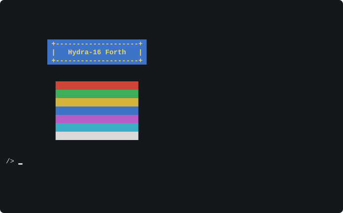
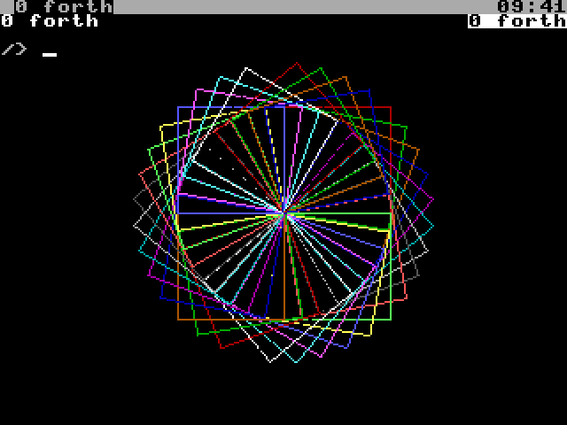

# Chapter 20. Programming the Hydra in HyForth

Chapter 19 taught the Forth language. This chapter shows how to use HyForth to work the Hydra: its files, the
terminal, the devices, sound, the screen and the big numbers. Most of it comes from **libraries**: sets of words that
HyForth loads when you ask for them.

> **IN THIS CHAPTER:** You'll use HyForth's libraries to work the Hydra's files, terminal, devices, sound and screen,
> and its big numbers. **You need:** Chapter 19. Each section leans on the chapter about its device (Chapters 13 to
> 17), which you can read alongside.

## 20.1 Libraries

HyForth's core is small: just the standard's Core words. Everything else is in libraries on the ROM disk, in
`/lib/forth`. As it starts, HyForth loads four of them (from `/lib/forth/startup.fs`): the Core Extension,
Exception, File Access and Programming-Tools word sets. The shell adds a fifth, `shell`. `libs` lists the libraries
loaded:

```session
/> libs
forth coreext exception file tools shell
```

`lib` *name* loads another (or, if it's loaded already, does nothing):

```session
/> lib hydra
/> libs
forth coreext exception file tools shell hydra
```

| Library | What it has |
|---|---|
| `coreext` | The Core Extension word set: `nip`, `tuck`, `?do`, `case`, `value`, `defer`, `:noname`, `pick` ... |
| `exception` | `catch` and `throw` |
| `file` | The File Access word set: files (section 20.3) |
| `tools` | The Programming-Tools word set: `.s`, `?`, `dump`, `see`, `words`, `[if]` ..., and `lib`, `libs`, `-lib` |
| `facility` | The terminal: the cursor, colours, keys, the time; structures (section 20.4) |
| `string` | Strings: `compare`, `search`, `/string`, `-trailing`, `substitute` ... |
| `search` | Word lists and the search order |
| `double` | Double-cell (32-bit) numbers: `d+`, `d.`, `2constant` ... |
| `memory` | `allocate`, `free`, `resize` |
| `locals` | Local variables: `{: a b -- c :}` |
| `block` | Forth's blocks (section 20.10) |
| `hydra` | The Hydra's own words: system calls, commands, directories, banks, notes (section 20.9) |
| `numbers` | The Hydra's numbers: any size, fractions, decimals, complex (section 20.8) |
| `sound` | Sound (section 20.6) |
| `bits` | `tbit`, `sbit`, `cbit`: testing, setting and clearing bits |
| `random` | Random numbers: `rand`, `random`, `rseed` |
| `disasm` | The disassembler: `disasm` (Chapter 28) |
| `gpio`, `i2c`, `spi`, `clock`, `disk`, `cons`, `proc`, `pc`, `video` | The devices, in Forth (sections 20.5 to 20.7) |

`-lib` *name* hides a library's words again (its code stays, for words that use it), and `require` *file* loads any
file of Forth just once. To have a library loaded every time HyForth starts, put your own `startup.fs` (a copy of
the ROM disk's, with more `require` lines) in `/sd/0/lib/forth`.

## 20.2 Running commands

The `hydra` library has words that run commands, and other programs, from Forth:

| Word | Stack | What it does |
|---|---|---|
| `sh` | ( *c-addr u* -- *status* ) | Runs a command line with rc, and waits: its status (0 for success) |
| `run` | ( *c-addr u* -- *status* ) | Runs a program and its arguments (without rc), and waits |

And the shell library has more (section 8.15):

| Word | Stack | What it does |
|---|---|---|
| `sh-out` | ( *c-addr u* -- *c-addr2 u2* ) | Runs a command line, and gives its output as a string |
| `spawn` | ( *c-addr u* -- *task* ) | Starts a command line, without waiting: its task |
| `wait` | ( *task* -- ) | Waits for it to end |
| `piped` | ( *xt c-addr u* -- ) | What a word prints, into a command line's input |

<!-- session
lib hydra
-->

```session
/> s" ls /nothing" sh .
ls: /nothing: not found
1
/> s" /bin/echo hi there" run drop
hi there
```

## 20.3 Files

The File Access words work on any file: on a disk, a device, or `/pc`. A file is opened with a **file access
method**, `r/o` (read only), `w/o` (write only) or `r/w` (both), and gives a **file id** for the other words to use.
Each word that can fail leaves an **ior**: 0 for success, or an error number, which `throw` turns into an error.

| Word | Stack | What it does |
|---|---|---|
| `open-file` | ( *c-addr u fam* -- *fileid ior* ) | Open a file |
| `create-file` | ( *c-addr u fam* -- *fileid ior* ) | Make a new file (or empty an old one), and open it |
| `close-file` | ( *fileid* -- *ior* ) | Close it |
| `read-file` | ( *c-addr u1 fileid* -- *u2 ior* ) | Read up to *u1* bytes: *u2* is how many came (0 at the end) |
| `read-line` | ( *c-addr u1 fileid* -- *u2 flag ior* ) | Read a line: *flag* is false at the end of the file |
| `write-file` | ( *c-addr u fileid* -- *ior* ) | Write bytes |
| `write-line` | ( *c-addr u fileid* -- *ior* ) | Write a line, and a new line |
| `file-size` | ( *fileid* -- *ud ior* ) | Its length, a double number |
| `file-position`, `reposition-file` | ( *fileid* -- *ud ior* ), ( *ud fileid* -- *ior* ) | Where reading or writing happens next |
| `delete-file` | ( *c-addr u* -- *ior* ) | Remove a file |
| `rename-file` | ( *c-addr1 u1 c-addr2 u2* -- *ior* ) | Rename one |
| `bin` | ( *fam* -- *fam* ) | Read and write bytes, as they are |

Writing a file:

```session
/> s" /ram/out.txt" w/o create-file throw constant g
/> s" first line" g write-line throw
/> s" second line" g write-line throw
/> g close-file throw
/> cat /ram/out.txt
first line
second line
```

And reading one, a line at a time. This definition is long, so it's typed over several lines: HyForth's second
prompt, a tab, shows that the definition isn't finished.

```session
/> create buf 80 allot
/> : show-file ( c-addr u -- )
        r/o open-file throw >r
        begin buf 80 r@ read-line throw while
        buf swap type cr
        repeat drop r> close-file throw ;
/> s" /rom/lib/shell" show-file
/bin/forth -l
```

The `hydra` library adds words for directories: `open-dir` ( *c-addr u* -- *dirid ior* ), `read-dir` ( *c-addr u1
dirid* -- *u2 flag ior* ), which reads a directory's next name, and `close-dir` ( *dirid* -- *ior* ); and `=mkdir`,
`get-dir` and `set-dir`.

## 20.4 The terminal

The `facility` library has the words for the terminal's screen and keys (they send the escape sequences of section
13.7 for you):

| Word | Stack | What it does |
|---|---|---|
| `page` | ( -- ) | Clear the screen |
| `at-xy` | ( *col row* -- ) | Move the cursor (from 0, 0 at the top left) |
| `color`, `bgcolor` | ( *c* -- ) | The text's colour, the background's (0 to 15) |
| `black` ... `white` | ( -- *c* ) | The colours: `black red green yellow blue magenta cyan white` |
| `bright` | ( *c* -- *c'* ) | A colour's bright version |
| `bold`, `dim`, `underline`, `blink`, `reverse`, `plain` | ( -- ) | Styles; `plain` turns them all off |
| `cursor-up` ... `cursor-left` | ( *n* -- ) | Move the cursor *n* places |
| `clear-line`, `clear-below` | ( -- ) | Clear the rest of the line, or of the screen |
| `cursor-on`, `cursor-off` | ( -- ) | Show or hide the cursor |
| `form` | ( -- *rows cols* ) | The window's size |
| `key?` | ( -- *flag* ) | Has a key been pressed? |
| `ekey` | ( -- *u* ) | Wait for a key, special keys too: compare with `k-up`, `k-f1` ... |
| `ms` | ( *u* -- ) | Wait *u* milliseconds |
| `time&date` | ( -- *sec min hour day month year* ) | The date and time |
| `beep` | ( -- ) | Ring the bell |

```text
lib facility
: at ( col row -- ) at-xy ;
: banner ( -- )
  yellow color blue bgcolor bold
  10 4 at ."  +--------------------+ "
  10 5 at ."  |   Hydra-16 Forth   | "
  10 6 at ."  +--------------------+ "
  plain ;
: bars ( -- ) 8 1 do i bgcolor 12 i 8 + at-xy 20 spaces loop plain ;
page banner bars 0 17 at-xy
```

<figure>

<figcaption>Figure 20-1. The <code>facility</code> library's colours and cursor moves.</figcaption>
</figure>

## 20.5 The devices

The device libraries work the devices of Part Three through their files, so you don't need to remember the files'
names or commands.

**The pins: `lib gpio`** (section 17.2).

| Word | Stack | What it does |
|---|---|---|
| `gpio` | ( *pin* -- *level* ) | A pin's level, 0 or 1 |
| `gpio!` | ( *pin level* -- ) | Make a pin an output, and set it |
| `gpio-in`, `gpio-out` | ( *pin* -- ) | Make a pin an input, or an output |
| `gpio-port` | ( -- *byte* ) | All eight pins at once |
| `gpio-port!` | ( *byte* -- ) | Set all the outputs at once |
| `gpio-ddr!` | ( *byte* -- ) | Set all eight directions (bit *n* 1: pin *n* an output) |
| `gpio-ca1!` | ( *rise?* -- ) | CA1 counts rises (true) or falls (false) |
| `gpio-ca2!` | ( *n* -- ) | CA2: 0 low, 1 high, -1 an input |
| `gpio-wait` | ( -- *count* ) | Wait for CA1's next change: the changes so far |
| `gpio-state` | ( -- *c-addr u* ) | The `ctl` file's text |

With an LED on pin 2 (section 17.1), this flashes it ten times:

```text
lib gpio  lib facility
: flash ( -- ) 10 0 do 2 0 gpio! 250 ms 2 1 gpio! 250 ms loop ;
flash
```

(0 lights the LED, if it's wired from +5 V to the pin.)

**The I²C bus: `lib i2c`** (section 17.3): `i2c-read` ( *addr reg c-addr u* -- ) and `i2c-write` ( *addr reg c-addr
u* -- ) read and write a chip's registers; `i2c-reg-size` ( *n* -- ) sets how many bytes a register's number has (0,
1 or 2); `i2c-speed` ( *khz* -- ); `i2c?` ( *addr* -- *flag* ) asks whether a chip is there; and `i2c-devices` lists
the chips that answer.

**SPI: `lib spi`** (section 17.4): `spi` ( *dev c-addr u* -- ) sends the bytes to SPI device *dev* and puts what it
sent back in their place; `spi-read` ( *dev c-addr u* -- ) reads bytes; `spi-mode` ( *dev mode* -- ) sets mode 0 or 3.

**The clock: `lib clock`**: `set-date` ( *c-addr u* -- ) sets the date and time, given as text like `2026-10-12
09:41:00`, and `rtc` ( -- *c-addr u* ) says whether there's a clock chip. (`time&date`, in `facility`, reads it.)

**The disks: `lib disk`**: `disk-ctl` ( *disk* -- *c-addr u* ) is a disk's control file's text, `disk-cmd` ( *c-addr
u disk* -- ) sends one a command, `disk-start` and `disk-stop` ( *disk* -- ) start a card again or stop a RAM disk,
and `cards` ( -- *mask* ) says which SD cards are there (bit *n* for SPI device *n*). A disk is named by its character:
`char 0 disk-ctl type`.

**The windows: `lib cons`**: `window` ( -- *n* ) is this window's number; `windows` ( -- *c-addr u* ) lists them;
`new-window` and `new-group` ( *c-addr u* -- ) open a window running a command line; `show-window` ( *n* -- ) shows
one; and `window-label`, `window-status` and `window-ctl` ( *c-addr u* -- ) set its label, its status line, or send
its `wctl` a command.

**The tasks: `lib proc`**: `task-args`, `task-cwd`, `task-env`, `task-ns` and `task-regs` ( *task* -- *c-addr u* )
read a task's `/proc` files; `task-mem` ( *task addr c-addr u* -- ) reads its memory, and `task-ram` ( *task bank
offset c-addr u* -- ) its RAM banks.

**The PC: `lib pc`**: `pc?` ( -- *flag* ) is true if the PC tool is there to serve `/pc`.

## 20.6 Sound

`lib sound` has words for each of the sound driver's commands (section 15.3), and for playing tunes:

| Word | Stack | What it does |
|---|---|---|
| `snd-patch` | ( *ch p* -- ) | Give channel *ch* patch *p* |
| `snd-note` | ( *ch n* -- ) | Play note *n* (60: middle C) |
| `snd-off` | ( *ch* -- ) | Let it go |
| `snd-level` | ( *ch v* -- ) | The channel's volume, 0 to 127 |
| `snd-pan` | ( *ch pan* -- ) | Its speakers: 1 left, 2 right, 3 both |
| `snd-bend`, `snd-glide` | ( *ch n* -- ) | Bend its pitch; glide to note *n* |
| `snd-drum` | ( *ch n* -- ) | Play General MIDI drum *n* |
| `snd-freq` | ( *ch hz* -- ) | Play a frequency (0: stop) |
| `snd-wave` | ( *ch w width* -- ) | A PSG channel's wave |
| `snd-sens`, `snd-lfo`, `snd-noise`, `snd-reg` | | The LFO, the noise, a register (as `sndctl`'s commands) |
| `snd-volume` | ( *v* -- ) | The master volume, 0 to 200 |
| `snd-claim`, `snd-release` | ( *mask* -- ) | Claim or release channels 0 to 7 (bit *n*: channel *n*); `snd-claim-psg` and `snd-release-psg` for 8 to 23 |
| `snd-reset` | ( -- ) | Silence everything |
| `note-of` | ( *c-addr u* -- *n* ) | A note's number from its name: `s" A4" note-of` is 69 |
| `tune` | ( *c-addr u ch tempo* -- ) | Play a tune: note names and their beats |
| `snd-mml` | ( *ch c-addr u* -- *status* ) | Play a line of MML (section 15.6) |
| `snd-chord` | ( *ch c-addr u* -- *status* ) | Play a chord |
| `snd-play` | ( *c-addr u times* -- *status* ) | Play a song file *times* times (0: until <kbd>CTRL</kbd>-<kbd>C</kbd>) |

```session
/> lib sound
/> s" A4" note-of .
69
/> 0 0 snd-patch
/> s" C4 1 D4 1 E4 1 C4 1" 0 120 tune
```

A tune is note names and beats: `C4 1` is middle C for one beat, and a `-` is a rest. `0 120` plays it on channel 0
at 120 beats a minute.

## 20.7 The screen

With a Vera X, `lib video` draws on the screen (section 16.4):

| Word | Stack | What it does |
|---|---|---|
| `bitmap` | ( *width depth* -- ) | A bitmap under the text: 320 or 640 across, 1, 2, 4 or 8 bits a dot |
| `bitmap-off` | ( -- ) | No bitmap |
| `pen` | ( *colour* -- ) | The colour to draw in |
| `plot` | ( *x y* -- ) | A dot |
| `line`, `box`, `bar` | ( *x0 y0 x1 y1* -- ) | A line, a rectangle, a filled rectangle |
| `circle`, `disc` | ( *x y r* -- ) | A circle, a filled circle |
| `clear` | ( -- ) | Clear the bitmap |
| `text` | ( *x y c-addr u* -- ) | Write text on it |
| `border` | ( *colour* -- ) | The border's colour |

It has **turtle graphics** too, as the Logo language has: an imaginary turtle, carrying a pen, that walks around the
screen. `cs` clears the screen and puts the turtle in the middle, facing up; `fd` ( *n* -- ) walks it forward *n*
dots, drawing a line; `bk` ( *n* -- ) walks backward; `rt` and `lt` ( *degrees* -- ) turn it right and left; `pu` and
`pd` lift its pen up and put it down; and `heading` ( -- *degrees* ) and `seth` ( *degrees* -- ) read and set the way
it faces.

```text
lib video
320 8 bitmap
: square ( n -- ) 4 0 do dup fd 90 rt loop drop ;
: flower 36 0 do i 16 mod 1+ pen 60 square 10 rt loop ;
cs flower
```

<figure>

<figcaption>Figure 20-2. Turtle graphics: thirty-six squares make a flower.</figcaption>
</figure>

For programs that need more, `lib video` reaches the VERA itself: `vpoke` ( *addr bank c* -- ) and `vpeek` ( *addr
bank* -- *c* ) read and write a byte of video RAM (*bank* is the address's 17th bit), `vram!` and `vram@` ( *addr bank
c-addr u* -- ) move several, `palette!` ( *index rgb* -- ) sets a colour (as $RGB, 4 bits each), `sprite!` ( *n
c-addr* -- ), `sprite-at` ( *n x y* -- ) and `sprite-off` ( *n* -- ) work the sprites, `vsync` ( -- ) waits for the
next frame, and `mouse` and `mouse-wait` ( -- *x y buttons* ) read the mouse.

## 20.8 Big numbers

Forth's own numbers are 16-bit cells. `lib numbers` brings in all of Chapter 18's numbers: integers of any size,
fixed decimals, fractions and complex numbers. They live on a stack of their own, the **number stack**, and the words
that work on them have an `n` in front of Forth's name: `n+`, `n*`, `n.`, `ndup`. In the stack diagrams, `N:` shows
the number stack.

With the library loaded, any number Forth can't fit in a cell goes on the number stack: `2/3`, `1.25`, `#xFF`, `2i`,
`100000000000000000000`. `s>n` moves a cell from Forth's stack to the number stack, and `n>s` moves one back.

> **NOTE:** At the shell's `/>` prompt, a line that starts with one of these numbers goes to rc, because the shell
> only knows Forth's own numbers. Start the line with a Forth word instead (as with `0 drop` below), or type `forth`
> for a plain HyForth, where every line is Forth.

```session
/> lib numbers
/> 0 drop 2/3 n.
2/3
/> 0 drop 1/3 1/6 n+ n.
1/2
/> 0 drop 100 s>n 10 s>n npow n.
100000000000000000000
/> 0 drop 7 s>n 2 s>n n/ n.s
<1> 7/2
```

The math functions, `nsqrt`, `nexp`, `nlog`, `nsin`, `ncos`, `ntan`, `natan` and `npi`, work to the precision in the
variable `digits`, 12 unless you change it:

```session
/> lib numbers
/> 50 digits ! 0 drop 2 s>n nsqrt n.
1.4142135623730950488016887242096980785696718753769
```

`set-base` ( *c-addr u* -- ) sets the base for all numbers, with any base string from Chapter 18: `s" b" set-base`
works in binary. Appendix A lists all the library's words.

## 20.9 The Hydra library

`lib hydra` has HyForth's words for the Hydra's system.

**System calls.** For each of HydraOS's **system calls** (Appendix K), there's a word named `sys-` and the call's
name: `sys-getpid`, `sys-ticks`, `sys-open` and so on. Each takes the call's inputs from the stack, in the order
Appendix K lists them (the first deepest), and leaves its outputs; a call that can fail leaves an ior on top too. A
file name is given as a zero-terminated string: `>z` ( *c-addr u* -- *z-addr* ) makes one.

```session
/> lib hydra
/> sys-getpid .
2
```

(This shell is task 2.)

**Arguments.** In a script (section 19.16), `argc` ( -- *n* ) is how many arguments it was given, counting its own
name, and `arg` ( *n* -- *c-addr u* ) is one of them: `0 arg` is the script's name.

**Banks.** `bank!` ( *bank* -- ) puts one of the task's RAM banks at `bank-window` ($8000), and `bank@` ( -- *bank* )
says which is there; `seg-bank!` ( *seg n* -- *ior* ) puts a shared segment's bank there. HyForth keeps compiled words
in RAM banks of its own, so a word that changes the bank must be compiled with `false code-banks` first.

**Notes.** `note` ( *task n* -- ) sends a task a note, `note-group` ( *group n* -- ) sends one to every task in a
note group, and `on-note` ( *xt* -- ) gives a word to handle the notes that come to HyForth.

**Machine code.** `sys` ( *addr a x y* -- *a x y p* ) calls machine code at *addr*, with the processor's A, X and Y
registers set, and gives back the registers, and its flags, after it (Chapter 27).

**Odds and ends.** `ctl` ( *c-addr1 u1 c-addr2 u2* -- ) writes the text *c-addr2 u2* to the file *c-addr1 u1*, as
`echo` does (`s" /dev/sd/0/ctl" s" sync" ctl`); `pause` ( -- ) lets the other tasks have a turn; and `ior>text` (
*ior* -- *c-addr u* ) gives an error's message.

## 20.10 Blocks

Forth's oldest way of keeping programs is the **block**: a numbered 1K piece of a disk, shown as 16 lines of 64
characters. `lib block` brings it back: `s" /sd/0/my.blk" open-blocks` chooses a file of blocks, `list` ( *u* -- )
shows block *u*, `load` ( *u* -- ) runs it, `thru` ( *u1 u2* -- ) runs several, and `block` ( *u* -- *addr* ),
`update`, `save-buffers` and `flush` work on them as memory. Files are easier to edit, but blocks are a part of
Forth's history, and many old Forth programs come as blocks.
