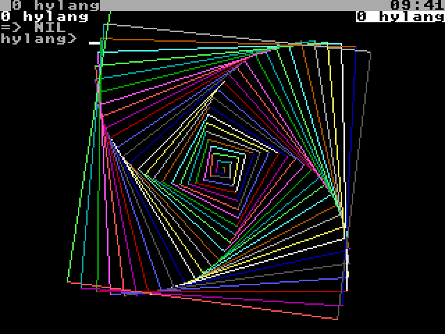

# Chapter 22. Programming the Hydra in hylang

hylang was made for the Hydra: files, programs, the clock, memory and the system are built into the language, and
libraries add the devices, sound and the screen. This chapter shows them.

> **IN THIS CHAPTER:** You'll use hylang to work the Hydra's files, programs, clock, memory, devices, sound and
> screen. **You need:** Chapter 21. Each section leans on the chapter about its device (Chapters 13 to 17), which you
> can read alongside.

## 22.1 Libraries

hylang starts with its own library (`globals`) already loaded. The others are on the ROM disk, in `/lib/hylang`:
`(use "name")` loads one (once: using it again does nothing), and `(load "name")` loads a file every time it's
asked.

| Library | What it has |
|---|---|
| `gpio`, `i2c`, `spi` | The I/O header's pins, the I²C bus, the SPI devices (section 22.5) |
| `clock`, `disk`, `cons`, `proc`, `pc` | The clock chip, the disks, the windows, the tasks, `/pc` |
| `snd` | Sound (section 22.6) |
| `video` | The Vera X's screen: drawing and turtle graphics (section 22.7) |
| `screen` | The terminal's screen: clearing, the cursor, colours |
| `dice` | Dice for games: `(d6)`, `(dice 3 6)` ... |
| `dev` | What the device libraries share |

## 22.2 Files and directories

These are built in:

| Function | What it does |
|---|---|
| `(read-file p)` | The file's contents, a string |
| `(read-lines p)` | Its lines, a list of strings |
| `(write-file p x ...)`, `(append-file p x ...)` | Write the values to a file (made, or emptied first), or add them to its end |
| `(ls [p])` | The names in a directory, sorted |
| `(dir [p])`, `(stat p)` | The details of each file, or of one: a hash of `:name`, `:length`, `:mtime` ... |
| `(exists? p)`, `(dir? p)`, `(file? p)` | Is it there? Is it a directory, or a file? |
| `(mkdir p)`, `(remove p)`, `(rename p q)`, `(copy-file p q)` | Make a directory; remove, rename, copy a file |
| `(cd [p])`, `(cwd)` | Change the current directory; what it is |
| `(glob pattern)` | The paths that match a pattern, like `/rom/lib/*` |

```session
hylang> (write-file "/ram/t.txt" "line one\nline two")
=> NIL
hylang> (read-lines "/ram/t.txt")
=> {"line one" "line two"}
hylang> (ls "/rom")
=> {"README" "bin" "doc" "lib" "songs"}
hylang> (exists? "/rom/lib")
=> T
```

**Streams.** For reading or writing a file a piece at a time, open a **stream**: `(open p [mode])`, where the mode is
`:read` (the usual), `:write`, `:append` or `:update`. Then `(read-line s)`, `(read-byte s)`, `(read-all s)` and
`(read-bytes s n)` read it, giving `NIL` at its end; `(print-to s x ...)`, `(write-to s x ...)` and `(write-bytes s
bytes)` write it; `(seek s n)` and `(tell s)` move around it; and `(close s)` closes it.

```session
hylang> (def {s} (open "/ram/u.txt" :write))
=> NIL
hylang> (print-to s "first")
=> NIL
hylang> (print-to s "second")
=> NIL
hylang> (close s)
=> NIL
hylang> (def {r} (open "/ram/u.txt"))
=> NIL
hylang> (read-line r)
=> "first"
hylang> (read-line r)
=> "second"
hylang> (read-line r)
=> NIL
```

`read-line`, `read-byte` and `read-all` with no stream read the standard input: your typing.

## 22.3 Programs

| Function | What it does |
|---|---|
| `(run prog x ...)` | Run a program, with the values as its arguments; wait, and give its exit code |
| `(sh line [input])` | Run a command line with rc: its exit code |
| `(sh-out line [input])` | The same, but give its output, as a string |
| `(spawn prog x ...)` | Start a program without waiting: its task |
| `(wait task)` | Wait for it to end: its exit code |
| `(kill task)` | Stop a task |
| `(pid)` | This task's number |
| `(env [name])`, `(setenv name value)`, `(unsetenv name)` | The environment's variables (`$name` is `(env "name")`) |

```session
hylang> (sh-out "date")
=> "2000-01-01 00:00:05\n"
hylang> (run "echo" "hi" "there")
hi there
=> 0
hylang> (env "path")
=> {"." "/bin"}
```

## 22.4 Time, memory and the system

| Function | What it does |
|---|---|
| `(date [t])` | The date and time, as a string |
| `(date-parts [t])` | A hash of its `:year`, `:month`, `:day`, `:hour`, `:minute`, `:second` and `:weekday` |
| `(time)` | The clock: seconds since the start of 2000 |
| `(seconds-of y m d [h mi s])` | The seconds since 2000 of a date |
| `(ticks)`, `(tick-rate)` | The tick count (0 to 32,767); ticks a second (200) |
| `(sleep s)`, `(sleep-until tick)` | Sleep for *s* seconds (`(sleep 1/10)`: a tenth); until a tick |
| `(clock)` | Seconds since hylang started |
| `(key)`, `(key?)` | The next key, as it's pressed (an atom like `:up` for a special key); is one waiting? |
| `(free)` | Memory, as `free` shows it: a hash |
| `(sysinfo)`, `(mods)`, `(ps)`, `(task-info task)` | The system, the ROM's modules, the tasks, a task |
| `(peek addr)`, `(poke addr byte)`, `(peek-word addr)`, `(poke-word addr n)` | Read and write the task's memory |
| `(banks)`, `(bank-alloc n)`, `(bank-free bank n)`, `(bank-read bank off n)`, `(bank-write bank off bytes)` | The task's RAM banks |
| `(seg-create banks)`, `(seg-attach seg)`, `(seg-read ...)`, `(seg-write ...)` | Shared segments |
| `(bind new old ...)`, `(mount dev old ...)`, `(unmount old ...)`, `(ns)`, `(newns)` | The namespace |
| `(note task n)`, `(note-group group n)`, `(on-note f)` | Notes |
| `(hold body ...)` | Run the body without letting other tasks have a turn (for exact timing) |

```session
hylang> (date-parts)
=> <hash>{{:year 2000} {:month 1} {:day 1} {:hour 0} {:minute 0} {:second 5} {:weekday 6}}
hylang> (free)
=> <hash>{{:ram 384} {:shared 1024} {:used 512} {:free 512} {:segments 1}}
```

**System calls.** Every system call has a function: `sys-` and its name, taking the call's inputs as Appendix K lists
them, and giving its output (a list, if it has several). `(sys :name ...)` does the same.

```session
hylang> (sys-getpid)
=> 4
hylang> (sys :ticks)
=> 1197
```

## 22.5 The devices

**The pins: `(use "gpio")`** (section 17.2): `(gpio pin)` reads a pin, `(gpio! pin level)` sets one (making it an
output), `(gpio-in pin)` and `(gpio-out pin)` set its direction, `(gpio-port)` and `(gpio-port! byte)` read and set all
eight, `(gpio-ddr! byte)` sets all their directions, `(gpio-ca1! edge)` and `(gpio-ca2! v)` set the handshake lines,
`(gpio-wait)` waits for CA1, and `(gpio-state)` reads the `ctl` file.

```session
hylang> (use "gpio")
=> NIL
hylang> (gpio-out 2)
=> NIL
hylang> (gpio! 2 1)
=> NIL
hylang> (gpio 2)
=> 1
```

**The I²C bus: `(use "i2c")`**: `(i2c-devices)` lists the chips that answer; `(i2c-read addr n)` reads *n* bytes from
a chip, and `(i2c-write addr bytes)` writes a list of bytes; `(i2c-reg-size n)` and `(i2c-speed khz)` set the bus up.

**SPI: `(use "spi")`**: `(spi d bytes)` sends a list of bytes to SPI device *d*, and gives what came back;
`(spi-read d n)` reads *n* bytes; `(spi-mode d mode)` sets mode 0 or 3.

**The disks: `(use "disk")`**: `(df)` lists the disks, each as a hash; `(cards)` lists the SD cards; `(disk-start d)`
and `(disk-stop d)` start a card again, or stop a RAM disk.

```session
hylang> (use "disk")
=> NIL
hylang> (cards)
=> {0}
```

**And the rest.** `(use "clock")`: `(set-date text)` sets the clock, and `(rtc)` says whether there's a clock chip.
`(use "cons")`: `(window)`, `(windows)`, `(new-window)`, `(show-window n)`, `(window-label)`, `(window-status s)`,
`(raw-on)`, `(raw-off)`, `(snarf)` and `(snarf! s)` work the console's windows. `(use "proc")`: `(task-args task)`,
`(task-cwd task)`, `(task-regs task)`, `(task-mem task addr n)` ... read a task's `/proc` files. `(use "pc")`: `(pc?)`
is `T` if the PC tool is there.

**The terminal: `(use "screen")`**: `(cls)` clears the screen, `(at col row)` moves the cursor, `(color fg)` sets the
text's colour (0 to 15), `(bold)` and `(plain)` change the style, and `(clear-line)`, `(cursor-off)` and `(cursor-on)`
do what they say.

## 22.6 Sound

`(use "snd")` has the same words as HyForth's sound library (section 20.6): `snd-patch`, `snd-note`, `snd-off`,
`snd-level`, `snd-pan`, `snd-bend`, `snd-drum`, `snd-freq`, `snd-glide`, `snd-wave`, `snd-lfo`, `snd-sens`,
`snd-noise`, `snd-reg`, `snd-volume`, `snd-claim`, `snd-release`, `snd-reset`, `note-of`, `snd-mml`, `snd-chord` and
`play` (a song file). `tune` plays a list of notes, each a name (or a number, or `NIL` for a rest) and its beats,
with the channel and the tempo after it if you like:

```session
hylang> (use "snd")
=> NIL
hylang> (note-of "A4")
=> 69
hylang> (tune {{"C4" 1} {"E4" 1} {"G4" 2}})
=> NIL
```

## 22.7 Drawing

`(use "video")` has the same drawing words as HyForth's (section 20.7): `bitmap`, `bitmap-off`, `pen`, `plot`,
`line`, `box`, `bar`, `circle`, `disc`, `clear`, `text`, `border`; the turtle's `cs`, `home`, `fd`, `bk`, `rt`, `lt`,
`pu`, `pd`, `heading` and `seth`; and `vpoke`, `vpeek`, `vram!`, `vram@`, `palette!`, `sprite!`, `sprite-at`,
`sprite-off`, `vsync`, `mouse` and `mouse-wait`.

```text
(use "video")
(use "screen")
(bitmap 320 8)
(cs)
(fun {spiral n} {dotimes {i n} (do (pen (+ 1 (mod i 15))) (fd (* i 2)) (rt 91))})
(spiral 100)
(cls)
```

<figure>

<figcaption>Figure 22-1. A spiral from hylang: turning 91 degrees, not 90, makes the squares twist.</figcaption>
</figure>

## 22.8 Numbers

hylang's numbers are Chapter 18's, written as Chapter 18 writes them. `(base)` and `(base "x")` read and set the base;
`(digits)` and `(digits n)` the precision of `sqrt`, `exp`, `log`, `sin`, `cos`, `tan`, `atan`, `pi` and `pow`:

```session
hylang> (digits 30)
=> 12
hylang> (sqrt 2)
=> 1.41421356237309504880168872421
```

(Setting the precision gives back the one before.) For bits: `bit-and`, `bit-or`, `bit-xor`, `bit-not`, `shl`, `shr`
and `bit?`; `(hex n)` and `(bin n [width])` write a number's digits; and `lo`, `hi`, `word`, `bytes` and `from-bytes`
work with bytes.

## 22.9 hylang as your shell

`hylang -l` makes hylang a login shell (section 8.16): any line that doesn't start with `(`, `{` or `[` (or a prefix)
is a command for rc, and the prompt shows where you are, like HyForth's. Put `/bin/hylang -l` in `/sd/0/lib/shell` to
make it yours, and your own settings in `/sd/0/lib/hylang/profile.hl`.
