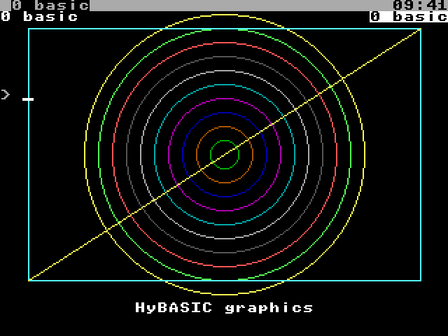

# Chapter 23. Programming the Hydra in HyBASIC

This chapter shows how HyBASIC works the Hydra: its files, the terminal, other programs, sound, graphics, the numbers,
and machine code. Everything here is built into HyBASIC: there are no libraries to load.

## 23.1 Files

A file is opened with a **file number**, and then read or written by that number:

```text
OPEN "name" FOR INPUT AS #1     ' read it
OPEN "name" FOR OUTPUT AS #1    ' write it (made, or emptied first)
OPEN "name" FOR APPEND AS #1    ' write on to its end (made if it isn't there)
OPEN "name" FOR BINARY AS #1    ' read and write bytes, anywhere in it
```

A `'` starts a comment, as `REM` does.

```session
> 10 OPEN "/ram/data.txt" FOR OUTPUT AS #1
> 20 PRINT #1, "apple"
> 30 PRINT #1, "banana"
> 40 CLOSE #1
> 50 OPEN "/ram/data.txt" FOR INPUT AS #1
> 60 DO UNTIL EOF(1)
> 70   LINE INPUT #1, L$
> 80   PRINT "read: "; L$
> 90 LOOP
> 100 CLOSE #1
> RUN
read: apple
read: banana
```

| Statement or function | What it does |
|---|---|
| `PRINT #n, items`, `WRITE #n, items` | Write to a file (`WRITE` puts strings in quotes, and commas between) |
| `INPUT #n, v, ...`, `LINE INPUT #n, v$` | Read items, or a whole line |
| `INPUT$(k, #n)` | Read *k* bytes |
| `GET #n, [pos], v`, `PUT #n, [pos], v` | Read or write a value at a place in a binary file |
| `SEEK #n, pos`, `SEEK(n)` | Move to a place; where it is |
| `EOF(n)`, `LOF(n)`, `LOC(n)` | At the end? Its length; the bytes before the place |
| `CLOSE [#n, ...]` | Close files (none named: all of them) |
| `FREEFILE` | A file number not in use |
| `KILL f$`, `NAME old$ AS new$` | Remove, rename a file |
| `MKDIR d$`, `RMDIR d$`, `CHDIR d$` | Make, remove, change to a directory |
| `FILES [path$]` | List a directory |
| `DIR$(path$)`, `DIR$` | A directory's first name; then each next one ("" after the last) |

```session
> FILES "/rom/lib"
as/             basic/          edit/           font/           forth/
hylang/         namespace       profile         shell           windows
```

## 23.2 The terminal

| Statement or function | What it does |
|---|---|
| `CLS` | Clear the screen |
| `LOCATE row, col` | Move the cursor (from 1, 1 at the top left) |
| `COLOR fg [, bg]` | The text's colour and the background's (0 to 15) |
| `CSRLIN`, `POS(0)` | The cursor's row and column |
| `WIDTH n` | The screen's width, for `PRINT`'s zones |
| `INKEY$` | The key pressed, or `""` if none (it doesn't wait) |
| `INPUT$(n)` | Wait for *n* keys |
| `SLEEP [s]` | Wait *s* seconds (none: until a key) |
| `BEEP` | Ring the bell |
| `TIMER`, `TIME$`, `DATE$` | Seconds since midnight; the time; the date |

`PRINT USING` prints numbers in a fixed form: each `#` is a digit, `.` places the decimal point, `,` puts commas in,
and `$$` a dollar sign:

```session
> PRINT USING "###.##"; 3.14159
  3.14
> PRINT USING "Total: $$#,###.##"; 1234.5
Total:  $1,234.50
```

## 23.3 Other programs

| Statement or function | What it does |
|---|---|
| `SHELL [line$]` | Run a command line with rc, and wait (none: an rc of its own) |
| `SHELL$(line$)` | Run it, and give its output, as a string |
| `STATUS` | The last `SHELL`'s status |
| `ENV$(name$)` | An environment variable |
| `ENVIRON "name=value"` | Set one |
| `ARG$(n)`, `COMMAND$` | In a program run from a file: its argument *n* (0: its name); all its arguments |
| `SYSTEM [n]`, `BYE [n]` | Leave HyBASIC, with status *n* |

```session
> PRINT SHELL$("date")
2000-01-01 00:00:05
> PRINT ENV$("path")
. /bin
```

A program run from a file gets its arguments:

```session
/> echo 'PRINT "args:"; COMMAND$' >/ram/args.bas
/> echo 'PRINT ARG$(0); " "; ARG$(1)' >>/ram/args.bas
/> basic /ram/args.bas red blue
args:red blue
/ram/args.bas red
```

`INCLUDE "file"` puts another file's lines into the program, so procedures can be kept in a file of their own and
shared between programs.

## 23.4 Records

`TYPE` makes a new kind of variable, a **record**, with named **fields**:

```session
> 10 TYPE PLAYER
> 20   NAME AS STRING * 8
> 30   SCORE AS INTEGER
> 40 END TYPE
> 50 DIM P AS PLAYER
> 60 P.NAME = "Sam" : P.SCORE = 42
> 70 PRINT P.NAME; P.SCORE
> RUN
Sam      42
```

`STRING * 8` is a string of exactly 8 characters. Records are useful for files of fixed-size entries, with `GET` and
`PUT`, and arrays of them: `DIM TEAM(10) AS PLAYER`.

## 23.5 Sound

| Statement | What it does |
|---|---|
| `SOUND ch, note [, patch [, vol]]` | Play a note (a MIDI number: 60 is middle C) on channel *ch* |
| `SOUND ch` | Let it go |
| `SOUND "text"` | Send the sound driver a command, as `sndctl` takes them (section 14.3) |
| `PLAY [ch,] mml$` | Play a line of MML (section 14.6) on channel 0 (or *ch*), and wait for it to finish |
| `PLAY "file"` | Play a song file: a ZSM file or a score |

```text
SOUND 0, 60, 0, 100   ' middle C, on the piano, loud
SLEEP 1
SOUND 0               ' let it go
PLAY "o4 l8 c d e f g a b > c"
PLAY "/rom/songs/scom.zsm"
```

## 23.6 Graphics

With a Vera X, HyBASIC has QuickBASIC's graphics statements, drawn on the bitmap under the text. `SCREEN` chooses a
mode first:

| Mode | Dots | Colours |
|---|---|---|
| `SCREEN 0` | (Text only: no bitmap) | |
| `SCREEN 1` | 320 by 240 | 4 |
| `SCREEN 2` | 640 by 480 | 2 |
| `SCREEN 7` | 320 by 240 | 16 |
| `SCREEN 12` | 640 by 480 | 4 |
| `SCREEN 13` | 320 by 240 | 256 |

| Statement | What it does |
|---|---|
| `PSET (x, y) [, c]`, `PRESET (x, y)` | Set a dot (in colour *c*); clear one |
| `LINE (x1, y1)-(x2, y2) [, c [, B | BF]]` | A line; with `B` a box, with `BF` a filled box |
| `CIRCLE (x, y), r [, c]` | A circle |
| `PAINT (x, y) [, c [, border]]` | Fill the area around a point |
| `DRAW s$` | Draw with a little language of moves (below) |
| `GPRINT (x, y), text$` | Write text on the bitmap |
| `PALETTE n, rgb` | Change colour *n* |
| `POINT(x, y)` | A dot's colour |
| `WINDOW (x1, y1)-(x2, y2)` | Use your own coordinates |
| `VIEW (x1, y1)-(x2, y2)` | Draw in only part of the bitmap |
| `SPRITE n, x, y [, image$]`, `SPRITE n OFF` | Show, move or hide a sprite |
| `COLOR c`, `CLS` | With a bitmap: the pen's colour; clear the bitmap too |

`STEP (x, y)` instead of `(x, y)` means "this far from the last point drawn".

`DRAW`'s language moves a pen from the last point drawn: `U`, `D`, `L` and `R` (up, down, left, right) and `E`, `F`,
`G` and `H` (the diagonals: up and right, down and right, down and left, up and left), each followed by a distance;
`M x,y` (to a point, or by so much with `+` or `-`); `B` before a move (don't draw it) and `N` (come back after it);
`C n` (the colour); `S n` (the scale: *n* quarter-dots a step); `A n` (turn *n* quarter turns) and `TA n` (turn *n*
degrees). So `DRAW "C2 R40 D40 L40 U40"` draws a green square.

```text
SCREEN 13
CLS
FOR R = 10 TO 100 STEP 10 : CIRCLE (160, 110), R, R / 10 + 1 : NEXT
LINE (20, 20)-(300, 200), 14, B
LINE (20, 200)-(300, 20), 11
GPRINT (96, 216), "HyBASIC graphics"
```

<figure>

<figcaption>Figure 23-1. HyBASIC's graphics, in SCREEN 13.</figcaption>
</figure>

## 23.7 Numbers

HyBASIC's numbers are Chapter 17's. A number in a program can be written in any of its forms (`2/3`, `1.5`, `2i`,
`1_000`, `#xFF`), and also QuickBASIC's way: `&HFF` (hex), `&O17` (octal) and `&B101` (binary), and `1E3` (1000).

| Statement or function | What it does |
|---|---|
| `BASE b$`, `BASE$` | Set the base for reading and showing numbers; what it is |
| `DIGITS n`, `DIGITS()` | Set the precision of `SQR`, `EXP`, `LOG`, `SIN` ...; what it is |
| `FIXED(x, n)` | *x* as a fixed decimal of *n* places |
| `RATIONAL(x)`, `NUMERATOR(x)`, `DENOMINATOR(x)` | As a fraction; its top; its bottom |
| `COMPLEX(re, im)`, `REAL(z)`, `IMAG(z)` | A complex number; its parts |
| `FIB(n)`, `GCD(a, b)` | A Fibonacci number; the greatest common divisor |
| `BIT(x, n)`, `SHL(x, n)`, `SHR(x, n)` | A bit of *x*; *x* shifted left, right |
| `HEX$(x)`, `OCT$(x)`, `STR$(x [, base$])` | A number's text in hex, octal, or any base |
| `MKN$(x)`, `CVN(s$)` | A number as bytes (to keep in a file), and back |
| `RND`, `RANDOMIZE n` | A random number from 0 to 1; start the random numbers from *n* |
| `INT(x)`, `FIX(x)`, `SGN(x)`, `ABS(x)` | Round down; drop the fraction; -1, 0 or 1; the size |
| `SQR`, `EXP`, `LOG`, `SIN`, `COS`, `TAN`, `ATN`, `PI` | The math functions |

```session
> PRINT &HFF, &B101, &O17
 255           5             15
> PRINT FIXED(1/3, 4), RATIONAL(0.25), NUMERATOR(6/8)
 0.3333        1/4           3
> PRINT COMPLEX(1, 2) * COMPLEX(1, -2)
 5
> DIGITS 30 : PRINT SQR(2)
 1.41421356237309504880168872421
```

## 23.8 Memory and machine code

| Statement or function | What it does |
|---|---|
| `PEEK(addr)`, `POKE addr, b` | Read or write a byte of the task's memory |
| `BANK n`, `BANK()` | Which of the task's RAM banks `PEEK` and `POKE` see at $8000 |
| `SYS addr [, a [, x [, y]]]` | Call machine code at *addr*, with the processor's A, X and Y registers set |
| `SYS "NAME" [, a [, x [, y]]]` | Make a system call by its name (Appendix K) |
| `RREG a, x, y, p` | The registers after the last `SYS` |
| `ASM` ... `END ASM` | Assembly language, inside the program (Chapter 25) |
| `CALL ASM label`, `CALL ABSOLUTE (addr)` | Call an `ASM` block's code, or machine code |

## 23.9 HyBASIC as your shell

`basic -l` makes HyBASIC a login shell (section 7.16). A line is BASIC's if it starts with a line number, `?`, a
keyword, an assignment, or the name of one of the program's SUBs; any other line is a command for rc, and `%` at the
start makes any line rc's. The prompt shows where you are. Put `/bin/basic -l` in `/sd/0/lib/shell` to make it yours,
and your own settings in `/sd/0/lib/basic/profile.bas`.
