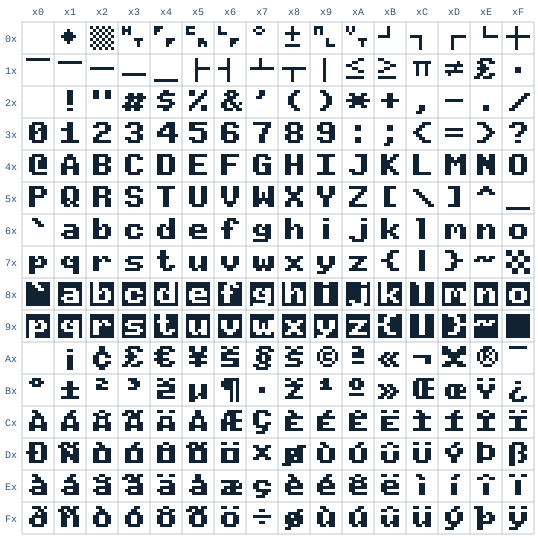
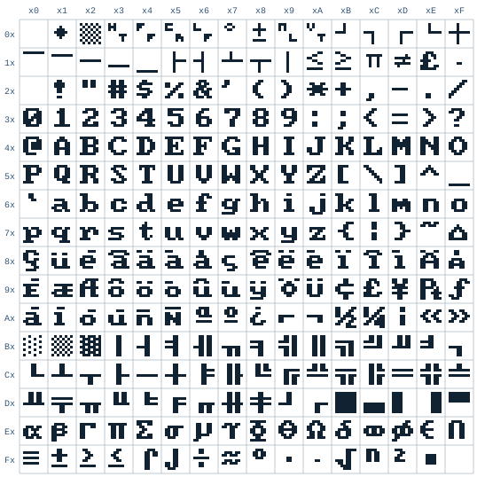

# Appendix E. Characters

Every character is stored as a number, its **code**: one byte, from 0 to 255. This appendix lists them. The first 128
are **ASCII** (the American Standard Code for Information Interchange, from 1963), which nearly every computer uses.
The Hydra uses **ISO-8859-15** for the codes from 160 to 255: the letters of the Western European languages, and
signs like €, £ and ©.

In HyForth, `char A .` prints 65 and `65 emit` prints `A`; in hylang, `(char-code "A")` and `(code-char 65)`; in
HyBASIC, `ASC("A")` and `CHR$(65)`.

## E.1 The control characters

The codes from 0 to 31, and 127, aren't printed: they're **control characters**, which tell a terminal to do
something. Each can be typed by holding <kbd>CTRL</kbd> and pressing the key in the **Key** column (so
<kbd>CTRL</kbd>-<kbd>C</kbd> is code 3). The last column says what the Hydra's console does with each when a program
prints it (Chapter 12), or, for the keys, what it does when you type it.

| Dec | Hex | Name | Key | What the console does |
|---|---|---|---|---|
| 0 | $00 | NUL | <kbd>CTRL</kbd>-<kbd>@</kbd> | Nothing |
| 1 | $01 | SOH | <kbd>CTRL</kbd>-<kbd>A</kbd> | Typed: to the start of the line |
| 2 | $02 | STX | <kbd>CTRL</kbd>-<kbd>B</kbd> | |
| 3 | $03 | ETX | <kbd>CTRL</kbd>-<kbd>C</kbd> | Typed: the `interrupt` note, to the programs in the window |
| 4 | $04 | EOT | <kbd>CTRL</kbd>-<kbd>D</kbd> | Typed at the start of a line: the end of the input |
| 5 | $05 | ENQ | <kbd>CTRL</kbd>-<kbd>E</kbd> | Typed: to the end of the line |
| 6 | $06 | ACK | <kbd>CTRL</kbd>-<kbd>F</kbd> | |
| 7 | $07 | BEL | <kbd>CTRL</kbd>-<kbd>G</kbd> | Rings the bell |
| 8 | $08 | BS | <kbd>CTRL</kbd>-<kbd>H</kbd>, <kbd>BACKSPACE</kbd> | Moves the cursor left; typed: rubs out the character before the cursor |
| 9 | $09 | HT | <kbd>CTRL</kbd>-<kbd>I</kbd>, <kbd>TAB</kbd> | Moves to the next tab stop |
| 10 | $0A | LF | <kbd>CTRL</kbd>-<kbd>J</kbd> | A new line |
| 11 | $0B | VT | <kbd>CTRL</kbd>-<kbd>K</kbd> | As LF |
| 12 | $0C | FF | <kbd>CTRL</kbd>-<kbd>L</kbd> | As LF |
| 13 | $0D | CR | <kbd>CTRL</kbd>-<kbd>M</kbd>, <kbd>RETURN</kbd> | Back to the first column; typed: ends a line |
| 14 | $0E | SO | <kbd>CTRL</kbd>-<kbd>N</kbd> | Uses character set G1 |
| 15 | $0F | SI | <kbd>CTRL</kbd>-<kbd>O</kbd> | Uses character set G0 |
| 16 | $10 | DLE | <kbd>CTRL</kbd>-<kbd>P</kbd> | |
| 17 | $11 | DC1 | <kbd>CTRL</kbd>-<kbd>Q</kbd> | |
| 18 | $12 | DC2 | <kbd>CTRL</kbd>-<kbd>R</kbd> | |
| 19 | $13 | DC3 | <kbd>CTRL</kbd>-<kbd>S</kbd> | |
| 20 | $14 | DC4 | <kbd>CTRL</kbd>-<kbd>T</kbd> | |
| 21 | $15 | NAK | <kbd>CTRL</kbd>-<kbd>U</kbd> | Typed: rubs out the whole line |
| 22 | $16 | SYN | <kbd>CTRL</kbd>-<kbd>V</kbd> | |
| 23 | $17 | ETB | <kbd>CTRL</kbd>-<kbd>W</kbd> | |
| 24 | $18 | CAN | <kbd>CTRL</kbd>-<kbd>X</kbd> | Cancels an escape sequence |
| 25 | $19 | EM | <kbd>CTRL</kbd>-<kbd>Y</kbd> | |
| 26 | $1A | SUB | <kbd>CTRL</kbd>-<kbd>Z</kbd> | Cancels an escape sequence |
| 27 | $1B | ESC | <kbd>CTRL</kbd>-<kbd>[</kbd>, <kbd>ESC</kbd> | Starts an escape sequence (section 12.7) |
| 28 | $1C | FS | <kbd>CTRL</kbd>-<kbd>\\</kbd> | |
| 29 | $1D | GS | <kbd>CTRL</kbd>-<kbd>]</kbd> | |
| 30 | $1E | RS | <kbd>CTRL</kbd>-<kbd>^</kbd> | |
| 31 | $1F | US | <kbd>CTRL</kbd>-<kbd>_</kbd> | |
| 127 | $7F | DEL | <kbd>BACKSPACE</kbd> (on some keyboards) | Typed: rubs out the character before the cursor |

Programs that read keys one at a time (in raw mode, section 12.3) get every code as it's typed, and decide for
themselves what to do with it: `edit`, for one, uses many of them.

## E.2 ASCII

The printable ASCII characters, from 32 (the space) to 126:

<!-- generated: tools/charsets.js ascii -->

| Dec | Hex | Char | Dec | Hex | Char | Dec | Hex | Char | Dec | Hex | Char |
|---|---|---|---|---|---|---|---|---|---|---|---|
| 32 | $20 | (space) | 56 | $38 | 8 | 80 | $50 | P | 104 | $68 | h |
| 33 | $21 | ! | 57 | $39 | 9 | 81 | $51 | Q | 105 | $69 | i |
| 34 | $22 | " | 58 | $3A | : | 82 | $52 | R | 106 | $6A | j |
| 35 | $23 | # | 59 | $3B | ; | 83 | $53 | S | 107 | $6B | k |
| 36 | $24 | $ | 60 | $3C | &#60; | 84 | $54 | T | 108 | $6C | l |
| 37 | $25 | % | 61 | $3D | = | 85 | $55 | U | 109 | $6D | m |
| 38 | $26 | &#38; | 62 | $3E | &#62; | 86 | $56 | V | 110 | $6E | n |
| 39 | $27 | ' | 63 | $3F | ? | 87 | $57 | W | 111 | $6F | o |
| 40 | $28 | ( | 64 | $40 | @ | 88 | $58 | X | 112 | $70 | p |
| 41 | $29 | ) | 65 | $41 | A | 89 | $59 | Y | 113 | $71 | q |
| 42 | $2A | &#42; | 66 | $42 | B | 90 | $5A | Z | 114 | $72 | r |
| 43 | $2B | + | 67 | $43 | C | 91 | $5B | &#91; | 115 | $73 | s |
| 44 | $2C | , | 68 | $44 | D | 92 | $5C | &#92; | 116 | $74 | t |
| 45 | $2D | - | 69 | $45 | E | 93 | $5D | &#93; | 117 | $75 | u |
| 46 | $2E | . | 70 | $46 | F | 94 | $5E | ^ | 118 | $76 | v |
| 47 | $2F | / | 71 | $47 | G | 95 | $5F | &#95; | 119 | $77 | w |
| 48 | $30 | 0 | 72 | $48 | H | 96 | $60 | &#96; | 120 | $78 | x |
| 49 | $31 | 1 | 73 | $49 | I | 97 | $61 | a | 121 | $79 | y |
| 50 | $32 | 2 | 74 | $4A | J | 98 | $62 | b | 122 | $7A | z |
| 51 | $33 | 3 | 75 | $4B | K | 99 | $63 | c | 123 | $7B | { |
| 52 | $34 | 4 | 76 | $4C | L | 100 | $64 | d | 124 | $7C | &#124; |
| 53 | $35 | 5 | 77 | $4D | M | 101 | $65 | e | 125 | $7D | } |
| 54 | $36 | 6 | 78 | $4E | N | 102 | $66 | f | 126 | $7E | ~ |
| 55 | $37 | 7 | 79 | $4F | O | 103 | $67 | g | 127 | $7F | (DEL) |

<!-- end generated: tools/charsets.js ascii -->

## E.3 ISO-8859-15

The codes from 128 to 159 are more control characters, which the Hydra doesn't use. From 160 to 255 are
ISO-8859-15's characters:

<!-- generated: tools/charsets.js iso -->

| Dec | Hex | Char | Dec | Hex | Char | Dec | Hex | Char | Dec | Hex | Char |
|---|---|---|---|---|---|---|---|---|---|---|---|
| 160 | $A0 | (no-break space) | 184 | $B8 | ž | 208 | $D0 | Ð | 232 | $E8 | è |
| 161 | $A1 | ¡ | 185 | $B9 | ¹ | 209 | $D1 | Ñ | 233 | $E9 | é |
| 162 | $A2 | ¢ | 186 | $BA | º | 210 | $D2 | Ò | 234 | $EA | ê |
| 163 | $A3 | £ | 187 | $BB | » | 211 | $D3 | Ó | 235 | $EB | ë |
| 164 | $A4 | € | 188 | $BC | Œ | 212 | $D4 | Ô | 236 | $EC | ì |
| 165 | $A5 | ¥ | 189 | $BD | œ | 213 | $D5 | Õ | 237 | $ED | í |
| 166 | $A6 | Š | 190 | $BE | Ÿ | 214 | $D6 | Ö | 238 | $EE | î |
| 167 | $A7 | § | 191 | $BF | ¿ | 215 | $D7 | × | 239 | $EF | ï |
| 168 | $A8 | š | 192 | $C0 | À | 216 | $D8 | Ø | 240 | $F0 | ð |
| 169 | $A9 | © | 193 | $C1 | Á | 217 | $D9 | Ù | 241 | $F1 | ñ |
| 170 | $AA | ª | 194 | $C2 | Â | 218 | $DA | Ú | 242 | $F2 | ò |
| 171 | $AB | « | 195 | $C3 | Ã | 219 | $DB | Û | 243 | $F3 | ó |
| 172 | $AC | ¬ | 196 | $C4 | Ä | 220 | $DC | Ü | 244 | $F4 | ô |
| 173 | $AD | (soft hyphen) | 197 | $C5 | Å | 221 | $DD | Ý | 245 | $F5 | õ |
| 174 | $AE | ® | 198 | $C6 | Æ | 222 | $DE | Þ | 246 | $F6 | ö |
| 175 | $AF | ¯ | 199 | $C7 | Ç | 223 | $DF | ß | 247 | $F7 | ÷ |
| 176 | $B0 | ° | 200 | $C8 | È | 224 | $E0 | à | 248 | $F8 | ø |
| 177 | $B1 | ± | 201 | $C9 | É | 225 | $E1 | á | 249 | $F9 | ù |
| 178 | $B2 | ² | 202 | $CA | Ê | 226 | $E2 | â | 250 | $FA | ú |
| 179 | $B3 | ³ | 203 | $CB | Ë | 227 | $E3 | ã | 251 | $FB | û |
| 180 | $B4 | Ž | 204 | $CC | Ì | 228 | $E4 | ä | 252 | $FC | ü |
| 181 | $B5 | µ | 205 | $CD | Í | 229 | $E5 | å | 253 | $FD | ý |
| 182 | $B6 | ¶ | 206 | $CE | Î | 230 | $E6 | æ | 254 | $FE | þ |
| 183 | $B7 | · | 207 | $CF | Ï | 231 | $E7 | ç | 255 | $FF | ÿ |

<!-- end generated: tools/charsets.js iso -->

Over the serial port, the Hydra sends a character as its code. A terminal program on a PC shows the codes from 160 up
correctly when it's set to ISO-8859-15 (it's sometimes called **Latin-9**); most terminal programs have a setting for
it. Codes 164, 166, 168, 180, 184, 188, 189 and 190 are the ones where ISO-8859-15 differs from the older ISO-8859-1
(Latin-1): €, Š, š, Ž, ž, Œ, œ and Ÿ.

## E.4 The DEC Special Graphics

`ESC (0` switches the console to the **DEC Special Graphics** (section 12.7), and `ESC (B` back to ASCII. In it, the
codes from 95 to 126 draw these instead:

| Code | Typed | Draws | Code | Typed | Draws | Code | Typed | Draws | Code | Typed | Draws |
|---|---|---|---|---|---|---|---|---|---|---|---|
| 95 | `_` | (blank) | 103 | `g` | ± | 111 | `o` | ⎺ (scan line 1) | 119 | `w` | ┬ |
| 96 | &#96; | ◆ | 104 | `h` | NL | 112 | `p` | ⎻ (scan line 3) | 120 | `x` | │ |
| 97 | `a` | ▒ | 105 | `i` | VT | 113 | `q` | ─ | 121 | `y` | ≤ |
| 98 | `b` | HT | 106 | `j` | ┘ | 114 | `r` | ⎼ (scan line 7) | 122 | `z` | ≥ |
| 99 | `c` | FF | 107 | `k` | ┐ | 115 | `s` | ⎽ (scan line 9) | 123 | `{` | π |
| 100 | `d` | CR | 108 | `l` | ┌ | 116 | `t` | ├ | 124 | &#124; | ≠ |
| 101 | `e` | LF | 109 | `m` | └ | 117 | `u` | ┤ | 125 | `}` | £ |
| 102 | `f` | ° | 110 | `n` | ┼ | 118 | `v` | ┴ | 126 | `~` | · |

(HT, FF, CR, LF, NL and VT are tiny pairs of letters, as the old terminals showed them.)

## E.5 The screen's fonts

The Vera X draws each character from a **font**: a picture of each code, 8 dots by 8. The console's font has
ISO-8859-15's characters, with the DEC Special Graphics in the places of the control codes, and reversed letters from
128 to 159:

<figure>

<figcaption>Figure E-1. The console's font, ISO-8859-15. The row is a code's first hex digit, the column its second.</figcaption>
</figure>

The ROM disk has a second font, the PC's (**CP437**, the IBM PC's characters), with more lines and blocks for
drawing, Greek letters and math signs. `cat /lib/font/cp437 >/dev/vid/font` loads it (section 15.5), and
`cat /lib/font/iso8859-15 >/dev/vid/font` puts the console's back.

<figure>

<figcaption>Figure E-2. The PC's font, CP437.</figcaption>
</figure>

A font is 2048 bytes: 8 for each code, the top row of dots first, and in each byte the leftmost dot is bit 7. So you
can make your own, with any program that writes bytes to a file.
