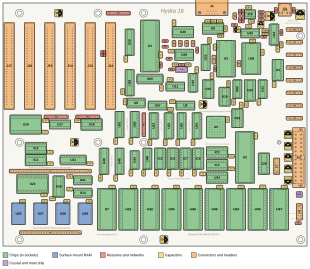

# Appendix I. Parts and Board Diagrams

This appendix lists every part of the Hydra-16 (board revision 1.8D) and its memory cards, in the order Chapter 4
fits them, with a box to tick as each one goes in. Then it says what each chip does, and shows where every part is.

## I.1 The main board's parts

**Resistors** (Chapter 4, step 2):

| ☐ | Parts | Value | Code |
|---|---|---|---|
| ☐ | R23, R24, R25, R26, R27 | 22 Ω | 220 |
| ☐ | R30, R31 | 33 Ω | 330 |
| ☐ | R3 | 100 Ω | 101 |
| ☐ | R22 | 330 Ω | 331 |
| ☐ | R2 | 470 Ω | 471 |
| ☐ | R4, R5, R6, R7, R13, R19, R20, R21, R28, R32, R33 | 10 kΩ | 103 |
| ☐ | R1 | 1 MΩ | 105 |
| ☐ | R29 | 0 Ω (a link) | 0 |
| ☐ | RN1, RN2, RN3 (networks of 8, 9 pins) | 3.3 kΩ | 332 |
| ☐ | RN4 (a network of 8, 9 pins) | 10 kΩ | 103 |

**Ceramic capacitors** (step 3):

| ☐ | Parts | Value | Code |
|---|---|---|---|
| ☐ | C47, C48 | 33 pF | 330 |
| ☐ | C50, C52 | 3.3 nF | 332 |
| ☐ | C1, C2, C3, C5, C6, C12 to C46, C57 to C64, C66 to C85 (68) | 100 nF | 104 |
| ☐ | C4, C7, C8, C9, C10 | 1 µF | 105 |
| ☐ | C49 | 4.7 µF | 475 |

**Sockets** (step 4), and the chips that go in them (section 4.5):

| ☐ | Place | Socket | Chip |
|---|---|---|---|
| ☐ | U1 | 40 pins, wide | W65C02S |
| ☐ | U2 | 40 pins, wide | R65C22 |
| ☐ | U3 | 28 pins, wide | R65C51 |
| ☐ | U4, U20, U24 | 16 pins | 74F138 |
| ☐ | U5 | 16 pins | MAX232 |
| ☐ | U6 | PLCC-32 | SST39SF010A |
| ☐ | U7 | 32 pins, wide | HM628512LP-5 (or a DS1747) |
| ☐ | U8, U9 | 14 pins | 74LS260 |
| ☐ | U10 | 14 pins | 74F20 |
| ☐ | U11 | 14 pins | 74ACT08 |
| ☐ | U12 | 14 pins | 74F86 |
| ☐ | U13, U16, U56 | 14 pins | 74F32 |
| ☐ | U14 | 14 pins | 74F30 |
| ☐ | U15, U44 | 14 pins | 74F00 |
| ☐ | U17, U18 | 16 pins | 74LS148 |
| ☐ | U19, U23 | 24 pins, wide | 74LS154 |
| ☐ | U21, U49, U51, U53, U55, U58, U60 | 20 pins | 74F541 |
| ☐ | U22 | 20 pins | 74ACT240 |
| ☐ | U26 | 16 pins | 74F139 |
| ☐ | U30 to U37 | 32 pins, wide | SST39SF040 (U31, U32 and U34 programmed; the rest empty) |
| ☐ | U38 | 24 pins, wide | YM2151 |
| ☐ | U39 | 14 pins | 74ACT14 |
| ☐ | U40 | 16 pins | 74F191 |
| ☐ | U41 | 16 pins | YM3012 |
| ☐ | U42 | 14 pins | TL074 |
| ☐ | U45 | 16 pins | 74F157 |
| ☐ | U48, U50, U52, U54 | 20 pins | 74F573 |
| ☐ | U57 | 14 pins | 74F02 |
| ☐ | U59 | 20 pins | 74ACT245 |
| ☐ | U61 | 14 pins | 74F125 |
| ☐ | IC1 to IC8 | 16 pins | 74LS219 |
| ☐ | IC9 | 8 pins | NJM4556AD |
| ☐ | J28 | 16 pins | SP720 |

**Soldered straight to the board** (steps 1, 5, 6 and 7):

| ☐ | Parts | What |
|---|---|---|
| ☐ | U25, U27, U28, U29 | HM628512 RAM chips, surface-mount (SOP-32) |
| ☐ | Y1 | 14.31818 MHz crystal |
| ☐ | U43 | DS1813-10 reset chip (TO-92) |
| ☐ | J5, J6, J7, J8 | 2-pin headers: the clock jumpers (0.89, 1.79, 3.58 and 7.16 MHz) |
| ☐ | J9, J29 | 2-pin headers: the sound chip's CT1/CT2, and Audio In |
| ☐ | J30 | 3-pin header: the serial port's CTS |
| ☐ | J10 | 2 × 6 header: the front panel |
| ☐ | J27 | 2 × 6 header: the I/O header (the VIA's port A) |
| ☐ | J18 to J25 | 6-hole pin sockets: SPI devices 0 to 7 |
| ☐ | J1, J2 | 32-hole and 24-hole pin sockets: the memory card |
| ☐ | C90, C91 | 10 µF electrolytic (106) |
| ☐ | C86, C87, C88, C89 | 47 µF electrolytic (476) |
| ☐ | C51, C53, C54, C55, C56 | 100 µF electrolytic (107) |
| ☐ | C92, C93 | 220 µF non-polarized electrolytic (227 NP) |
| ☐ | J3 | 9-pin D connector (male): the serial port |
| ☐ | J26 | 3.5 mm stereo audio jack |
| ☐ | J12 to J17 | 62-pin card edge connectors: slots 0 to 5 |
| ☐ | J11 | 24-pin ATX power connector |

**Jumpers** (section 4.6): one on J7 (the clock), one on J30 (pins 1 and 2), and one for each RAM module (section
4.7). J9 and J29 get none.

## I.2 What each chip does

| Chips | Part | Its job |
|---|---|---|
| U1 | W65C02S | The processor (Chapter 24) |
| U2 | 65C22 VIA | The tick (its timer), the SPI bus, and the I/O header J27 |
| U3 | 65C51 ACIA | The serial port |
| U5 | MAX232 | Turns the ACIA's 5-volt signals into the serial cable's RS-232 ones, and back |
| U6 | SST39SF010A | The kernel ROM: 16 pages of 8K |
| U7 | HM628512 | The task RAM: 512K, 32K for each of the 16 tasks |
| U25, U27, U28, U29 | HM628512 | The shared RAM: 2 MB |
| U26 | 74F139 | Chooses one of the shared RAM chips |
| U30 to U37 | SST39SF040 | The paged ROM: up to 4 MB |
| U4, U8 to U16, U19 to U22 | 74-series logic | The **address decoder**: works out, from each address, which chip answers |
| U48, U50, U52, U54 | 74F573 | The registers T, U, V and W |
| U49, U51, U53, U55 | 74F541 | Read T, U, V and W back |
| U56, U57 | 74F32, 74F02 | Gates that tell the registers when they're written and read |
| IC1 to IC4, U23, U24 | 74LS219, 74LS154, 74F138 | The bank registers: a RAM and a ROM bank register for every task |
| U17, U18, U44, U45 | 74LS148, 74F00, 74F157 | The interrupts' priority encoder |
| IC5 to IC8 | 74LS219 | The vector RAM: an interrupt handler's address for each line |
| U58, U59, U60, U61 | 74F541, 74ACT245, 74F125 | The slots' buffers: they drive the address, data and control lines to the six slots |
| Y1, U39, U40 | Crystal, 74ACT14, 74F191 | The clock: the crystal's 14.31818 MHz, divided by 4 (or 16, 8 or 2) for the processor |
| U43 | DS1813 | The reset: holds the processor in reset at power-up, and when RESET is pressed |
| U38 | YM2151 | The FM sound chip |
| U41 | YM3012 | Turns the YM2151's sound into a voltage |
| U42, IC9 | TL074, NJM4556 | The sound's mixer and headphone amplifier |
| J28 | SP720 | Protects the I/O header's pins from static |

## I.3 The memory cards

The through-hole card (Figure 4-8):

| ☐ | Parts | What |
|---|---|---|
| ☐ | C1 to C5 | 100 nF ceramic capacitors (104) |
| ☐ | U1 | 74LS139 (a 16-pin socket) |
| ☐ | IC1 to IC4 | HM628512LP-7 RAM chips, in 32-pin wide sockets: one RAM module |
| ☐ | J1, J2 | 32-pin and 24-pin headers, under the card: they plug into the main board |
| ☐ | J3 | 2 × 15 header: the module number's jumper (section 4.7) |

The surface-mount card (Figure 4-10):

| ☐ | Parts | What |
|---|---|---|
| ☐ | C1 to C5 | 100 nF ceramic capacitors (104) |
| ☐ | U1 | 74LS139 |
| ☐ | IC1 to IC8 | HM628512LFP-7 RAM chips, surface-mount: two RAM modules |
| ☐ | J1, J2 | 32-pin and 24-pin headers, under the card |
| ☐ | J3 | 2 × 15 header: the first module's number (IC1 to IC4) |
| ☐ | J4 | 15-pin header: with J3, the second module's number (IC5 to IC8) |

## I.4 The board

<figure>

<figcaption>Figure I-1. Every part of the main board, by kind.</figcaption>
</figure>

Figure 1-1 shows the board by what its parts do, and Figures 4-1 to 4-7 each step of building it.
